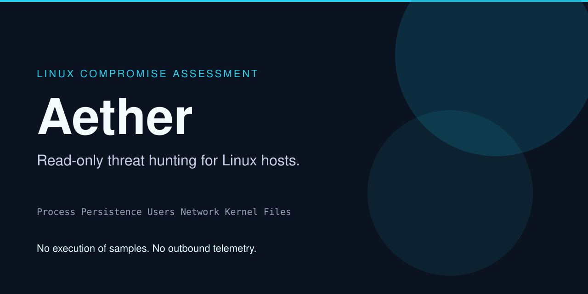
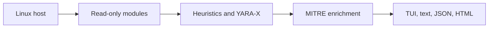

<p align="center">
  
</p>

<h1 align="center">Aether</h1>

<p align="center">
  Read-only Linux compromise assessment.<br>
  Find out whether a host is clean, then read why — without executing a single suspect file.
</p>

<p align="center">
  <a href="https://mr-n1ck.github.io/aether/"><strong>Open the interactive overview</strong></a>
  &nbsp;·&nbsp;
  <a href="#run-it">Run it</a>
  &nbsp;·&nbsp;
  <a href="#what-a-scan-checks">What it checks</a>
  &nbsp;·&nbsp;
  <a href="#reference">Full reference</a>
</p>

<p align="center">
  <a href="https://go.dev/"></a>
  <a href="LICENSE"></a>
  <a href="https://github.com/MR-N1CK/aether/actions/workflows/ci.yml"></a>
  <a href="https://attack.mitre.org/"></a>
  <a href="#limits"></a>
</p>

---

## What it is

Aether is a host scanner for incident response. Point it at a Linux system and it inspects processes, persistence, accounts, sockets, kernel modules, and files. Every finding is written in plain language, tagged with MITRE ATT&CK, and paired with containment steps.

It is built for people who have to answer “are we clean?” on a machine they are allowed to assess: responders, detection engineers, and administrators doing a compromise check.

| Question | Answer |
| --- | --- |
| Does it run the files it scans? | No. Inspection is static. |
| Does it change the host? | It does not write, delete, or chmod inspected files, and it does not update `mtime` or `ctime`. |
| Does it phone home? | Not during a scan. A network request happens only if you run `aether update` or pass an intel URL. |
| What do you leave with? | A terminal view, plain text, JSON, or one offline HTML report. |

The visual system behind the terminal UI and the HTML report is documented in [DESIGN.md](DESIGN.md). The overview site uses the same palette: deep navy, teal for signal, rose for alerts.

## Run it

```bash
git clone https://github.com/MR-N1CK/aether.git
cd aether
make build
./bin/aether doctor
sudo ./bin/aether
```

`doctor` checks the local engine. Running `aether` with no arguments in a terminal opens the command center. A file you can hand to someone else:

```bash
sudo ./bin/aether scan --quick --plain --html-out report.html
```

Pure Go is the default (`CGO_ENABLED=0`). `make build-yara` links YARA-X when `libyara_x_capi` is installed. Both paths evaluate the same embedded rules. Details are in the [reference](#reference).

## What a scan checks

| Area | What Aether looks for |
| --- | --- |
| Process | Memory-only binaries (`memfd`), deleted executables still running, masqueraded names, hidden PIDs |
| Persistence | systemd units, cron and at, sudoers, shell profiles, SSH authorized keys |
| Users | Extra UID 0, duplicate UIDs, empty or obsolete password hashes, privileged groups |
| Network | Listeners mapped to a process, raw sockets, promiscuous interfaces |
| Kernel | Modules present in `/proc` but missing from sysfs, taint flags, modprobe rules |
| Files | Unexpected SUID binaries, world-writable config, webshells, reverse shells, droppers |

Heuristics run in every build. YARA-X evaluates the same rule source when you compile with `-tags yara`. Package databases (dpkg, rpm, pacman, apk) flag system binaries whose hashes no longer match the package manager.

## What you get back

1. **Command center** — live module progress. Enter opens a dossier: why it matched, hashes, MITRE, containment.
2. **Plain text** — `--plain`, for SSH and CI.
3. **JSON** — `--json-out`, for a SIEM.
4. **HTML** — `--html-out`, one file, no CDN, strict Content-Security-Policy.



## Limits

A quiet report is not proof the host is clean.

- Without root, Aether cannot read `/etc/shadow`, root cron spools, or another user’s `/proc`. Coverage gaps are printed in the summary.
- Packed binaries are not emulated.
- A rootkit that disappears from both `/proc/modules` and sysfs needs a memory image.
- Files over 50 MB are noted and skipped for hashing and YARA unless you raise `--max-filesize`.

## Repository map

| Path | Why you would open it |
| --- | --- |
| [docs/index.html](docs/index.html) | Overview site source. Published at [mr-n1ck.github.io/aether](https://mr-n1ck.github.io/aether/). |
| [cmd/aether](cmd/aether) | CLI entrypoint |
| [internal/modules](internal/modules) | Process, persistence, users, network, kernel |
| [internal/scanner](internal/scanner) | Filesystem walk and heuristics |
| [internal/yara](internal/yara) | Embedded rules, pure-Go fallback, YARA-X |
| [internal/report](internal/report) | Finding copy, MITRE, HTML and JSON |
| [DESIGN.md](DESIGN.md) | Color, type, and motion |
| [AGENTS.md](AGENTS.md) | Rules for changing detection safely |
| [SECURITY.md](SECURITY.md) | How to report a vulnerability |
| [CONTRIBUTING.md](CONTRIBUTING.md) | Tests and review expectations |

## Reference

The sections below are the engineering record: every capability, where it lives, and which test covers it.

<details>
<summary><strong>Detection modules and evidence</strong></summary>

### Process

Memory-only execution (`/memfd:`), unlinked binaries (`(deleted)`), hidden PIDs via a two-pass `os.ReadDir` versus `unix.Fstatat` probe with `hidepid` detection, `comm` versus `cmdline` versus `exe` masquerading, and process-tree anomalies.

- Code: [internal/modules/process/process.go](internal/modules/process/process.go), [hidden_pid.go](internal/modules/process/hidden_pid.go)
- Tests: [internal/modules/process/process_test.go](internal/modules/process/process_test.go)

### Persistence

systemd system and user units, masked units, system cron, per-user crontabs, at jobs, sudoers, shell profiles, SSH authorized keys, and private keys in non-standard paths.

- Code: [internal/modules/persistence/persistence.go](internal/modules/persistence/persistence.go), [systemd.go](internal/modules/persistence/systemd.go), [cron.go](internal/modules/persistence/cron.go), [ssh.go](internal/modules/persistence/ssh.go)
- Tests: [internal/modules/persistence/persistence_test.go](internal/modules/persistence/persistence_test.go)

### Users

Non-root UID 0, duplicate UIDs, empty passwords, obsolete DES/MD5 hashes, system accounts with login shells, and membership of `sudo`, `wheel`, `docker`, or `lxd`.

- Code: [internal/modules/users/users.go](internal/modules/users/users.go)
- Tests: [internal/modules/users/users_test.go](internal/modules/users/users_test.go)

### Network

Inode-to-process mapping for TCP, UDP, and raw sockets, wildcard listeners, loopback listeners, and promiscuous sniffers.

- Code: [internal/modules/network/network.go](internal/modules/network/network.go)
- Tests: [internal/modules/network/network_test.go](internal/modules/network/network_test.go)

### Kernel

`/proc/modules` compared with `/sys/module`, hidden-module detection, taint-flag decoding, and world-writable or non-standard modprobe rules.

- Code: [internal/modules/kernel/kernel.go](internal/modules/kernel/kernel.go)
- Tests: [internal/modules/kernel/kernel_test.go](internal/modules/kernel/kernel_test.go)

### Filesystem and scanner

SUID/SGID anomalies, hidden executables in system directories, non-packaged ELF binaries in `/tmp`, `/var/tmp`, and `/dev/shm`, build-tree recognition, world-writable files in `/etc`, and a worker pool with a memory budget.

- Code: [internal/scanner/scanner.go](internal/scanner/scanner.go), [heuristics.go](internal/scanner/heuristics.go), [memory_budget.go](internal/scanner/memory_budget.go)
- Tests: [internal/scanner/heuristics_test.go](internal/scanner/heuristics_test.go), [fixtures_test.go](internal/scanner/fixtures_test.go)

</details>

<details>
<summary><strong>Heuristics and YARA-X rules</strong></summary>

Embedded signatures are active in every build. `make build` evaluates them with the pure-Go fallback ([internal/yara/fallback_engine.go](internal/yara/fallback_engine.go)). `make build-yara` and `make build-yara-static` evaluate the same source with YARA-X ([internal/yara/yarax_engine.go](internal/yara/yarax_engine.go)). A parity test ([internal/yara/fallback_parity_test.go](internal/yara/fallback_parity_test.go)) checks that both engines agree. Native regex heuristics always run from [internal/scanner/heuristics.go](internal/scanner/heuristics.go).

Rootkit and known-family rules (`Linux_Rootkit_Diamorphine_Reptile_Strings`, `Linux_Webshell_PHP_Known_Families`, `Linux_Implant_RedTeam_Persistence_Framework`) match strings from known samples. They are not generic kernel-hook detectors.

| Category | Heuristics | Embedded rules |
| --- | --- | --- |
| Reverse shells | `Script_Reverse_Shell_Interactive`, `Script_OpenSSL_Reverse_Shell`, `Script_Netcat_Reverse_Shell`, `Script_Socat_Reverse_Shell`, `Script_Reverse_Shell_Inline` | `Linux_Backdoor_Reverse_Shell_OneLiner`, `Linux_Backdoor_Encrypted_Reverse_Shell` |
| Ransomware and stealers | `Script_Python_Ransomware_Encryptor`, `Script_Data_Exfiltration_Stealer`, `Script_C2_Exfiltration_Server` | `Linux_Ransomware_Python_Locker`, `Linux_Malware_Data_Exfiltration_Client`, `Linux_Malware_Data_Exfiltration_Server` |
| Web shells | `Webshell_PHP_Generic_Backdoor` | `Linux_Webshell_PHP_Generic_Backdoor`, `Linux_Webshell_PHP_Known_Families`, `Linux_Webshell_JSP_Runtime_Exec` |
| Implants and rootkits | `Script_RedTeam_Persistence_Framework`, `Script_Process_Hiding_Procfs`, `Script_Download_And_Execute` | `Linux_Implant_RedTeam_Persistence_Framework`, `Linux_Rootkit_LDPRELOAD_Hook_Artifact`, `Linux_Rootkit_Diamorphine_Reptile_Strings`, `Linux_Malware_Cryptominer_Stratum_Pool`, `Linux_Dropper_Remote_Pipe_Shell_Execution` |

Tests: [internal/scanner/heuristics_test.go](internal/scanner/heuristics_test.go), [internal/yara/yarax_integration_test.go](internal/yara/yarax_integration_test.go).

Finding titles, explanations, MITRE techniques, and remediation are registered for the report. Mapped techniques include T1547, T1564.001, T1552.004, T1059.004, T1014, T1486, T1070.004, T1041, T1005, T1071.001, T1573.002, T1105, T1505.003, T1548.001, and T1620. Checked in [internal/report/reporter_test.go](internal/report/reporter_test.go).

</details>

<details>
<summary><strong>Install, commands, and trust model</strong></summary>

### Install script

[`install.sh`](install.sh) splits build and install.

```bash
./install.sh build          # refuses to run as root
sudo ./install.sh install --sha256 <sha256 of the binary you just built>
```

The install phase checks that `bin/` is owned by `$SUDO_USER` and is not group- or world-writable, requires the hash you pass to match, and installs `/usr/local/bin/aether` as `root:root` mode `0755`.

`aether setup` creates a rules directory only when it is missing. Root gets `/etc/aether/rules` (`0755`, `root:root`). An unprivileged user gets `~/.config/aether/rules` (`0700`). Rule files are written there only if you pass `--download-rules`.

Manual builds:

```bash
make build                # pure Go
make build-yara           # dynamic libyara_x_capi
make build-yara-static    # static libyara_x_capi.a
```

### Commands

| Command | What runs |
| --- | --- |
| `aether` | Command center, when stdout is a terminal |
| `aether doctor` | Privileges, signatures, package DB, engine self-test |
| `aether scan --quick` | Live modules against high-risk locations |
| `aether scan --quick /some/dir` | That directory’s files only |
| `aether scan /some/dir` | Filesystem-only. An explicit path means files. |
| `aether scan --full` | Full walk |
| `aether scan --modules process,persistence` | The modules you name |
| `aether ack /path --reason "..."` | Pin a benign match by hash. Alert and IOC matches cannot be acked. |
| `sudo aether update` | Re-download the YARA-Forge core ruleset |
| `aether intel import /path/to/feed.txt` | Offline indicator import |

```bash
sudo ./bin/aether scan --full --html-out /tmp/aether-report.html
sudo ./bin/aether scan --full --json-out /var/log/aether_audit.json
```

### File access

Opens go through [`safeopen.OpenRegularReadOnly`](internal/safeopen/safeopen.go) with `O_RDONLY | O_NOFOLLOW | O_NONBLOCK | O_NOATIME`. If `O_NOATIME` returns `EPERM`, the open falls back without that flag, so an unprivileged scan of someone else’s files can still update `atime` on filesystems mounted with `atime` or `relatime`. Symlink escape is covered in [internal/safeopen/safeopen_test.go](internal/safeopen/safeopen_test.go).

### Trust

- Custom `--rules-dir` paths must be root-owned and not world-writable unless you pass `--trust-rules-dir` ([internal/yara/lib_trust.go](internal/yara/lib_trust.go)).
- `aether ack` stores a SHA-256 of the matched line. Editing the file voids the acknowledgement. `ALERT` findings cannot be acked ([internal/triage/triage.go](internal/triage/triage.go)).
- Package ownership is checked for dpkg, rpm (including `/usr/lib/sysimage/rpm`), pacman, and apk ([internal/pkgdb/pkgdb.go](internal/pkgdb/pkgdb.go)).

### Tests

Verified locally on Kali Linux, kernel `7.1.5+kali`, `amd64`. The suite also runs in containers for Debian 12, Ubuntu 24.04, Fedora 41, Arch, and Alpine via `make test-cross`. CI covers `ubuntu-latest`, Ubuntu 24.04, and Ubuntu 24.04 arm.

```bash
make test
go test -race -count=1 ./...
make test-yara
```

`arm64` images are not part of the local cross script. CI does build `aarch64` on `ubuntu-24.04-arm`. Kernels 5.x and 6.x are not claimed as locally verified here.

</details>

## License

[Apache License 2.0](LICENSE).
