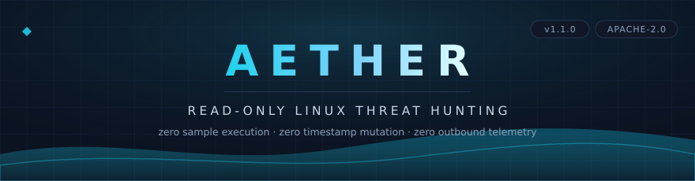
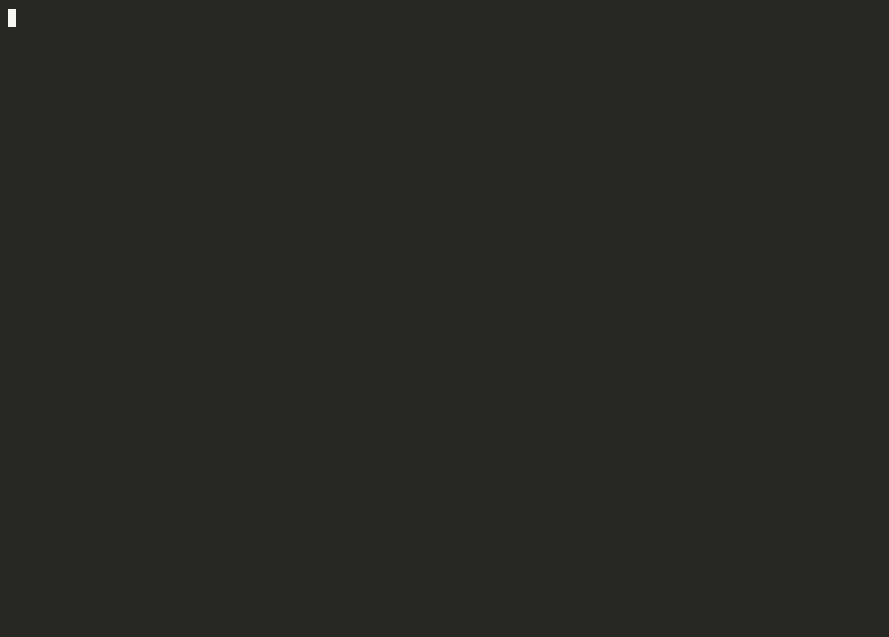

<p align="center">
  
</p>

<p align="center">
  <a href="#quickstart"><strong>Quickstart</strong></a>
  &nbsp;•&nbsp;
  <a href="#incident-response-field-recipes"><strong>Field Recipes</strong></a>
  &nbsp;•&nbsp;
  <a href="#core-capabilities"><strong>Capabilities</strong></a>
  &nbsp;•&nbsp;
  <a href="#architecture"><strong>Architecture</strong></a>
  &nbsp;•&nbsp;
  <a href="#comparison"><strong>Comparison</strong></a>
  &nbsp;•&nbsp;
  <a href="#benchmarks"><strong>Benchmarks</strong></a>
  &nbsp;•&nbsp;
  <a href="https://mr-n1ck.github.io/aether/"><strong>Web Showcase</strong></a>
  &nbsp;•&nbsp;
  <a href="#deep-dives"><strong>Documentation</strong></a>
</p>

<p align="center">
  <!-- Tier 1: Engineering & Build Integrity -->
  <a href="https://github.com/MR-N1CK/aether/releases/latest"></a>
  <a href="https://go.dev/"></a>
  <a href="https://github.com/MR-N1CK/aether/actions/workflows/ci.yml"></a>
  <a href="https://goreportcard.com/report/github.com/MR-N1CK/aether"></a>
  <a href="LICENSE"></a>
</p>
<p align="center">
  <!-- Tier 2: Security, Compliance & Distro Coverage -->
  <a href="#forensic-safety-invariant"></a>
  <a href="#forensic-safety-invariant"></a>
  <a href="https://attack.mitre.org/"></a>
  <a href="#multi-distribution-grounding"></a>
  <a href="#benchmarks"></a>
</p>

---

<a id="forensic-safety-invariant"></a>
> [!IMPORTANT]
> **Forensic Safety Invariant & Chain of Custody**  
> All host inspection strictly uses `safeopen.OpenRegularReadOnly` with flags `O_RDONLY | O_NOFOLLOW | O_NONBLOCK | O_NOATIME`. Files are inspected statically without altering file timestamps (`mtime`/`ctime`) or resolving malicious symlinks. **Untrusted sample code is never executed.**

---

## What is Aether?

**Aether** is a high-performance, read-only incident response and threat-hunting scanner (~67,000 lines of pure Go) purpose-built for Linux systems. It statically assesses endpoints for active compromises—including weaponized reverse shells, ransomware lockers, web shells, stealth rootkits, unauthorized UID-0 accounts, hidden processes, masquerading binaries, and persistence mechanisms.

Unlike traditional agents, Aether operates with **zero runtime kernel hooks**, **zero forensic disk alteration**, and **zero outbound network connections**, making it suitable for strict chain-of-custody investigations, air-gapped forensic enclaves, and live production endpoints.

---

## Live Command Center

<p align="center">
  
</p>

<p align="center">
  <code>[1-5]</code> Switch Surface Tabs &nbsp;•&nbsp; 
  <code>j/k</code> Row Navigation &nbsp;•&nbsp; 
  <code>Enter</code> Threat Dossier &nbsp;•&nbsp; 
  <code>/</code> Filter &nbsp;•&nbsp; 
  <code>p/y/c</code> Yank (OSC 52) &nbsp;•&nbsp; 
  <code>q</code> Quit
</p>

---

## Quickstart

Build and launch Aether as a standalone static binary with zero external dependencies.

**Prebuilt binary** (no Go toolchain required):

```bash
curl -sSL https://github.com/MR-N1CK/aether/releases/download/v1.1.0/aether-1.1.0-linux-amd64.tar.gz | tar xz
./aether doctor
```

**Build from source:**

```bash
# 1. Clone repository
git clone https://github.com/MR-N1CK/aether.git && cd aether

# 2. Build standalone static pure-Go binary (CGO_ENABLED=0)
make build

# 3. Launch the Flight Deck interactive terminal UI
sudo ./bin/aether
```

> [!TIP]
> Run `./bin/aether doctor` to perform instant self-diagnostics: root capabilities, package database detection, signature availability, and memory constraints.

---

## Incident Response Field Recipes

Four operational runbooks for real-world forensic engagements:

### 1. Live Endpoint Triage (Interactive Flight Deck)
Launch the 60 FPS Bubbletea terminal UI to hunt live memory, processes, sockets, and persistence with keyboard-driven inspection:
```bash
sudo ./bin/aether
```

### 2. Cold Mount / Disk Image Inspection
Audit an unbooted forensic mount, raw disk image, or extracted container layer without running any host scripts:
```bash
sudo ./bin/aether scan /mnt/target_rootfs --plain
```

### 3. Generate Air-Gapped Executive HTML Dossier
Create a self-contained, single-file HTML report with inline CSS/SVG, strict CSP nonces, and zero external network requests:
```bash
sudo ./bin/aether scan --quick --plain --html-out /tmp/aether-dossier.html
```

### 4. Stream Structured NDJSON to SIEM Pipelines
Stream machine-readable JSON finding objects directly into Splunk, Elasticsearch, Wazuh, or local log forwarders:
```bash
sudo ./bin/aether scan --full --plain --json-out /var/log/aether_stream.json
```

---

## Core Capabilities

```
┌────────────────────────────────────────────────────────────────────────────────────────┐
│                                   THE 5 PILLARS OF AETHER                              │
├────────────────────────────────┬───────────────────────────────┬───────────────────────┤
│ 🛡️ Static ELF Behavioral       │ ⚡ Dual Threat Engine          │ 📦 Multi-Distro       │
│ • Syscall import combos        │ • Embedded YARA-X rules       │ • Alpine APK reader   │
│ • W⊕X segment violations       │ • Pure-Go interpreter fallback│ • Debian/Ubuntu dpkg  │
│ • High code entropy (> 7.20)   │ • Rust CGO build option       │ • Arch Pacman reader  │
│ • Anti-analysis corrupt shoff  │ • 100% cross-engine parity    │ • RedHat/CentOS RPM   │
├────────────────────────────────┴───────────────────────────────┼───────────────────────┤
│ 🔍 Live Kernel & Host Triage                                   │ 📊 Multi-Surface      │
│ • Hidden PIDs (procfs vs Fstatat sweeps)                       │ • 60 FPS Bubbletea HUD│
│ • Anonymous memory execution (/memfd:, deleted inodes)         │ • Standalone HTML     │
│ • Rootkit module discrepancies (/proc/modules vs sysfs)        │ • Streaming NDJSON    │
│ • Socket inode-to-PID correlation & 18 kernel taint flags      │ • Headless ANSI mode  │
└────────────────────────────────────────────────────────────────┴───────────────────────┘
```

### 1. Static ELF Behavioral & Capabilities Engine
Aether inspects compiled Linux ELF binaries without executing them:
- **Weaponized Syscall Combinations**: Detects compiled implants by correlating imported dynamic symbols:
  - *Reverse Shell Combo*: `socket + connect + dup2 + execve` $\to$ **ALERT (Score 90)**
  - *C2 Listener Combo*: `socket + bind + listen + execve` $\to$ **ALERT (Score 85)**
  - *Process Injection Combo*: `ptrace + mprotect + /proc/*/mem` $\to$ **ALERT (Score 90)**
  - *Fileless Dropper Combo*: `memfd_create + execveat` $\to$ **ALERT (Score 85)**
- **$W \oplus X$ Segment Violations**: Detects `PT_LOAD` segments marked simultaneously Writable (`PF_W`) and Executable (`PF_X`).
- **Cryptographic & Packed Implants**: Scans `.text` sections for high Shannon entropy ($> 7.20$ bits/byte) and UPX packer headers.
- **Anti-Analysis Corruption**: Identifies intentionally corrupted section table offsets (`e_shoff`) designed to crash disassemblers.

### 2. Dual Signature & Heuristics Architecture
- **Native Heuristics**: Pure-Go regex engine with recursive de-obfuscation (base64, hex, rot13, shell de-quoting like `b''a\sh`, and inline Python base64 execs).
- **Dual YARA-X Engine**: The same embedded rules run in **pure-Go fallback mode** (`CGO_ENABLED=0`) or via Rust-compiled **YARA-X C-API** (`make build-yara`) with guaranteed verdict parity.

<a id="multi-distribution-grounding"></a>
### 3. Multi-Distribution Package Grounding (`pkgdb`)
Eliminates false positives on legitimate administrative tools (`/usr/bin/curl`, `/usr/bin/ssh`, `/usr/bin/gdb`):
- Pure-Go zero-dependency parsers for **Alpine APK** (`/lib/apk/db/installed`), **Debian/Ubuntu dpkg** (`/var/lib/dpkg/status`), **Arch Pacman** (`/var/lib/pacman/local/`), and **RPM**.
- Cross-references binary paths and hashes; suppresses alerts on verified package assets.

### 4. Live Kernel & Host Triage Modules
- **Process Hunter**: Discovers hidden processes via a two-pass sweep comparing `os.ReadDir("/proc")` against iterative `unix.Fstatat` syscalls; detects memory-only execution (`/memfd:`) and deleted inode binaries.
- **Persistence Audit**: Audits systemd unit files, `/etc/cron*`, user spool crontabs, `at` queues, `/etc/sudoers`, PAM hooks, and dynamic linker preloads (`/etc/ld.so.preload`).
- **Network Sockets**: Maps raw/listening TCP/UDP sockets from `/proc/net/*` directly to owning PID descriptors.
- **Kernel Integrity**: Detects unlinked LKM rootkits by contrasting `/proc/modules` with `/sys/module/*` and decodes all 18 standard kernel taint flags.

---

## Architecture

```mermaid
%%{init: {'theme': 'base', 'themeVariables': { 'darkMode': true, 'background': '#050811', 'primaryColor': '#0f172a', 'primaryTextColor': '#38bdf8', 'primaryBorderColor': '#1e293b', 'lineColor': '#38bdf8', 'secondaryColor': '#0a0f1d', 'tertiaryColor': '#050811' }}}%%
flowchart TD
  subgraph Input ["Target Host or Forensic Mount"]
    Target["Linux Filesystem & Kernel Pseudofs"] --> safeopen["safeopen: O_RDONLY · O_NOFOLLOW · O_NOATIME"]
  end

  subgraph Triage ["Forensic Triage Modules"]
    safeopen --> M1["Process Hunter: /memfd, hidden PIDs, masquerading"]
    safeopen --> M2["Persistence: systemd, cron, sudoers, PAM, ld.so"]
    safeopen --> M3["Privilege: UID 0 clones, duplicate UIDs, shadow hashes"]
    safeopen --> M4["Network: Raw sockets, listeners, inode-to-PID correlation"]
    safeopen --> M5["Kernel: /proc/modules vs sysfs, taint flags, rootkits"]
  end

  subgraph Engine ["Dual Threat Inspection"]
    Triage --> Heuristics["Native Go Heuristics: de-obfuscation & shell dequoting"]
    Triage --> YARAX["Static YARA-X Engine: embedded rules & family signatures"]
    Triage --> ELF["Static ELF Behavioral: imports, W⊕X, entropy, UPX"]
    PkgDB[("Package Grounding: apk, deb, rpm, pacman")] -.-> Engine
  end

  subgraph Presentation ["Executive Output Surfaces"]
    Engine --> TUI["Flight Deck TUI: 60 FPS Bubbletea HUD"]
    Engine --> HTML["Self-Contained HTML: air-gapped SVG dossier"]
    Engine --> JSON["Streaming NDJSON: SIEM ingestion"]
  end
```

---

## Comparison

| Capability / Standard | **Aether** | **Lynis** | **Osquery** | **Falco** |
| :--- | :---: | :---: | :---: | :---: |
| **Analysis Paradigm** | **100% Static & Read-Only** | Shell Scripts (Runs tests) | SQL Query Daemon | eBPF Kernel Driver |
| **Forensic Contamination** | **Zero (`O_NOATIME`)** | Mutates `mtime`/`ctime` | Standard OS opens | Runtime hooks |
| **Static ELF Behavioral & $W \oplus X$** | **Yes (Syscall Combos)** | No | No | Runtime only |
| **Dual YARA-X Engine** | **Native Embedded** | External plugin | Extension required | Rule syntax only |
| **Multi-Distro Grounding** | **Built-in (apk, deb, rpm, pacman)** | Shell calls | SQLite virtual table | None |
| **Self-Contained Offline HTML** | **Yes (Strict CSP)** | Plain text | External SIEM | gRPC / Syslog |
| **Outbound Telemetry** | **Zero by Default** | Update checks | SIEM logging | Cloud stream |
| **Distribution Footprint** | **~11 MB Static Pure-Go** | Shell / multi-file | ~40 MB + SQLite | Kernel Module / eBPF |

---

## Benchmarks

Aether is engineered for scale across high-density enterprise environments:

| Benchmark Metric | Measured Result | Verification Method |
| :--- | :---: | :--- |
| **Inspection Throughput** | **33,000+ files/sec** | Scale benchmark across 100,000 synthetic test files (`test/realworld`) |
| **Memory Budget** | **< 300 MB Bound** | Worker pool memory tracker with automatic backpressure throttling |
| **Static Binary Size** | **~11 MB** | Stripped pure-Go binary (`CGO_ENABLED=0 go build`) |
| **Test Suite Coverage** | **100% Pass** | All 26 test packages green (`make test`); 3 utility packages have no tests |
| **Race Conditions** | **0 Detected** | Verified via `go test -race -count=1 ./...` |

```bash
# Verify test suite and real-world scale harness
make test
go test -v -run TestRealWorldScaleAndMemory ./test/realworld
```

---

## Deep Dives

| Document | Description |
| :--- | :--- |
| **[WALKTHROUGH.md](WALKTHROUGH.md)** | Guided tour: first scan, interpreting findings, threat dossiers, containment. |
| **[docs/BUILDING.md](docs/BUILDING.md)** | Compilation modes, reproducible releases, cross-compilation matrix. |
| **[docs/ENGINES.md](docs/ENGINES.md)** | Dual signature engine: YARA-X vs pure-Go fallback parity guarantees. |
| **[docs/RULES.md](docs/RULES.md)** | Detection rules: heuristic families, MITRE ATT&CK mappings, authoring rules. |
| **[docs/TESTING.md](docs/TESTING.md)** | Test strategy: accuracy benchmarks, cross-distro coverage, scale harness. |
| **[DESIGN.md](DESIGN.md)** | Aurora Command Deck design system: tokens, motion spec, feedback states. |

---

## Technical Reference

<details>
<summary><strong>1. Live Triage Modules & Forensic Mechanics</strong></summary>

### Process Forensics
- **In-Memory Executables**: Detects execution from anonymous shared memory (`/memfd:`) or unlinked binary inodes (`(deleted)`).
- **Hidden Process Discovery**: Two-pass sweep comparing `os.ReadDir("/proc")` against iterative `unix.Fstatat` to detect processes hidden via rootkit hooks or procfs bind mounts.
- **Masquerading Detection**: Compares executable path (`/proc/[pid]/exe`), command line (`/proc/[pid]/cmdline`), and task comm name (`/proc/[pid]/comm`).

### Persistence Audit
- **systemd Services**: Inspects unit definitions across `/lib/systemd/system`, `/etc/systemd/system`, and user scopes for suspicious binaries in volatile drop directories.
- **Scheduled Tasks**: Comprehensive parser for `/etc/crontab`, `/etc/cron.*`, per-user spools (`/var/spool/cron/crontabs`), and `at` job queues.
- **Privilege Escalation Paths**: Sudoers configuration (`/etc/sudoers` and `/etc/sudoers.d/`), PAM execution hooks (`pam_exec`, `pam_script`), dynamic linker hooks (`/etc/ld.so.preload`), and SSH `authorized_keys`.

### Network & Kernel
- **Socket Inode Mapping**: Resolves TCP/UDP/Raw sockets from `/proc/net/*` directly to owning PID descriptors.
- **Kernel Module Discrepancies**: Compares loaded drivers reported in `/proc/modules` with active sysfs trees (`/sys/module/*`) to detect rootkits employing list unlink hooks.
- **Kernel Taint Verification**: Decodes all 18 standard Linux kernel taint flags (`sys/kernel/tainted`).

</details>

<details>
<summary><strong>2. CLI Command Suite & Options</strong></summary>

| Command | Action |
| :--- | :--- |
| `aether` | Opens the interactive Flight Deck TUI (when run in a TTY). |
| `aether doctor` | Performs environment diagnostics: root privileges, kernel capabilities, package DB status, and signature tests. |
| `aether scan --quick` | Rapid scan targeting live processes, persistence mechanisms, and volatile drop locations. |
| `aether scan --full` | Exhaustive scan covering the entire filesystem and all triage modules. |
| `aether scan /path` | Direct inspection of a specific directory or target mount. |
| `aether scan --modules process,persistence` | Restricts triage to the specified modules. |
| `aether ack /path --reason "..."` | Creates a cryptographic hash acknowledgement to suppress acknowledged benign fixtures. |

</details>

---

## License & Attribution

Aether is open-source software licensed under the **[Apache License 2.0](LICENSE)**.  
Created and maintained by **[MR-N1CK](https://github.com/MR-N1CK)**.

<p align="center">
  <sub>Aether Threat &amp; Forensic Scanner &nbsp;·&nbsp; Zero Forensic Contamination &nbsp;·&nbsp; Read-Only Linux Incident Response</sub>
</p>

<p align="center">
  
</p>
