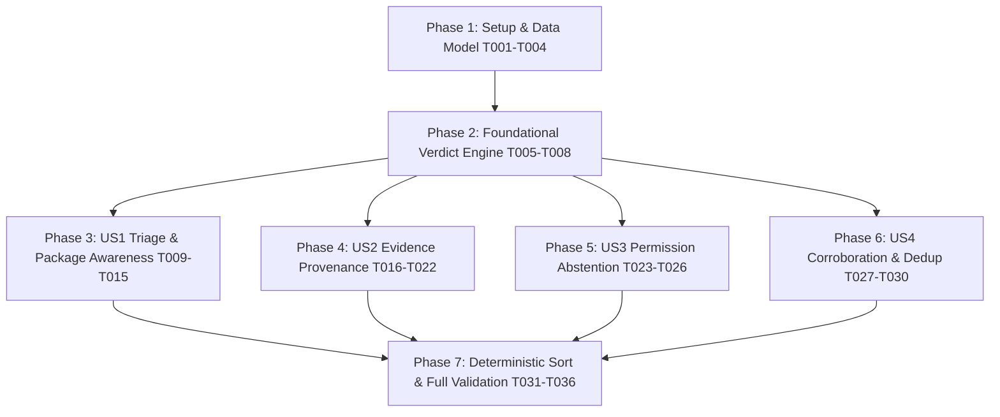

# Implementation Tasks: Trustworthy Detection & False-Positive Control

**Feature Branch**: `001-trustworthy-detection`  
**Specification**: [`specs/001-trustworthy-detection/spec.md`](spec.md)  
**Implementation Plan**: [`specs/001-trustworthy-detection/plan.md`](plan.md)  
**Data Model**: [`specs/001-trustworthy-detection/data-model.md`](data-model.md)  
**JSON Contract**: [`specs/001-trustworthy-detection/contracts/finding-schema.json`](contracts/finding-schema.json)  
**Quickstart**: [`specs/001-trustworthy-detection/quickstart.md`](quickstart.md)  
**Governing Authority**: [Aether Constitution v1.0.0](file:///home/nick/Documents/doc/tools/WORKING_TOOLS/Aether/.specify/memory/constitution.md)

---

## Phase 1: Setup & Data Model Foundations

**Purpose**: Establish the core analytical types (`Verdict`, `EvidenceRecord`) and extend the `Finding` struct without breaking backward compatibility.

- [x] T001 [P] Define `Verdict` enum (`VerdictMalicious`, `VerdictSuspicious`, `VerdictSafe`, `VerdictUnknown`) in `internal/report/finding.go`
- [x] T002 [P] Define `EvidenceRecord` struct with detector metadata, condition, package status, context profile, and corroborating signals in `internal/report/finding.go`
- [x] T003 Extend `Finding` model with `Verdict`, `EvidenceRecord`, and `ConfidenceRationale` fields in `internal/report/finding.go`
- [x] T004 Add unit tests for `Verdict` string conversions, JSON serialization, and default values in `internal/report/finding_test.go`

*Checkpoint*: `internal/report` data models compile cleanly and pass pure-Go unit tests (`go test ./internal/report/...`).

---

## Phase 2: Foundational (Verdict Determination Engine)

**Purpose**: Build the deterministic logic engine that decouples severity scoring from analytical verdicts and applies tiered evidence evaluation and contextual suppression.

**⚠️ CRITICAL**: Must be completed and tested before individual user story integrations begin.

- [x] T005 [P] Create `internal/report/verdict.go` implementing `DetermineVerdict(f *Finding, pkgDB pkgdb.PackageDB, isExec bool, isDoc bool, isTestFixture bool, corroboration []string) Verdict`
- [x] T006 Implement context profile classifier in `internal/report/verdict.go` recognizing `.dist-info/METADATA`, `.egg-info/*`, `README*`, documentation formats, test subtrees (`/test/`, `*_test.py`), and non-executable modes
- [x] T007 Implement tiered evidence evaluation in `internal/report/verdict.go`:
  - *Direct Strong Evidence* (cryptographic IOC hash match, confirmed reverse shell socket redirection on unowned file, ransomware encryptor loop with key destruction, kernel rootkit hook) $\to$ independently supports `MALICIOUS`.
  - *Strong + Independent Corroboration* (suspicious payload script + persistence hook OR memory execution + unauthorized network listener) $\to$ supports `MALICIOUS`.
  - *Weak/Contextual Evidence* (active network socket alone, deleted binary after package upgrade, generic `curl | sh` without persistence, unmapped listener) $\to$ `SUSPICIOUS` or `UNKNOWN` unless corroborated by independent malicious evidence.
  - *Package Context*: Contextual evidence (not a universal whitelist) that reduces suspicion for standard library files and doc metadata without suppressing direct high-confidence signatures or corroborated threats.
- [x] T008 Add comprehensive unit tests for the verdict determination matrix across all permutations in `internal/report/verdict_test.go`

*Checkpoint*: Core verdict evaluation engine passes 100% of unit tests independently.

---

## Phase 3: User Story 1 - Defensible High-Confidence Triage (Priority: P1) 🎯 MVP

**Goal**: Eliminate false positives on standard distribution packages and documentation while maintaining 100% recall on verified malicious samples.

**Independent Test**: Running `./bin/aether-yara-static scan` against `/usr/lib/python3` produces 0 `MALICIOUS` alerts on benign packages (`cheroot`, `elasticsearch`, `joblib`, `theharvester`, `twisted`), while static malware fixtures trigger `MALICIOUS`.

### Tests for User Story 1
- [x] T009 [P] [US1] Create synthetic benign regression fixtures for package metadata and test fixtures in `testdata/fixtures/benign/`
- [x] T010 [P] [US1] Add unit test asserting `VerdictSafe` on benign package fixtures in `internal/scanner/heuristics_test.go`
- [x] T011 [P] [US1] Add unit test asserting `VerdictSafe` on package-owned YARA matches in `internal/yara/yarax_integration_test.go`

### Implementation for User Story 1
- [x] T012 [US1] Update `internal/yara/yarax_engine.go` (and scanner invocation loop) to pass `pkgdb.PackageDB` and path attributes into YARA match processing
- [x] T013 [US1] Update `internal/scanner/heuristics.go` to integrate context profile classification for Python metadata and package test fixtures
- [x] T014 [US1] Integrate `DetermineVerdict` into `internal/scanner/scanner.go` file scan worker loop
- [x] T015 [US1] Update `internal/yara/benign_corpus_test.go` to verify 0 `MALICIOUS` alerts across `/etc`, `/usr/bin`, and `/usr/lib/python3*`

*Checkpoint*: User Story 1 complete. Running benign corpus scan produces 0 false-positive `MALICIOUS` alerts.

---

## Phase 4: User Story 2 - Transparent Evidence & Provenance Inspection (Priority: P2)

**Goal**: Provide complete forensic provenance for every finding across JSON, Plain ANSI terminal, and interactive TUI modal views.

**Independent Test**: Inspecting any finding in `--json-out` or pressing `[Enter]` in the TUI displays detector type, rule name, matched condition, cryptographic SHA-256, package ownership status, and confidence rationale.

### Tests for User Story 2
- [x] T016 [P] [US2] Add JSON schema validation test against `specs/001-trustworthy-detection/contracts/finding-schema.json` in `internal/report/reporter_test.go`
- [x] T017 [P] [US2] Add UI rendering test verifying Verdict badge and Evidence summary output in `internal/ui/plain/ui_test.go`

### Implementation for User Story 2
- [x] T018 [US2] Populate `EvidenceRecord` fields (`DetectorType`, `RuleName`, `MatchedCondition`, `SHA256`, `PackageName`, `PackageStatus`, `ConfidenceRationale`) in `internal/scanner/scanner.go`
- [x] T019 [US2] Populate `EvidenceRecord` across specialized inspection modules in `internal/modules/`
- [x] T020 [US2] Update `internal/ui/plain/card.go` to display Verdict badges (`MALICIOUS`, `SUSPICIOUS`, `SAFE`, `UNKNOWN`) and evidence rationale
- [x] T021 [US2] Update `internal/ui/tui/view.go` to display structured `EvidenceRecord` attributes in the interactive forensic threat dossier modal
- [x] T022 [US2] Update `internal/report/html/html.go` to render Verdict badges and context profiles in the offline HTML report

*Checkpoint*: User Stories 1 and 2 work seamlessly. All outputs present transparent evidence provenance.

---

## Phase 5: User Story 3 - Explicit Abstention on Incomplete Visibility (Priority: P3)

**Goal**: Explicitly report `UNKNOWN / INSUFFICIENT_EVIDENCE` when permission constraints (`EACCES`) prevent inspecting protected assets, without falsifying clean passes or creating alarms.

**Independent Test**: Scanning a `0600` root-only file as an unprivileged user produces an `UNKNOWN` visibility finding with reason `Permission Denied (requires root / CAP_DAC_OVERRIDE)`.

### Tests for User Story 3
- [x] T023 [P] [US3] Add unit test for permission-denied handling returning `VerdictUnknown` in `internal/scanner/scanner_test.go`
- [x] T024 [P] [US3] Add unit test for unreadable cron/shadow paths in `internal/modules/users/users_test.go`

### Implementation for User Story 3
- [x] T025 [US3] Update `internal/scanner/scanner.go` file worker to construct `VerdictUnknown` finding on `os.ErrPermission` without incrementing threat alert tallies
- [x] T026 [US3] Update `internal/ui/plain/verdict.go` and `internal/ui/plain/card.go` to display `UNKNOWN` findings under a dedicated **Coverage / Incomplete Visibility** section

*Checkpoint*: Abstention behavior verified. Unreadable targets are clearly reported without false certainty.

---

## Phase 6: User Story 4 - Multi-Signal Corroboration & Deduplication (Priority: P4)

**Goal**: Consolidate duplicate detections on identical artifacts without inflating confidence, while elevating weak signals to `MALICIOUS` only when corroborated by independent execution signals.

**Independent Test**: Dual heuristic + YARA matches on a single reverse shell file produce 1 canonical finding with `ContributingDetectors`; an uncorroborated dropper script remains `SUSPICIOUS`, while a dropper in `/etc/cron.hourly` escalates to `MALICIOUS`.

### Tests for User Story 4
- [x] T027 [P] [US4] Add unit test verifying that dual YARA + regex hits on same line produce 1 canonical finding in `internal/scanner/corroboration_test.go`
- [x] T028 [P] [US4] Add unit test verifying dropper escalation only with persistence/socket corroboration in `internal/scanner/corroboration_test.go`

### Implementation for User Story 4
- [x] T029 [US4] Implement intra-file detector deduplication in `internal/scanner/scanner.go` (populating `ContributingDetectors`)
- [x] T030 [US4] Implement cross-signal corroboration in `internal/report/verdict.go` linking static file detections with persistence units or active sockets

*Checkpoint*: All 4 User Stories functional, independently verified, and integrated.

---

## Phase 7: Deterministic Aggregation, Polish & Validation

**Purpose**: Enforce byte-for-byte reproducible finding ordering and validate the entire test suite.

- [x] T031 [P] Implement deterministic finding sort by `(Path, LineNumber, RuleName)` in `internal/report/reporter.go`
- [x] T032 [P] Add test in `internal/report/reporter_test.go` proving 10 consecutive concurrent scans produce identical JSON finding ordering
- [x] T033 Execute full pure-Go test suite: `go test -v ./...`
- [x] T034 Execute full YARA-X test suite: `go test -v -tags yara ./...`
- [x] T035 Execute benign corpus scan validation: `go test -v -tags yara -run TestBenignCorpus ./internal/yara/...`
- [x] T036 Run quickstart validation scenarios from `specs/001-trustworthy-detection/quickstart.md`

---

## Dependencies & Execution Order

---

## Quality Risk Assessment & Mitigation

| Task Group | Failure Risk ("What could go wrong?") | Mitigation & Quality Gate |
| :--- | :--- | :--- |
| **Verdict Engine (T005–T008)** | An unowned active trojan could be suppressed, or a weak indicator (e.g. deleted binary after `apt upgrade` or normal daemon socket) could falsely trigger `MALICIOUS`. | **Strict Tiered Evidence Gate**: Direct strong evidence (IOC hash, reverse shell redirection, ransomware encryptor) supports `MALICIOUS`. Weak/contextual signals (active socket alone, deleted binary alone) produce `SUSPICIOUS` unless corroborated by independent malicious evidence. Package ownership reduces suspicion for inert docs/test mocks but never acts as a blind whitelist. |
| **Package Integration (T012–T015)** | Performance degradation from repeated package lookups during large scans. | `pkgdb.PackageDB` uses in-memory map lookup with $O(1)$ complexity; total scan duration overhead must remain $<5\%$ per `SC-006`. |
| **Deduplication (T029–T030)** | Independent physical findings in different directories could be accidentally merged, or multiple rules on one line could inflate confidence. | Deduplication key strictly scoped to physical file identity `(InodeKey, Path)` and line range. Multiple rules on the same artifact populate `ContributingDetectors` without multiplying confidence. |
| **Determinism (T031–T032)** | Concurrent map iterations could introduce non-deterministic finding slices. | Sorting applied to the final snapshot slice by `(Path, LineNumber, RuleName)` before serialization. |
