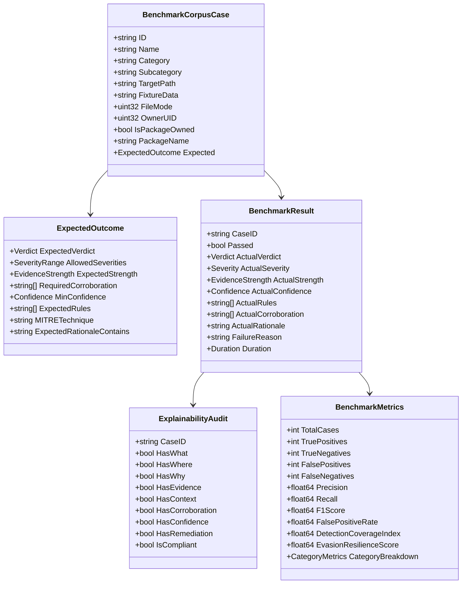

# Data Model: Detection Accuracy & Validation Benchmark

**Feature**: Detection Accuracy & Validation Benchmark  
**Date**: 2026-10-03  
**Status**: Draft  

---

## 1. Entity Relationship Diagram

---

## 2. Entity Definitions

### 2.1 `BenchmarkCorpusCase`
Represents an individual scenario in the test corpus with its physical attributes and expected analytical outcome.

| Field | Type | Description |
| :--- | :--- | :--- |
| `ID` | `string` | Unique identifier (e.g., `BENIGN-001`, `MAL-REV-002`). |
| `Name` | `string` | Human-readable scenario name. |
| `Category` | `CorpusCategory` | `BENIGN`, `MALICIOUS`, `SUSPICIOUS`, `EDGE_CASE`, `PARTIAL_VISIBILITY`. |
| `Subcategory` | `string` | Specific subcategory (e.g. `reverse_shell_interactive`, `python_metadata`). |
| `TargetPath` | `string` | Virtual or relative path for evaluation. |
| `FixtureContent` | `[]byte` | Content bytes of the static fixture. |
| `FileMode` | `uint32` | Synthetic or physical filesystem mode bits (e.g., `0755`, `0644`). |
| `OwnerUID` | `uint32` | Owner UID for privilege and ownership evaluation. |
| `IsPackageOwned` | `bool` | Whether the path is registered in the simulated `PackageDB`. |
| `PackageName` | `string` | Owning package name if `IsPackageOwned` is true. |
| `Expected` | `ExpectedOutcome` | Contract defining the expected analytical result. |

---

### 2.2 `ExpectedOutcome`
The contract against which Aether's actual findings are validated.

| Field | Type | Description |
| :--- | :--- | :--- |
| `ExpectedVerdict` | `report.Verdict` | Expected final verdict (`MALICIOUS`, `SUSPICIOUS`, `SAFE`, `UNKNOWN`). |
| `AllowedSeverities` | `[]report.Severity` | Permissible severities for this scenario (e.g. `[ALERT]` for malware). |
| `ExpectedStrength` | `report.EvidenceStrength` | Expected evidence weight (`Direct`, `Corroborated`, `Contextual`, `Incomplete`). |
| `RequiredCorroboration` | `[]string` | Corroborating signals required to justify escalation (e.g. `persistence:*`). |
| `MinConfidence` | `report.Confidence` | Minimum permissible confidence (`HIGH`, `MEDIUM`, `LOW`). |
| `ExpectedRules` | `[]string` | Detector rule names expected to trigger. |
| `MITRETechnique` | `string` | Expected MITRE ATT&CK technique code (e.g. `T1059.004`). |
| `ExpectedRationaleContains` | `string` | Substring that must appear in the human-readable confidence rationale. |

---

### 2.3 `BenchmarkResult`
Records the outcome of evaluating a single corpus case.

| Field | Type | Description |
| :--- | :--- | :--- |
| `CaseID` | `string` | Referenced `BenchmarkCorpusCase.ID`. |
| `Passed` | `bool` | True if all assertions in `ExpectedOutcome` and explainability pass. |
| `NormalizedPath` | `string` | Path normalized relative to corpus root (e.g. `malicious/01_reverse_shells/bash.sh`). |
| `ActualVerdict` | `report.Verdict` | Verdict returned by Aether. |
| `ActualSeverity` | `report.Severity` | Highest severity returned. |
| `ActualStrength` | `report.EvidenceStrength` | Assigned evidence strength. |
| `ActualConfidence` | `report.Confidence` | Assigned confidence level. |
| `ActualRules` | `[]string` | Rules triggered during inspection. |
| `ActualCorroboration`| `[]string` | Corroborating signals attached. |
| `ActualRationale` | `string` | Finding rationale generated by engine. |
| `FailureReason` | `string` | Diagnostic description if `Passed == false`. |
| `Duration` | `time.Duration` | Execution duration for performance tracking. |

---

### 2.4 `BenchmarkMetrics`
Aggregated statistical summary across all test cases. All float metrics are guaranteed non-NaN and non-Inf.

| Field | Type | Description | Zero-Denominator Behavior |
| :--- | :--- | :--- | :--- |
| `TotalCases` | `int` | Total count of evaluated cases. | N/A |
| `TruePositives` | `int` | Malicious cases correctly classified as `MALICIOUS`. | N/A |
| `TrueNegatives` | `int` | Benign cases correctly classified as `SAFE`. | N/A |
| `FalsePositives` | `int` | Benign/suspicious cases incorrectly classified as `MALICIOUS`. | N/A |
| `FalseNegatives` | `int` | Malicious cases missed or classified as `SAFE`/`UNKNOWN`. | N/A |
| `Precision` | `float64` | $TP / (TP + FP)$ | Defaults to $1.0$ if $TP=0 \land FP=0$; $0.0$ if $TP+FP=0 \land FP>0$. |
| `Recall` | `float64` | $TP / (TP + FN)$ | Defaults to $1.0$ if $TP=0 \land FN=0$; $0.0$ if $TP+FN=0 \land FN>0$. |
| `F1Score` | `float64` | $2 \times \frac{\text{Precision} \times \text{Recall}}{\text{Precision} + \text{Recall}}$ | Defaults to $0.0$ if $\text{Precision}+\text{Recall}=0$. |
| `FalsePositiveRate` | `float64` | $FP / (FP + TN)$ | Defaults to $0.0$ if $FP+TN=0$. |
| `DetectionCoverageIndex`| `float64` | Percentage of cataloged threat subclasses detected. | Defaults to $0.0$ if subclasses $=0$. |
| `SuspiciousTriageAccuracy`| `float64` | Percentage of Category C cases correctly classified as `SUSPICIOUS`. | Defaults to $1.0$ if Category C count $=0$. |
| `AbstentionAccuracy` | `float64` | Percentage of Category E cases correctly classified as `UNKNOWN`. | Defaults to $1.0$ if Category E count $=0$. |
| `EvasionResilienceScore`| `float64` | Percentage of static evasion mutations successfully caught. | Defaults to $0.0$ if total mutations $=0$. |

---

### 2.5 `ExplainabilityAudit`
Audit record verifying human-actionable transparency on every generated finding.

| Field | Type | Validation Rule |
| :--- | :--- | :--- |
| `HasWhat` | `bool` | `Title` and `RuleName` non-empty. |
| `HasWhere` | `bool` | `Path` non-empty or `PID > 0`. |
| `HasWhy` | `bool` | `Why` string length $\ge 30$ chars. |
| `HasEvidence` | `bool` | `SHA256` non-empty (for files) and `MatchedCondition` non-empty. |
| `HasContext` | `bool` | `PackageStatus` and `ContextProfile` populated. |
| `HasCorroboration` | `bool` | Corroborating signals recorded if `StrengthCorroborated`. |
| `HasConfidence` | `bool` | `Confidence` and `ConfidenceRationale` non-empty. |
| `HasRemediation` | `bool` | `Remediation` slice has $\ge 1$ actionable step. |
| `IsCompliant` | `bool` | `All(Has*) == true`. |
