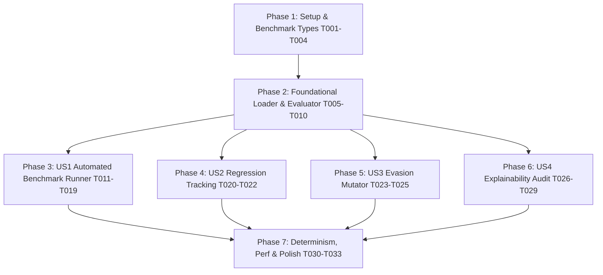

# Implementation Tasks: Detection Accuracy & Validation Benchmark

**Feature Branch**: `002-detection-accuracy-benchmark`  
**Specification**: [`specs/002-detection-accuracy-benchmark/spec.md`](spec.md)  
**Implementation Plan**: [`specs/002-detection-accuracy-benchmark/plan.md`](plan.md)  
**Data Model**: [`specs/002-detection-accuracy-benchmark/data-model.md`](data-model.md)  
**Corpus Schema Contract**: [`specs/002-detection-accuracy-benchmark/contracts/corpus-schema.json`](contracts/corpus-schema.json)  
**Report Schema Contract**: [`specs/002-detection-accuracy-benchmark/contracts/benchmark-result-schema.json`](contracts/benchmark-result-schema.json)  
**Quickstart**: [`specs/002-detection-accuracy-benchmark/quickstart.md`](quickstart.md)  
**Governing Authority**: [Aether Constitution v1.0.0](file:///home/nick/Documents/doc/tools/WORKING_TOOLS/Aether/.specify/memory/constitution.md)

---

## Phase 1: Setup & Shared Benchmark Infrastructure

**Purpose**: Establish the isolated benchmark test package structure, core data types, and contract validators.

- [x] T001 Create benchmark directory structure (`internal/benchmark/`, `test/benchmark/`, `testdata/benchmark_corpus/`) per implementation plan
- [x] T002 [P] Implement core benchmark data structures (`BenchmarkCorpusCase`, `ExpectedOutcome`, `BenchmarkResult` with `NormalizedPath`, `BenchmarkMetrics` with Triage/Abstention fields, `ExplainabilityAudit`) in `internal/benchmark/types.go`
- [x] T003 [P] Implement corpus JSON manifest schema validation test against `specs/002-detection-accuracy-benchmark/contracts/corpus-schema.json` in `internal/benchmark/types_test.go`
- [x] T004 [P] Implement benchmark result report JSON schema validation test against `specs/002-detection-accuracy-benchmark/contracts/benchmark-result-schema.json` in `internal/benchmark/types_test.go`

*Checkpoint*: Benchmark data structures and schema validators compile and pass unit tests (`go test ./internal/benchmark/...`).

---

## Phase 2: Foundational (Corpus Loader, Evaluator & Metrics Engine)

**Purpose**: Build the hermetic corpus loader, decision evaluator, and mathematically exact metric calculations.

**⚠️ CRITICAL**: Must be completed and tested before individual user story integrations begin.

- [x] T005 [P] Implement hermetic corpus loader with relative path normalization (`filepath.Rel` against corpus root), recursive category parsing, and JSON contract mapping in `internal/benchmark/loader.go`
- [x] T006 Add unit tests for corpus manifest loading, malformed JSON handling, and strict relative path normalization in `internal/benchmark/loader_test.go`
- [x] T007 [P] Implement decision evaluator comparing actual findings against immutable `ExpectedOutcome` contracts with normalized relative paths in `internal/benchmark/evaluator.go`
- [x] T008 Add unit tests for decision evaluator matrix (handling correct verdicts, over-classifications, and under-classifications) in `internal/benchmark/evaluator_test.go`
- [x] T009 [P] Implement mathematically exact metrics engine ($TP$, $TN$, $FP$, $FN$, Precision, Recall, F1-Score, FPR, DCI, Suspicious Triage Accuracy, and Abstention Accuracy) with strict zero-denominator guarding (guaranteeing zero `NaN`/`Inf`) in `internal/benchmark/metrics.go`
- [x] T010 Add unit tests for metrics engine asserting correct accounting for `MALICIOUS`, `SUSPICIOUS`, `SAFE`, and `UNKNOWN` cases, zero-denominator edge cases, and JSON float validity in `internal/benchmark/metrics_test.go`

*Checkpoint*: Foundational benchmark engine passes 100% of unit tests independently.

---

## Phase 3: User Story 1 - Automated Detection Benchmark Execution (Priority: P1) 🎯 MVP

**Goal**: Execute an end-to-end automated validation benchmark across all 5 corpus categories, outputting verifiable metrics and category breakdowns.

**Independent Test**: Running `go test -v -tags yara ./test/benchmark/...` evaluates $\ge 50$ test scenarios and outputs exact Precision, Recall, FPR, F1, and DCI without executing any payload.

### Tests for User Story 1
- [x] T011 [P] [US1] Create Category A Benign synthetic fixtures & contracts (11 subcategories: daemons, packages, Python metadata/test trees, build caches, pentest tools, cron, systemd, SSH, listeners, kernel drivers) in `testdata/benchmark_corpus/benign/`
- [x] T012 [P] [US1] Create Category B Malicious synthetic fixtures & contracts (12 subcategories: reverse shells, webshells, ransomware, stealers, droppers, rogue UID 0 accounts, SSH/systemd persistence, memory execution, rootkits, IOCs) in `testdata/benchmark_corpus/malicious/`
- [x] T013 [P] [US1] Create Category C Suspicious/Ambiguous synthetic fixtures & contracts (6 subcategories: dual-use scripts, post-upgrade deleted binaries, unmapped listeners, debug services, custom SUIDs) in `testdata/benchmark_corpus/suspicious/`
- [x] T014 [P] [US1] Create Category D Environmental Edge Case fixtures & contracts (6 subcategories: cyclic symlinks, sparse files, container namespaces, multi-vector collisions, trojanized packages) in `testdata/benchmark_corpus/edge_cases/`
- [x] T015 [P] [US1] Create Category E Partial Visibility / EACCES fixtures & contracts (4 subcategories: unreadable shadow, root cron spools, restricted `/proc` descriptors) in `testdata/benchmark_corpus/partial_visibility/`

### Implementation for User Story 1
- [x] T016 [US1] Implement top-level benchmark test suite runner executing all corpus categories with hermetic in-memory `pkgdb.MockPackageDB` simulation in `test/benchmark/benchmark_test.go`
- [x] T017 [US1] Implement JSON report generator and human-readable Markdown summary report exporter in `internal/benchmark/report.go`
- [x] T018 [US1] Add integration test for Category A Benign asserting exactly 0 false-positive `MALICIOUS` alerts ($\text{FPR} = 0.0\%$) in `test/benchmark/benchmark_test.go`
- [x] T019 [US1] Add integration test for Category B Malicious asserting $\ge 95\%$ threat recall against baseline malware fixtures in `test/benchmark/benchmark_test.go`

*Checkpoint*: User Story 1 complete. Benchmark executes across all 5 corpus categories and generates full metric reports.

---

## Phase 4: User Story 2 - Automated False-Positive Regression Tracking (Priority: P2)

**Goal**: Codify historical false-alarm patterns into a permanent regression suite to ensure signature updates never reintroduce false alarms.

**Independent Test**: Running `go test -v ./test/benchmark/... -run TestRegressionSuite` asserts 100% pass rate on all historical false-positive cases.

### Tests for User Story 2
- [x] T020 [P] [US2] Create regression fixture manager and test harness in `internal/benchmark/regression.go`
- [x] T021 [P] [US2] Codify historical Python package metadata & test mock false-positive regression fixtures in `testdata/benchmark_corpus/benign/03_python_packages/`

### Implementation for User Story 2
- [x] T022 [US2] Implement automated regression suite asserting zero reintroduction of known false alarms across heuristic and YARA engines in `test/benchmark/regression_test.go`

*Checkpoint*: Regression tracking operational. All false-positive fixes permanently codified.

---

## Phase 5: User Story 3 - Adversarial & Evasion Robustness Assessment (Priority: P3)

**Goal**: Evaluate detector resilience against static evasion mutations (quoting, whitespace, variable indirection, alternate interpreters) without dynamic execution.

**Independent Test**: Running `go test -v -tags yara ./test/benchmark/... -run TestStaticEvasionResilience` calculates and outputs the Evasion Resilience Score.

### Tests for User Story 3
- [x] T023 [P] [US3] Implement safe static lexical mutation engine (quoting variations, whitespace injection, variable indirection, alternate interpreters, path aliasing) in `internal/benchmark/mutator.go`
- [x] T024 [P] [US3] Add unit tests for lexical mutation generator asserting valid syntax generation in `internal/benchmark/mutator_test.go`

### Implementation for User Story 3
- [x] T025 [US3] Implement static evasion resilience assessment and scoring in `test/benchmark/evasion_test.go`

*Checkpoint*: Evasion mutation assessment operational and integrated into benchmark reporting.

---

## Phase 6: User Story 4 - Multi-Environment Consistency & Explainability (Priority: P4)

**Goal**: Validate that detection accuracy remains consistent across distribution environments and enforce the mandatory 8-question explainability standard.

**Independent Test**: Running `go test -v ./test/benchmark/... -run TestExplainabilityCompliance` verifies that 100% of emitted findings answer WHAT, WHERE, WHY, EVIDENCE, CONTEXT, CORROBORATION, CONFIDENCE, and REMEDIATION.

### Tests for User Story 4
- [x] T026 [P] [US4] Implement 8-question explainability compliance auditor in `internal/benchmark/explainability.go`
- [x] T027 [P] [US4] Add unit tests for explainability compliance auditor asserting rejection of empty or placeholder fields in `internal/benchmark/explainability_test.go`

### Implementation for User Story 4
- [x] T028 [US4] Implement hermetic environment simulation adapter (Debian vs Arch vs Unmanaged in-memory `pkgdb.MockPackageDB`) in `internal/benchmark/env_adapter.go`
- [x] T029 [US4] Add multi-environment consistency and explainability validation test in `test/benchmark/explainability_test.go`

*Checkpoint*: All 4 User Stories complete, verified, and integrated.

---

## Phase 7: Determinism, Performance & Polish

**Purpose**: Enforce byte-for-byte reproducibility across runs, measure execution overhead, and provide CI make targets.

- [x] T030 [P] Implement deterministic finding ordering verifier asserting byte-for-byte identical JSON across 10 concurrent runs in `test/benchmark/determinism_test.go`
- [x] T031 [P] Implement benchmark execution latency and memory overhead measurement in `test/benchmark/performance_test.go`
- [x] T032 Add `make benchmark` target in `Makefile` executing `go test -v -tags yara ./test/benchmark/...`
- [x] T033 Execute full validation quickstart scenarios across pure-Go and YARA-X builds per `specs/002-detection-accuracy-benchmark/quickstart.md`

---

## Dependencies & Execution Order

---

## Parallel Opportunities

- **Phase 1**: Tasks T002, T003, and T004 can be implemented in parallel.
- **Phase 2**: Tasks T005, T007, and T009 can be developed in parallel.
- **Phase 3 (Corpus Generation)**: Fixture generation tasks T011, T012, T013, T014, and T015 can be authored concurrently across independent category directories.
- **Phases 4, 5, 6**: User Stories 2, 3, and 4 can proceed in parallel once Phase 2 is complete.

---

## Implementation Strategy: MVP First (User Story 1 Only)

1. Complete Phase 1: Setup & Shared Infrastructure (T001–T004).
2. Complete Phase 2: Foundational Loader, Evaluator & Metrics (T005–T010).
3. Complete Phase 3: User Story 1 Corpus & Benchmark Runner (T011–T019).
4. **STOP and VALIDATE**: Execute `go test -v -tags yara ./test/benchmark/...` and generate initial empirical baseline metrics.
5. Incrementally deliver User Stories 2, 3, 4, and Final Polish.
