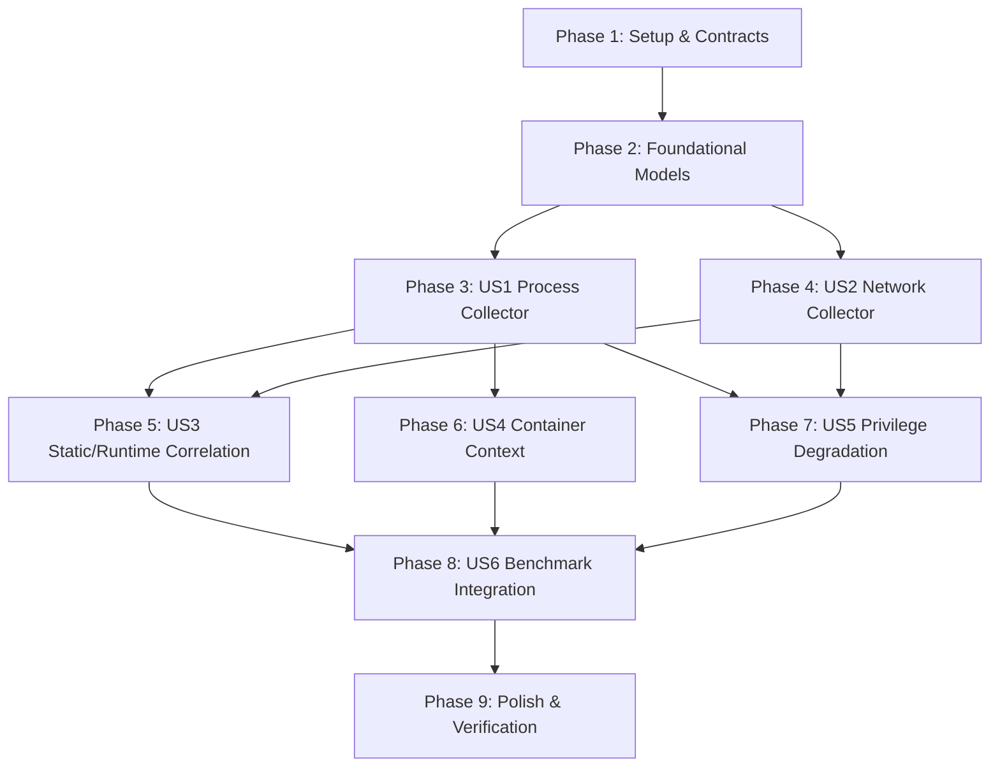

# Implementation Tasks: Aether Runtime Threat Assessment & Static/Runtime Correlation

**Feature Branch**: `003-runtime-threat-assessment`
**Spec**: [spec.md](file:///home/nick/Documents/doc/tools/WORKING_TOOLS/Aether/specs/003-runtime-threat-assessment/spec.md)
**Plan**: [plan.md](file:///home/nick/Documents/doc/tools/WORKING_TOOLS/Aether/specs/003-runtime-threat-assessment/plan.md)

---

## Phase 1: Setup & Shared Infrastructure

**Purpose**: Establish contract test validations and core data structure definitions.

- [X] T001 [P] Create contract validation tests for `runtime-finding-schema.json`, `correlation-context-schema.json`, and `benchmark-runtime-schema.json` in [`internal/report/contract_test.go`](file:///home/nick/Documents/doc/tools/WORKING_TOOLS/Aether/internal/report/contract_test.go) and [`internal/benchmark/runtime_schema_test.go`](file:///home/nick/Documents/doc/tools/WORKING_TOOLS/Aether/internal/benchmark/runtime_schema_test.go)
- [X] T002 [P] Define `CorroboratingSignal`, `CorroboratingDomain`, and update `EvidenceRecord` struct with runtime fields (`PID`, `Comm`, `Cmdline`, `SocketInfo`, `MountNamespace`, `CorroborationDetails`) in [`internal/report/finding.go`](file:///home/nick/Documents/doc/tools/WORKING_TOOLS/Aether/internal/report/finding.go)

---

## Phase 2: Foundational (Blocking Prerequisites)

**Purpose**: Core data models and procfs abstractions that MUST be complete before collector or correlation logic executes.

**⚠️ CRITICAL**: No user story implementation can begin until foundational data models are ready.

- [X] T003 Implement `CorrelationIndex` and `CorrelateFindings` function skeleton in [`internal/report/correlate.go`](file:///home/nick/Documents/doc/tools/WORKING_TOOLS/Aether/internal/report/correlate.go)
- [X] T004 [P] Update `ProcessInfo` struct with mount/net namespace identifiers and unreadability flags (`ReadableExe`, `ReadableMaps`, `ReadableFDs`, `CoverageGaps`) in [`internal/modules/process/procfs.go`](file:///home/nick/Documents/doc/tools/WORKING_TOOLS/Aether/internal/modules/process/procfs.go)
- [X] T005 [P] Update `SocketDescriptor` struct with namespace metadata, kernel-ownership flags, and unmapped provenance fields in [`internal/modules/network/network.go`](file:///home/nick/Documents/doc/tools/WORKING_TOOLS/Aether/internal/modules/network/network.go)

**Checkpoint**: Foundation ready — collector and correlation tasks can proceed.

---

## Phase 3: User Story 1 - Live Process & Execution State Assessment (Priority: P1) 🎯 MVP

**Goal**: Deliver non-executing, read-only Linux process inspection across `/proc` detecting deleted binaries in temp locations, memfd ELF injections, masquerading, root user-writable executables, and hidden PIDs.

**Independent Test**: Execute `go test -v ./internal/modules/process/...` against synthetic procfs fixtures and verify accurate signal detection without false positives on legitimate system daemons.

### Tests for User Story 1

- [X] T006 [P] [US1] Unit tests for process detection signals (unlinked temporary binary vs package upgrade replacement, memfd ELF magic, masquerading, root user-writable exe) in [`internal/modules/process/process_test.go`](file:///home/nick/Documents/doc/tools/WORKING_TOOLS/Aether/internal/modules/process/process_test.go)

### Implementation for User Story 1

- [X] T007 [US1] Implement unlinked binary inspection and inode comparison differentiating suspicious temp locations from package upgrade replacements (`CheckDeletedExe`) in [`internal/modules/process/detections.go`](file:///home/nick/Documents/doc/tools/WORKING_TOOLS/Aether/internal/modules/process/detections.go)
- [X] T008 [US1] Implement fileless executable memory inspection with ELF magic validation (`CheckFilelessExecution`) in [`internal/modules/process/detections.go`](file:///home/nick/Documents/doc/tools/WORKING_TOOLS/Aether/internal/modules/process/detections.go)
- [X] T009 [US1] Implement process masquerading detection (bracketed kernel thread names with valid exe, fake system daemons in user paths) (`CheckMasquerading`) in [`internal/modules/process/detections.go`](file:///home/nick/Documents/doc/tools/WORKING_TOOLS/Aether/internal/modules/process/detections.go)
- [X] T010 [US1] Implement root process executable security check (UID 0 running non-root owned or world-writable binaries) (`CheckRootWritableExe`) in [`internal/modules/process/detections.go`](file:///home/nick/Documents/doc/tools/WORKING_TOOLS/Aether/internal/modules/process/detections.go)
- [X] T011 [US1] Implement hidden PID detection with timing breakdown (`CheckHiddenPIDsWithTimings`) in [`internal/modules/process/hidden_pid.go`](file:///home/nick/Documents/doc/tools/WORKING_TOOLS/Aether/internal/modules/process/hidden_pid.go)
- [X] T012 [US1] Integrate process signal consolidation, deduplication, and group buffering in [`internal/modules/process/process.go`](file:///home/nick/Documents/doc/tools/WORKING_TOOLS/Aether/internal/modules/process/process.go)

**Checkpoint**: User Story 1 is fully functional and independently verified.

---

## Phase 4: User Story 2 - Socket & Network Listener Threat Hunting (Priority: P1)

**Goal**: Deliver read-only network inspection across `/proc/net/*` tables, linking listening ports and sockets to owning processes via `/proc/<pid>/fd`, and triaging unmapped wildcard listeners vs verified package daemons.

**Independent Test**: Execute `go test -v ./internal/modules/network/...` against mock socket tables and assert accurate socket-to-process mapping.

### Tests for User Story 2

- [X] T013 [P] [US2] Unit tests for socket table parsing and socket-to-process inode mapping in [`internal/modules/network/network_test.go`](file:///home/nick/Documents/doc/tools/WORKING_TOOLS/Aether/internal/modules/network/network_test.go)

### Implementation for User Story 2

- [X] T014 [US2] Implement `/proc/net/*` table parsing for TCP, TCP6, UDP, UDP6, RAW, RAW6, and PACKET tables in [`internal/modules/network/proc_net.go`](file:///home/nick/Documents/doc/tools/WORKING_TOOLS/Aether/internal/modules/network/proc_net.go)
- [X] T015 [US2] Implement socket-to-process inode mapping by inspecting `/proc/<pid>/fd/*` symlinks in [`internal/modules/network/network.go`](file:///home/nick/Documents/doc/tools/WORKING_TOOLS/Aether/internal/modules/network/network.go)
- [X] T016 [US2] Implement network listener classification (verified package daemons -> `VerdictSafe`/`INFO`, localhost loopback -> `VerdictSafe`, unmapped wildcard listeners -> `VerdictSuspicious`/`WARNING`, raw packet capture -> `VerdictSuspicious`) in [`internal/modules/network/detections.go`](file:///home/nick/Documents/doc/tools/WORKING_TOOLS/Aether/internal/modules/network/detections.go)

**Checkpoint**: User Stories 1 and 2 operate independently.

---

## Phase 5: User Story 3 - Multi-Vector Static & Runtime Threat Correlation (Priority: P1)

**Goal**: Deliver the automated Correlation Engine linking static filesystem findings with live process, persistence, and network socket observations to elevate multi-vector threats to `ALERT` (`StrengthCorroborated`) while preserving single-vector anomaly boundaries.

**Independent Test**: Execute `go test -v ./internal/report/... -run TestCorrelation` and assert: (1) dual-use script + running process + active listener -> `VerdictMalicious` (`ALERT`, `ConfidenceHigh`), (2) uncorroborated dual-use script -> `VerdictSuspicious` (`WARNING`).

### Tests for User Story 3

- [X] T017 [P] [US3] Unit tests for cross-domain static/runtime correlation in [`internal/report/correlate_test.go`](file:///home/nick/Documents/doc/tools/WORKING_TOOLS/Aether/internal/report/correlate_test.go)

### Implementation for User Story 3

- [X] T018 [US3] Implement cross-domain indexing (path $\leftrightarrow$ exe, hash $\leftrightarrow$ exe hash, PID $\leftrightarrow$ socket inode, persistence target $\leftrightarrow$ process) in [`internal/report/correlate.go`](file:///home/nick/Documents/doc/tools/WORKING_TOOLS/Aether/internal/report/correlate.go)
- [X] T019 [US3] Implement multi-vector corroboration evaluator and domain multiplier logic (requiring $\ge 2$ distinct domains for `StrengthCorroborated`) in [`internal/report/correlate.go`](file:///home/nick/Documents/doc/tools/WORKING_TOOLS/Aether/internal/report/correlate.go)
- [X] T020 [US3] Implement finding deduplication and primary threat consolidation to prevent duplicate alert inflation in [`internal/report/correlate.go`](file:///home/nick/Documents/doc/tools/WORKING_TOOLS/Aether/internal/report/correlate.go)
- [X] T021 [US3] Wire `CorrelateFindings` into `report.FindingAccumulator` and `scanner.Scanner` reporting pipeline in [`internal/report/reporter.go`](file:///home/nick/Documents/doc/tools/WORKING_TOOLS/Aether/internal/report/reporter.go) and [`internal/scanner/scanner.go`](file:///home/nick/Documents/doc/tools/WORKING_TOOLS/Aether/internal/scanner/scanner.go)

**Checkpoint**: Multi-vector static/runtime correlation operational.

---

## Phase 6: User Story 4 - Container & Namespace Context Adaptation (Priority: P2)

**Goal**: Prevent false positive alerts on containerized processes operating from container rootfs while preserving detection of active in-memory threats.

**Independent Test**: Execute `go test -v ./internal/modules/process/... -run TestContainer` and verify path-based score reduction on container processes without reducing severity on direct IOC or memfd ELF threats.

### Tests for User Story 4

- [X] T022 [P] [US4] Unit tests for container mount namespace detection and score calibration in [`internal/modules/process/container_test.go`](file:///home/nick/Documents/doc/tools/WORKING_TOOLS/Aether/internal/modules/process/container_test.go)

### Implementation for User Story 4

- [X] T023 [US4] Implement mount namespace extraction (`/proc/<pid>/ns/mnt`) and container score adjustment (`ApplyContainerScoreAdjustment`) in [`internal/modules/process/detections.go`](file:///home/nick/Documents/doc/tools/WORKING_TOOLS/Aether/internal/modules/process/detections.go)
- [X] T024 [US4] Update [`internal/report/verdict.go`](file:///home/nick/Documents/doc/tools/WORKING_TOOLS/Aether/internal/report/verdict.go) to recognize `container_namespace` context profile and record namespace provenance.

---

## Phase 7: User Story 5 - Privilege Degradation & Transparent Abstention (Priority: P3)

**Goal**: Ensure Aether degrades gracefully under non-root permissions, capturing permission boundaries as coverage gaps and emitting `VerdictUnknown` without speculative `SAFE` or `MALICIOUS` verdicts.

**Independent Test**: Execute `go test -v ./internal/modules/process/... -run TestPrivilege` and assert `EACCES` on `/proc/<pid>/exe` maps to `StrengthIncomplete` and `VerdictUnknown`.

### Tests for User Story 5

- [X] T025 [P] [US5] Unit tests for non-root permission boundary handling (`EACCES`/`EPERM`) in [`internal/modules/process/privilege_test.go`](file:///home/nick/Documents/doc/tools/WORKING_TOOLS/Aether/internal/modules/process/privilege_test.go) and [`internal/modules/network/privilege_test.go`](file:///home/nick/Documents/doc/tools/WORKING_TOOLS/Aether/internal/modules/network/privilege_test.go)

### Implementation for User Story 5

- [X] T026 [US5] Implement non-root permission boundary trapping, coverage counters, and `StrengthIncomplete` / `VerdictUnknown` emission in [`internal/modules/process/process.go`](file:///home/nick/Documents/doc/tools/WORKING_TOOLS/Aether/internal/modules/process/process.go) and [`internal/modules/network/network.go`](file:///home/nick/Documents/doc/tools/WORKING_TOOLS/Aether/internal/modules/network/network.go)
- [X] T027 [US5] Update plain terminal, TUI, and HTML reporting to render coverage limitation notes and abstention metrics in [`internal/ui/plain/plain.go`](file:///home/nick/Documents/doc/tools/WORKING_TOOLS/Aether/internal/ui/plain/plain.go) and [`internal/report/html/html.go`](file:///home/nick/Documents/doc/tools/WORKING_TOOLS/Aether/internal/report/html/html.go)

---

## Phase 8: User Story 6 - Hermetic Runtime Benchmark Integration (Priority: P2)

**Goal**: Extend Feature 002 Benchmark to evaluate runtime threat assessment (`SUSP-LISTEN-001`, `SUSP-UPGRADE-001`) and benign runtime scenarios using hermetic mock procfs fixtures without executing live malware.

**Independent Test**: Run `go test -v ./test/benchmark/... -run TestCategoryC_Suspicious` and assert Suspicious Triage Accuracy $\ge 90.0\%$.

### Fixtures & Benchmark Implementation for User Story 6

- [X] T028 [P] [US6] Create hermetic synthetic `/proc` test fixture for `SUSP-LISTEN-001` (PID 1337 `dev_server.py`, socket fd `0.0.0.0:4444`) in `testdata/benchmark_corpus/suspicious/03_unmapped_listeners/mock_proc/`
- [X] T029 [P] [US6] Create hermetic synthetic `/proc` test fixture for `SUSP-UPGRADE-001` (PID 1042 `/usr/sbin/deleted_daemon (deleted)`, replaced inode on disk) in `testdata/benchmark_corpus/suspicious/02_deleted_binaries_upgraded/mock_proc/`
- [X] T030 [P] [US6] Create hermetic synthetic benign runtime test fixtures for system daemons (`sshd`, `systemd-resolved`) and local dev servers (`127.0.0.1:8080`) in `testdata/benchmark_corpus/benign/`
- [X] T031 [US6] Update [`internal/benchmark/loader.go`](file:///home/nick/Documents/doc/tools/WORKING_TOOLS/Aether/internal/benchmark/loader.go) and [`internal/benchmark/types.go`](file:///home/nick/Documents/doc/tools/WORKING_TOOLS/Aether/internal/benchmark/types.go) to load mock procfs paths and execute `process.NewModuleWithRoots` / `network.NewModuleWithRoots`
- [X] T032 [US6] Update [`test/benchmark/benchmark_test.go`](file:///home/nick/Documents/doc/tools/WORKING_TOOLS/Aether/test/benchmark/benchmark_test.go) (`TestCategoryC_Suspicious`) to verify contract compliance on `SUSP-LISTEN-001` and `SUSP-UPGRADE-001`

---

## Phase 9: Polish, Explainability, MITRE ATT&CK & Verification

**Purpose**: Cross-cutting explainability enrichment, determinism verification, and repository-wide quality gate execution.

- [X] T033 [P] Register all runtime and socket rule names with WHAT, WHERE, WHY, MITRE, and REMEDIATION in [`internal/report/finding.go`](file:///home/nick/Documents/doc/tools/WORKING_TOOLS/Aether/internal/report/finding.go) (`PopulateFindingDetails`)
- [X] T034 Verify 100% 8-question explainability compliance for all runtime and correlated findings in [`test/benchmark/explainability_test.go`](file:///home/nick/Documents/doc/tools/WORKING_TOOLS/Aether/test/benchmark/explainability_test.go)
- [X] T035 [P] Verify 10-run concurrent determinism for runtime and correlated findings in [`test/benchmark/determinism_test.go`](file:///home/nick/Documents/doc/tools/WORKING_TOOLS/Aether/test/benchmark/determinism_test.go)
- [X] T036 Run complete validation suite across all packages: `go test ./...`, `go test -tags yara ./...`, and `make benchmark`

---

## Dependencies & Execution Order

### Phase Dependencies

### Parallel Opportunities

- **Phase 1**: T001, T002 can execute in parallel.
- **Phase 2**: T004, T005 can execute in parallel.
- **Phase 3 & 4**: Process collector (US1) and Socket collector (US2) can execute in parallel after Phase 2.
- **Phase 8**: Synthetic fixtures T028, T029, T030 can be created in parallel.
- **Phase 9**: T033, T035 can execute in parallel.

---

## Implementation Strategy

### MVP First (User Story 1: Process Collector)
1. Complete Phase 1 (Setup) and Phase 2 (Foundational).
2. Implement Phase 3 (Process Collector: US1).
3. Validate process threat hunting on unlinked binaries, memfd injections, and masquerading.

### Incremental Delivery (Runtime Sockets $\rightarrow$ Correlation $\rightarrow$ Benchmark)
1. Add Phase 4 (Socket Collector: US2) $\rightarrow$ Verify socket-to-process mapping.
2. Add Phase 5 (Correlation Engine: US3) $\rightarrow$ Verify multi-vector threat escalation.
3. Add Phase 6 & 7 (Containers & Non-Root Handling) $\rightarrow$ Eliminate false alarms on containers and non-root users.
4. Add Phase 8 (Hermetic Benchmark Integration: US6) $\rightarrow$ Re-evaluate benchmark scorecard and verify Suspicious Triage Accuracy $\ge 90.0\%$.
5. Complete Phase 9 (Polish & Full Verification).
