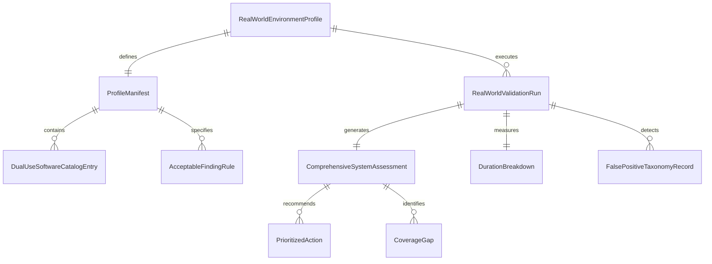
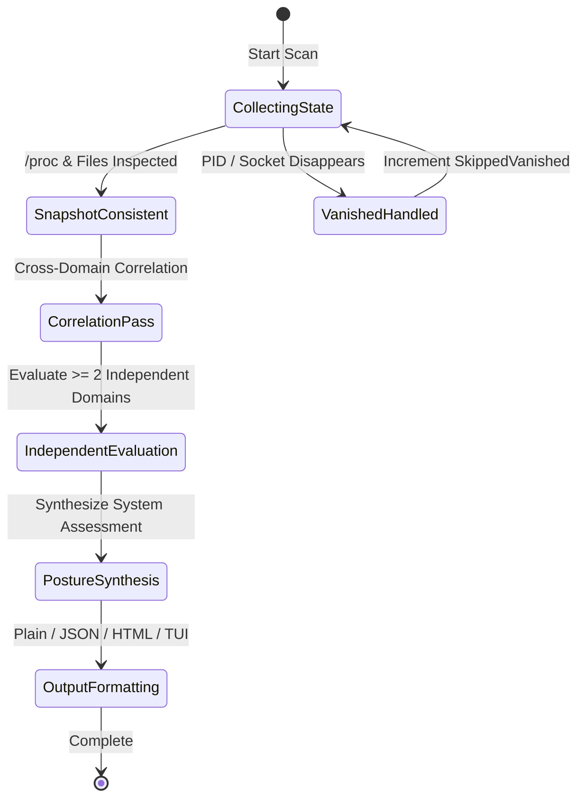

# Data Model: Real-World Linux Security Assessment & Reliability Validation

**Feature**: `004-real-world-validation`
**Date**: 2026-10-04
**Status**: Draft

---

## 1. Entity Overview & Relationships



---

## 2. Core Entities

### 2.1 `RealWorldEnvironmentProfile`
Represents an environment class specification used to validate Aether under realistic Linux system conditions.

```go
type RealWorldEnvironmentProfile struct {
    ProfileID            string        `json:"profile_id"`             // e.g. "desktop-standard", "workstation-pentest"
    Name                 string        `json:"name"`                   // Human-readable title
    Description          string        `json:"description"`            // Detailed environment description
    TargetDistribution   string        `json:"target_distribution"`    // "debian", "ubuntu", "fedora", "rhel", "arch"
    HasDualUseTools      bool          `json:"has_dual_use_tools"`     // True if pentest/debug tools are present
    HasActiveListeners   bool          `json:"has_active_listeners"`   // True if network services listen
    HasContainerWorkloads bool         `json:"has_container_workloads"`// True if Docker/Podman is active
    HasPendingUpgrades   bool          `json:"has_pending_upgrades"`   // True if replaced binaries exist
    ExpectedSystemStatus SystemPosture `json:"expected_system_status"` // Expected Posture (SAFE, ATTENTION, etc.)
}
```

### 2.2 `ProfileManifest` (`profile_manifest.json`)
The external, independent ground truth contract for an environment profile.

```go
type ProfileManifest struct {
    ProfileID              string                        `json:"profile_id"`
    Version                string                        `json:"version"`                 // Manifest schema version
    ExpectedStatus         SystemPosture                 `json:"expected_status"`         // Posture expected
    MaxAcceptableAlerts    int                           `json:"max_acceptable_alerts"`   // Usually 0 for benign
    MaxAcceptableWarnings  int                           `json:"max_acceptable_warnings"` // Bounded tolerance
    AcceptableFindings     []AcceptableFindingRule       `json:"acceptable_findings"`     // Whitelisted anomalies
    ForbiddenFindings      []ForbiddenFindingRule        `json:"forbidden_findings"`      // Findings that MUST NOT occur
    ExpectedCoverageLimits []string                      `json:"expected_coverage_limits"`// Paths/PIDs expected unreadable
    DualUseSoftware        []DualUseSoftwareCatalogEntry `json:"dual_use_software"`       // Expected dual-use tools
}

type AcceptableFindingRule struct {
    RuleName         string `json:"rule_name"`
    PathPattern      string `json:"path_pattern,omitempty"`
    ExpectedSeverity string `json:"expected_severity"`
    ExpectedVerdict  string `json:"expected_verdict"`
    Reason           string `json:"reason"`
}

type ForbiddenFindingRule struct {
    RulePattern string `json:"rule_pattern"` // Glob or regex matching rule name
    Severity    string `json:"severity,omitempty"`
    Reason      string `json:"reason"`
}
```

### 2.3 `DualUseSoftwareCatalogEntry`
Defines an authorized dual-use administrative, developer, or penetration-testing tool.

```go
type DualUseSoftwareCatalogEntry struct {
    ToolName                      string   `json:"tool_name"`                        // e.g. "metasploit-framework", "nmap"
    PrimaryBinary                 string   `json:"primary_binary"`                   // e.g. "msfconsole", "nmap"
    StandardPaths                 []string `json:"standard_paths"`                   // e.g. ["/usr/share/metasploit-framework"]
    ExpectedPassiveSeverity       string   `json:"expected_passive_severity"`        // "INFO" or "NOTICE"
    ExpectedPassiveVerdict        string   `json:"expected_passive_verdict"`         // "SAFE"
    CorroboratingAttackIndicators []string `json:"corroborating_attack_indicators"`  // Signals that elevate to ALERT
}
```

### 2.4 `DurationBreakdown`
Granular timing telemetry capturing sub-system execution performance.

```go
type DurationBreakdown struct {
    FilesystemWalk time.Duration `json:"filesystem_walk"`
    Hashing        time.Duration `json:"hashing"`
    Heuristics     time.Duration `json:"heuristics"`
    YARA           time.Duration `json:"yara"`
    Process        time.Duration `json:"process"`
    Network        time.Duration `json:"network"`
    Persistence    time.Duration `json:"persistence"`
    Users          time.Duration `json:"users"`
    Kernel         time.Duration `json:"kernel"`
    Correlation    time.Duration `json:"correlation"`
    Reporting      time.Duration `json:"reporting"`
    Total          time.Duration `json:"total"`
}
```

### 2.5 `RealWorldValidationRun`
Captures the complete audit and performance profile of a validation run.

```go
type RealWorldValidationRun struct {
    RunID                 string                        `json:"run_id"`
    Timestamp             time.Time                     `json:"timestamp"`
    ProfileID             string                        `json:"profile_id"`
    IsElevated            bool                          `json:"is_elevated"`
    FilesInspected        int64                         `json:"files_inspected"`
    ProcessesInspected    int64                         `json:"processes_inspected"`
    SocketsInspected      int64                         `json:"sockets_inspected"`
    PeakMemoryMB          float64                       `json:"peak_memory_mb"`
    ThroughputFilesPerSec float64                       `json:"throughput_files_per_sec"`
    Duration              DurationBreakdown             `json:"duration"`
    Assessment            ComprehensiveSystemAssessment `json:"assessment"`
    ManifestCompliance    bool                          `json:"manifest_compliance"`
    ComplianceViolations  []string                      `json:"compliance_violations,omitempty"`
}
```

### 2.6 `FalsePositiveTaxonomyRecord`
Documents and categorizes every field anomaly to drive deterministic regression prevention.

```go
type AnomalyTaxonomyCategory string

const (
    TaxonomyMissingContext     AnomalyTaxonomyCategory = "FP_MISSING_CONTEXT"
    TaxonomyWeakHeuristic      AnomalyTaxonomyCategory = "FP_WEAK_HEURISTIC"
    TaxonomyDualUseTool        AnomalyTaxonomyCategory = "FP_DUAL_USE_TOOL"
    TaxonomyPackageMismatch    AnomalyTaxonomyCategory = "FP_PACKAGE_MISMATCH"
    TaxonomyRuntimeRace        AnomalyTaxonomyCategory = "FP_RUNTIME_RACE"
    TaxonomyNamespaceIsolation AnomalyTaxonomyCategory = "FP_NAMESPACE_ISOLATION"
    TaxonomyEnvironmental      AnomalyTaxonomyCategory = "FP_ENVIRONMENTAL"

    TaxonomyCollectionGap      AnomalyTaxonomyCategory = "FN_COLLECTION_GAP"
    TaxonomyDetectorGap        AnomalyTaxonomyCategory = "FN_DETECTOR_GAP"
    TaxonomyOverSuppression    AnomalyTaxonomyCategory = "FN_CONTEXT_SUPPRESSION"
    TaxonomyCorrelationGap     AnomalyTaxonomyCategory = "FN_CORRELATION_GAP"
    TaxonomyPermissionBoundary AnomalyTaxonomyCategory = "FN_PERMISSION_LIMITATION"
)

type FalsePositiveTaxonomyRecord struct {
    AnomalyID          string                  `json:"anomaly_id"`
    RuleName           string                  `json:"rule_name"`
    TargetPath         string                  `json:"target_path"`
    Category           AnomalyTaxonomyCategory `json:"category"`
    ObservedVerdict    string                  `json:"observed_verdict"`
    ExpectedVerdict    string                  `json:"expected_verdict"`
    RootCauseAnalysis  string                  `json:"root_cause_analysis"`
    ProposedMitigation string                  `json:"proposed_mitigation"`
    RegressionFixture  string                  `json:"regression_fixture"` // Path to regression fixture
}
```

### 2.7 `ComprehensiveSystemAssessment`
The executive-level system posture and action plan generated for system administrators.

```go
type SystemPosture string

const (
    PostureSafe               SystemPosture = "SAFE"
    PostureAttentionRequired  SystemPosture = "ATTENTION_REQUIRED"
    PostureHighRisk           SystemPosture = "HIGH_RISK"
    PostureLimitedVisibility  SystemPosture = "LIMITED_VISIBILITY"
)

type ComprehensiveSystemAssessment struct {
    Posture           SystemPosture       `json:"posture"`
    SummaryRationale  string              `json:"summary_rationale"`
    TotalFindings     int                 `json:"total_findings"`
    AlertsCount       int                 `json:"alerts_count"`
    WarningsCount     int                 `json:"warnings_count"`
    NoticesCount      int                 `json:"notices_count"`
    InfosCount        int                 `json:"infos_count"`
    UnknownsCount     int                 `json:"unknowns_count"`
    CriticalFindings  []report.Finding    `json:"critical_findings,omitempty"`
    SuspiciousFindings []report.Finding   `json:"suspicious_findings,omitempty"`
    VisibilityGaps    []CoverageGap       `json:"visibility_gaps,omitempty"`
    NextActions       []PrioritizedAction `json:"next_actions"`
}

type CoverageGap struct {
    Subsystem   string `json:"subsystem"`   // "process", "filesystem", "users", etc.
    TargetPath  string `json:"target_path"`
    Reason      string `json:"reason"`      // e.g. "EACCES: permission denied"
    Remediation string `json:"remediation"` // e.g. "Run with sudo or CAP_DAC_OVERRIDE"
}

type PrioritizedAction struct {
    Priority    int    `json:"priority"`    // 1 = Critical, 2 = High, 3 = Moderate
    Title       string `json:"title"`
    Description string `json:"description"`
    Command     string `json:"command,omitempty"`
}
```

---

## 3. State Transitions & Invariants



### Core Invariants:
1. **Separation of Benchmark vs Validation**: Real-world validation runs MUST write results to `testdata/realworld_corpus/results/`, never mutating `internal/benchmark/` or `testdata/benchmark_corpus/`.
2. **Deterministic Posture Logic**:
   - If `AlertsCount > 0` $\rightarrow$ `HIGH_RISK`.
   - Else if `UnknownsCount > 0 && CoreAreaBlindSpot` $\rightarrow$ `LIMITED_VISIBILITY`.
   - Else if `WarningsCount > 0` $\rightarrow$ `ATTENTION_REQUIRED`.
   - Else $\rightarrow$ `SAFE`.
3. **No Speculative Guessing**: Inaccessible targets remain `UNKNOWN` / `StrengthIncomplete` and trigger `LIMITED_VISIBILITY`; they are never guessed as `SAFE` or `MALICIOUS`.

