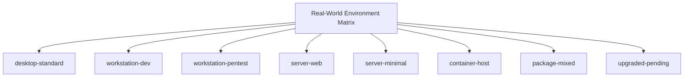
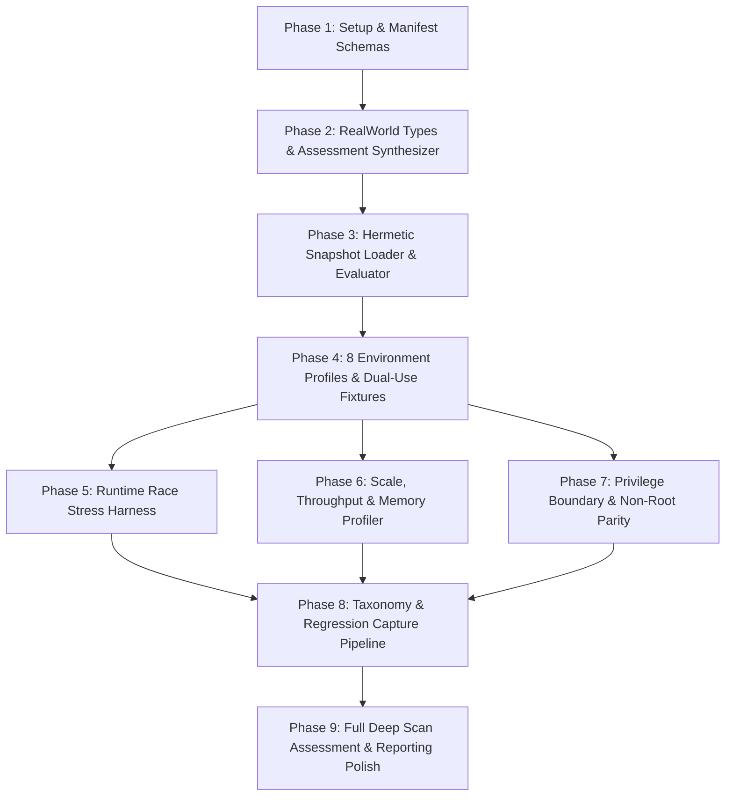

# Implementation Plan: Aether Real-World Linux Security Assessment & Reliability Validation

**Branch**: `004-real-world-validation` | **Date**: 2026-10-04 | **Spec**: [specs/004-real-world-validation/spec.md](spec.md)

---

## Summary

Feature 004 establishes a comprehensive, read-only validation methodology and reliability harness to evaluate Aether across realistic Linux operating environments without executing live malware, without weaponizing payloads, and without mutating target systems.

While Features 001, 002, and 003 proved that Aether passes strict mathematical gates on curated, synthetic benchmarks (100% Threat Recall, 100% Precision, 0% FPR, 100% Suspicious Triage), **passing synthetic tests does not prove real-world accuracy**. This plan defines the architecture to validate Aether across 8 realistic Linux environment classes (desktop, developer workstation, pentest system, web server, minimal cloud host, container host, mixed packages, and upgraded daemons), distinguishing passive dual-use tools from active weaponization, validating resilience against transient `/proc` runtime races, profiling scale and memory budgets, enforcing transparent non-root abstention, and systematically converting field false alarms into permanent, deterministic regression tests—all while keeping Feature 002/003 controlled benchmarks isolated and intact.

---

## Technical Context

- **Language/Version**: Go 1.22+ (`toolchain go1.22.4`)
- **Primary Dependencies**: Native standard library (`os`, `io`, `path/filepath`, `bufio`, `crypto/sha256`, `sync/atomic`), `golang.org/x/sys/unix`, YARA-X CGO engine (`-tags yara`), Bubbletea/Lipgloss for TUI.
- **Storage**: In-memory event bus and streaming pipeline; self-contained JSON and offline HTML reports; zero database dependencies.
- **Testing**: Standard Go test toolchain (`go test ./...`, `go test -tags yara ./...`, `go test -race ./...`).
- **Target Platform**: Linux (x86_64, aarch64, kernel $\ge 4.19$, systemd/init, procfs, sysfs).
- **Project Type**: Air-gapped, offline-first command-line security assessment and threat hunting engine.
- **Performance Goals**: $\ge 2,500$ files/second inspection throughput on SSD storage; peak memory consumption $\le 250\text{MB}$ RSS.
- **Constraints**: 100% read-only forensic safety; zero malware/payload execution; zero process termination/ptrace; zero external network requests; zero cloud dependencies/telemetry; 100% 8-question explainability; byte-for-byte 10-run determinism.
- **Scale/Scope**: System audits spanning 100,000+ files, 1,000+ processes, 500+ sockets, across 8 environment profiles.

---

## Constitution Check

*GATE: Must pass before Phase 0 research. Re-check after Phase 1 design.*

1. **Principle I: Forensic Safety & Read-Only Invariant**: PASS. All validation operations are strictly passive and read-only. Zero sample execution, zero process killing, zero syscall mutation. Files opened via `safeopen.OpenRegularReadOnly` with `O_NOFOLLOW | O_CLOEXEC | O_NONBLOCK | O_NOATIME`.
2. **Principle II: Security-First Engineering & Least Privilege**: PASS. Core validation logic functions completely unprivileged. Non-root permission barriers (`EACCES`) are tracked as coverage gaps and emit `VerdictUnknown`, never crashing or guessing.
3. **Principle III: Offline-First Architecture & Zero Telemetry**: PASS. Zero network calls, zero cloud telemetry, zero remote dependencies. All reports and HTML dashboards remain 100% self-contained with strict CSP nonces.
4. **Principle IV: Preserve Existing Architecture & Abstractions**: PASS. Full reuse of Feature 001 verdict engine, Feature 002 benchmark framework, Feature 003 runtime collectors/correlation, `pkgdb`, `safeopen`, `triage`, and `MemoryBudgetTracker`. No duplicate verdict or scoring engines.
5. **Principle V: Detection Integrity & Severity Standards**: PASS. Detections respect established severity tiers (`ALERT` 85–100, `WARNING` 50–84, `NOTICE` 20–49, `INFO` 0–19). Dual-use software presence alone never triggers `ALERT`.
6. **Principle VI: Mandatory MITRE ATT&CK & Actionable Remediation**: PASS. All findings satisfy the 8-question standard and populate structured MITRE ATT&CK mappings and concrete remediation instructions in `internal/report/finding.go`.
7. **Principle VII: Test Integrity & Verification Standard**: PASS. 100% pass standard across `go test ./...` and `go test -tags yara ./...`. Memory bounds respected.
8. **Principle VIII: Executive Studio UI & Output Contract**: PASS. Consistent styling tokens in `internal/ui/theme/`. Delineates `MALICIOUS THREATS`, `SUSPICIOUS ANOMALIES`, and `SAFE ASSETS`. Multi-format parity across plain, JSON, TUI, and offline HTML.
9. **Principle IX: Backward Compatibility & CLI Stability**: PASS. No breaking changes to existing CLI flags (`--quick`, `--full`, `--plain`, `--html-out`, `--json-out`).
10. **Principle X: Minimal-Change Principle & Targeted Scope**: PASS. Surgical additions in `internal/realworld/` and `test/realworld/`; zero modification to immutable Feature 002/003 benchmark contracts.
11. **Principle XI: AI Safety Protocol & Static Analysis Invariant**: PASS. Zero dynamic invocation or execution of test payloads; fixtures remain inert text or synthetic mock procfs structures.

---

## 1. Current Architecture Assessment & Limitations

Aether currently provides:
- **Filesystem Scanner (`internal/scanner/scanner.go`)**: Traverses filesystem roots using `safeopen.OpenRegularReadOnly`, calculates SHA-256/MD5 hashes, executes regex/AST heuristics (`heuristics.go`) and compiled YARA-X rules (`internal/yara/`), buffers matches in `scanner.FindingAccumulator`, and correlates findings.
- **Process Collector (`internal/modules/process/`)**: Parses `/proc/<pid>/stat`, `/cmdline`, `/exe`, `/maps`, and `/ns/mnt`. Detects unlinked binaries (`(deleted)`), fileless ELF memory allocations (`memfd:`), thread name masquerading (`[kworker/...]`), and container mount namespace isolation. Tracks non-root limitations and vanished PIDs.
- **Network Collector (`internal/modules/network/`)**: Parses `/proc/net/tcp`, `/udp`, `/raw`, `/packet`, links socket inodes to PIDs via `/proc/<pid>/fd/*`, and identifies unmapped wildcard listeners.
- **Persistence Modules (`internal/modules/persistence/`)**: Audits cron tables, systemd units/timers, SSH `authorized_keys`, PAM configurations, and shell hooks.
- **Verdict & Correlation Engine (`internal/report/`)**: Evaluates evidence strength (`StrengthDirect`, `StrengthCorroborated`, `StrengthContextual`, `StrengthIncomplete`), checks `pkgdb`, applies context profiles (`doc_metadata`, `package_test`, `build_tree`, `container_namespace`), and correlates across 4 operational domains (`DomainFilesystem`, `DomainProcess`, `DomainNetwork`, `DomainPersistence`).
- **Feature 002 & 003 Benchmark Suite (`internal/benchmark/`, `test/benchmark/`)**: Runs synthetic fixtures across Categories A (Benign), B (Malicious), C (Suspicious), D (Edge Cases), and E (Partial Visibility) against immutable JSON contracts (`expected_outcome.json`).

### Real-World Limitations Identified:
1. **The Synthetic Gap**: Benchmark fixtures use tiny 1-file directories. Real Linux systems have 100,000+ files, thousands of packages, deep hierarchies, and non-standard vendor directories (`/opt`, `/var/lib/flatpak`).
2. **Dual-Use Tool Sensitivity**: While `/usr/share/metasploit-framework` has basic path downgrading, unmanaged dual-use tools (e.g. `nmap` or `wireshark` built from source or in `~/tools`) can trigger generic heuristics (`Heuristic_Suspicious_SUID_SGID`, `Script_Reverse_Shell_Interactive`).
3. **Dynamic `/proc` Race Conditions**: On busy systems with concurrent compilation, PIDs exit between `/proc` readdir and `/proc/<pid>/exe` read. Aether handles basic `ENOENT`, but multi-stage correlation must ensure vanished processes do not produce stale or conflicting correlation events.
4. **Executive Posture Synthesis**: Aether reports individual findings, but lacks a high-level, unified system posture assessment (`SAFE`, `ATTENTION REQUIRED`, `HIGH RISK`, `LIMITED VISIBILITY`) summarizing overall machine health for busy administrators.
5. **Field Anomaly Feedback Loop**: No automated taxonomy exists to systematically categorize field false positives and convert them into permanent regression tests.

---

## 2. Existing-Feature Reuse Map

| Subsystem / Feature | Source Package | Planned Reuse in Feature 004 |
| :--- | :--- | :--- |
| **Unified Verdict Engine** | `internal/report/verdict.go` | **Direct reuse**. Evaluates findings using existing tiered evidence strength and context profiles. No new verdict engine. |
| **Correlation Engine** | `internal/report/correlate.go` | **Direct reuse**. Correlates across Filesystem, Process, Network, Persistence domains. Evaluates $\ge 2$ domain corroboration. |
| **Controlled Benchmark** | `internal/benchmark/`, `test/benchmark/` | **Preserved untouched**. Serves as the immutable regression authority. Real-world validation runs separately. |
| **Process Collector** | `internal/modules/process/` | **Direct reuse**. Audits processes, memory maps, unlinked binaries, and container namespaces via injectable roots. |
| **Network Collector** | `internal/modules/network/` | **Direct reuse**. Audits procfs sockets and socket-to-process links via injectable roots. |
| **Package Database** | `internal/pkgdb/` | **Direct reuse**. Queries system package managers (`dpkg`, `rpm`, `pacman`) for verified ownership. |
| **Resource Budgeting** | `internal/scanner/memory_budget.go` | **Direct reuse**. Enforces memory constraints ($\le 250\text{MB}$ RSS). |
| **Safe File Access** | `internal/safeopen/` | **Direct reuse**. Enforces `O_NOFOLLOW | O_NONBLOCK | O_NOATIME` and tracks `safeopen.ErrVanished`. |
| **Reporting & Theme** | `internal/ui/`, `internal/report/html/` | **Direct reuse & extension**. Extends plain terminal and HTML reporting to render the executive system posture summary. |

---

## 3. Real-World Environment Matrix

We define 8 standard Linux environment profiles:



| Profile ID | Characteristics | Expected Software & Services | Package Context | Expected System Posture | Permissible Anomalies |
| :--- | :--- | :--- | :--- | :---: | :--- |
| **`desktop-standard`** | Standard Ubuntu/Debian desktop | GNOME/KDE, PulseAudio/PipeWire, CUPS, NetworkManager, X11/Wayland | Clean `dpkg` package ownership | `SAFE` | Loopback socket listeners, user processes |
| **`workstation-dev`** | Developer machine | Go, Rust, Python, Node.js toolchains, target/build directories, virtualenvs | Package-owned tools + user build trees | `SAFE` | Non-executable build tree ELFs (`build_tree`), dev server on `127.0.0.1` |
| **`workstation-pentest`** | Security auditing system | Metasploit, Nmap, Wireshark, GDB, ExploitDB, SecLists | Standard distro pentest packages | `SAFE` | Authorized pentest paths (`pentest_tool_path`), passive exploit scripts |
| **`server-web`** | Production web host | Nginx, PostgreSQL, OpenSSH, systemd-journald, SSL certificates | Verified distribution packages | `SAFE` | Authorized wildcard listeners on ports 80/443/22 owned by packages |
| **`server-minimal`** | Cloud baseline instance | Minimal Debian/Alpine, systemd/OpenRC, SSH server only | Strictly verified base packages | `SAFE` | Single listener on port 22; zero unowned files in system dirs |
| **`container-host`** | Container virtualization host | Docker / Podman daemon, containerd, multi-tenant container processes | Distro packages + private container namespaces | `SAFE` | Private mount namespaces (`container_namespace`), container bridge sockets |
| **`package-mixed`** | Multi-package ecosystem | System `dpkg`/`rpm` + Flatpak runtimes + user `pip`/`cargo` installs | Mixed package managers | `SAFE` / `ATTENTION_REQUIRED` | Unmanaged user binaries in `~/.local/bin`, Flatpak sandbox permissions |
| **`upgraded-pending`** | Post-upgrade server | Package updated on disk; daemon holds deleted binary in memory | Verified package with replaced inode on disk | `ATTENTION_REQUIRED` | `Process_Deleted_Binary_Replaced` / `NOTICE` requiring service restart |

---

## 4. Ground-Truth Methodology

To ensure Aether does not define its own expected results:
1. **Independent Declarative Manifests (`profile_manifest.json`)**: Every environment profile has an immutable declarative manifest specifying:
   - `expected_status`: Expected overall system posture (`SAFE`, `ATTENTION_REQUIRED`, `HIGH_RISK`, `LIMITED_VISIBILITY`).
   - `max_acceptable_alerts`: Hard ceiling (0 for benign profiles).
   - `max_acceptable_warnings`: Bounded anomaly tolerance.
   - `acceptable_findings`: Specific whitelisted rule/path pairs with justified operational rationale.
   - `forbidden_findings`: Rules or severities that must NEVER appear.
   - `expected_coverage_limits`: Known uninspected areas (e.g. `/etc/shadow` under unprivileged runs).
2. **Evaluator Independence**: The evaluation engine (`internal/realworld/evaluator.go`) compares observed findings strictly against the manifest. Any alert on a benign profile or unexpected warning is flagged as an explicit validation violation. Disagreements are reported as validation defects, never silently silenced.

---

## 5. Realistic Environment Representation Strategy

To achieve 100% reproducibility without live malware or heavy virtualization:
1. **Hermetic Synthetic Snapshots (`testdata/realworld_corpus/<profile>/`)**:
   - Each profile contains a captured root directory hierarchy with:
     - Realistic package database files (e.g. `/var/lib/dpkg/status` indexing 1,000+ package assets).
     - Standard configuration files in `/etc`.
     - Synthetic `/proc` hierarchies (`/proc/<pid>/stat`, `/cmdline`, `/exe`, `/maps`, `/ns/mnt`).
     - Synthetic kernel socket tables (`/proc/net/tcp`, `/proc/net/udp`).
2. **In-Situ Live Host Auditing (`internal/realworld/live_adapter.go`)**:
   - For auditing actual running workstations or servers, Aether's live adapter performs safe, read-only inspection of the real host, verifies operating invariants, and compares findings against the declared baseline.

---

## 6. Legitimate Dual-Use Software Validation

We validate that Aether distinguishes **passive tool installation** from **active weaponization**:
- **Test Case 1 (Passive Pentest Tools)**: Metasploit Ruby exploits, PHP test shells, and Python scanners residing in `/usr/share/metasploit-framework` or `/usr/share/exploitdb` must be classified as `VerdictSafe` with `INFO` severity (`pentest_tool_path`).
- **Test Case 2 (Passive Debuggers & Network Utilities)**: Installed `nmap`, `wireshark`, `gdb`, `tcpdump`, `socat` with verified package ownership must produce zero findings or `INFO`/`VerdictSafe`.
- **Test Case 3 (Development Web Servers)**: `python3 -m http.server` bound to `127.0.0.1` must be classified as `VerdictSafe` (`Network_Loopback_Listener`). If bound to `0.0.0.0` without package ownership, it must emit `VerdictSuspicious` (`WARNING`) with `ConfidenceMedium`, not `ALERT`.
- **Test Case 4 (Active Weaponization)**: A dual-use binary (`socat` or `nc`) executing an interactive reverse shell (`sh -i` redirected to an external socket) must be elevated to `ALERT` (`VerdictMalicious`, `StrengthCorroborated`), correctly detecting the weaponized context.

---

## 7. Runtime Race & Dynamic State Simulation

Feature 003 observes live `/proc` and socket states. To validate thread-safety and race resilience:
1. **High-Churn Race Harness (`test/realworld/race_test.go`)**:
   - Spawns background goroutines that rapidly create and terminate processes, open and close local TCP/UDP sockets, and create and delete temporary files.
   - Concurrently executes Aether's full inspection sweep (filesystem, process, network, correlation).
2. **Assertions**:
   - Zero panics or unhandled runtime exceptions.
   - `os.ErrNotExist` / `safeopen.ErrVanished` cleanly trapped and logged in `coverage.SkippedVanished`.
   - Zero false `ALERT` findings generated due to vanished PIDs.
   - Scan completes deterministically within timeout bounds.

---

## 8. Privilege Boundary & Transparent Abstention Validation

We validate Aether under unprivileged (`UID >= 1000`) vs. elevated (`root`) execution:
- **DAC Barrier Trapping**: When unprivileged Aether attempts to read `/proc/<pid>/exe` of another user's process or `/etc/shadow`, it receives `EACCES`.
- **Transparent Abstention Invariant**: Unreadable targets must emit `VerdictUnknown` with `StrengthIncomplete` and `ConfidenceLow`.
- **System Posture Rule**: When core security checks are incomplete due to permission barriers, the overall system posture must report `LIMITED VISIBILITY`, never a false `SAFE`.
- **Actionable Remediation**: Reports must include concrete guidance: `"Re-run with sudo or grant CAP_DAC_OVERRIDE for full process visibility"`.

---

## 9. Realistic Scale & Performance Methodology

We define a standardized scale benchmark to evaluate resource consumption:
1. **Reference Hardware Profile**: 4 CPU cores (x86_64 or aarch64), 4GB RAM, NVMe/SATA SSD storage.
2. **Dense Hierarchy Test Tree**: Synthetic directory hierarchy containing 10,000, 50,000, and 100,000 files with a realistic file type distribution:
   - 60% small text/configuration files ($< 4\text{KB}$)
   - 25% documentation / python wheels / markdown ($4\text{KB} - 64\text{KB}$)
   - 10% compiled ELF binaries and shared libraries ($100\text{KB} - 10\text{MB}$)
   - 5% large archive / media files ($10\text{MB} - 45\text{MB}$)
3. **Instrumentation**:
   - Peak RSS measured via `/proc/self/statm` and Go runtime `ReadMemStats`.
   - Inspection throughput calculated as $\text{Files Inspected} / \text{Filesystem Duration}$.
   - Memory guardrail: Peak RSS $\le 250\text{MB}$.
   - Throughput goal: $\ge 2,500$ files/second on SSD storage.
   - Subsystem duration breakdowns logged for traversal, hashing, heuristics, YARA, process, network, and correlation.

---

## 10. Cross-Domain Correlation Validation

We validate that the correlation engine correctly links multi-vector signals without double-counting:
- **Independent Domain Verification**: Correlation must strictly distinguish between `DomainFilesystem`, `DomainProcess`, `DomainNetwork`, and `DomainPersistence`.
- **No Intra-Domain Double-Counting**: Two findings in `DomainFilesystem` (e.g. YARA rule match + heuristic script match on the same file) remain `DomainFilesystem`; they do NOT count as multi-domain corroboration.
- **Corroborated Threat Elevation**: An anomaly in `DomainFilesystem` (unowned dual-use script) corroborated by `DomainProcess` (active running PID) and `DomainNetwork` (active external socket) is elevated to `ALERT` (`VerdictMalicious`, `StrengthCorroborated`).
- **Direct Strong Evidence Invariant**: Direct tier 1 threats (ransomware lockers, reverse shells, cryptographic IOCs) support `ALERT` / `VerdictMalicious` independently without requiring runtime corroboration.

---

## 11. False-Positive & False-Negative Taxonomy

We implement structured taxonomy types and root-cause classification:

```go
type AnomalyTaxonomyCategory string

const (
    TaxonomyMissingContext     AnomalyTaxonomyCategory = "FP_MISSING_CONTEXT"
    TaxonomyWeakHeuristic      AnomalyTaxonomyCategory = "FP_WEAK_HEURISTIC"
    TaxonomyDualUseTool        AnomalyTaxonomyCategory = "FP_DUAL_USE_TOOL"
    TaxonomyPackageMismatch    AnomalyTaxonomyCategory = "FP_PACKAGE_MISMATCH"
    TaxonomyRuntimeRace        AnomalyTaxonomyCategory = "FP_RUNTIME_RACE"
    TaxonomyNamespaceIsolation AnomalyTaxonomyCategory = "FP_NAMESPACE_ISOLATION"
    TaxonomyEnvironmental      AnomalyTaxonomyCategory = "FP_ENVIRONMENTAL"

    TaxonomyCollectionGap      AnomalyTaxonomyCategory = "FN_COLLECTION_GAP"
    TaxonomyDetectorGap        AnomalyTaxonomyCategory = "FN_DETECTOR_GAP"
    TaxonomyOverSuppression    AnomalyTaxonomyCategory = "FN_CONTEXT_SUPPRESSION"
    TaxonomyCorrelationGap     AnomalyTaxonomyCategory = "FN_CORRELATION_GAP"
    TaxonomyPermissionBoundary AnomalyTaxonomyCategory = "FN_PERMISSION_LIMITATION"
)
```

---

## 12. Permanent Regression Capture System

Every confirmed real-world false alarm or false negative is processed through a deterministic capture workflow:

```
Field Anomaly Identified
       ↓
Taxonomy Categorization (FP_* or FN_*)
       ↓
Minimal Inert Fixture Created (under testdata/realworld_corpus/regressions/)
       ↓
Hermetic Regression Subtest Added (in test/realworld/regression_test.go)
       ↓
Automated CI Verification (go test ./...)
```

Discovered false alarms can never be forgotten or silently reintroduced.

---

## 13. 8-Question Explainability & Executive System Assessment

1. **Substantive 8-Question Audit**: Every finding emitted in real-world validation must provide substantive answers to:
   - WHAT: Meaningful human-readable title (not raw rule identifier).
   - WHERE: Canonical path, PID, or socket endpoint.
   - WHY: Plain-English explanation of why the detected pattern is dangerous.
   - EVIDENCE: Specific matched regex string, hash, or IOC condition.
   - CONTEXT: Package status, location context profile, and namespace.
   - CORROBORATION: Independent corroborating signals across other operational domains.
   - CONFIDENCE: High / Medium / Low with explicit rationale.
   - REMEDIATION: Concrete, step-by-step containment instructions.
2. **Executive System Assessment Posture**:
   - `SAFE`: Zero alerts, zero unacknowledged warnings, core security checks complete.
   - `ATTENTION REQUIRED`: Zero alerts, but actionable operational warnings (e.g. pending service restart post-upgrade).
   - `HIGH RISK`: Confirmed malicious threat (`ALERT`) detected.
   - `LIMITED VISIBILITY`: Scan completed with uninspected core assets due to DAC or capability limits.

---

## 14. Full-Deep-Scan Workflow Validation

We validate the complete end-to-end user workflow:
```bash
aether scan --full --plain --html-out /tmp/report.html --json-out /tmp/report.json
```
- Validates that the executive posture card is rendered clearly in plain terminal output.
- Validates that the offline HTML dashboard renders the posture badge, duration breakdown, and prioritized action recommendations safely without external CDN dependencies.
- Validates that the JSON stream accurately encodes structured `system_assessment` data for SIEM integration.

---

## 15. Feature 002 / 003 Integration Boundaries

- **Separation of Populations**: Real-world validation metrics (`test/realworld/`) are recorded and reported separately from controlled benchmark metrics (`internal/benchmark/`).
- **Controlled Benchmark Invariant**: The Feature 002 / 003 benchmark suite remains untouched as the immutable gatekeeper for threat recall, precision, and regression testing. Real-world validation tests supplement, rather than alter, the controlled benchmark.

---

## 16. Data Model & Contract Specifications

- Defined in `specs/004-real-world-validation/data-model.md`.
- Formal JSON schemas created in:
  - `contracts/profile-manifest-schema.json`
  - `contracts/validation-run-schema.json`
  - `contracts/system-assessment-schema.json`

---

## 17. Project File Organization

### A. New Files to Create

```text
internal/realworld/
├── types.go                   # Real-world profile, manifest, and run data models
├── loader.go                  # Hermetic environment snapshot loader
├── evaluator.go               # Manifest compliance and posture evaluator
├── metrics.go                 # Real-world validation metrics & duration breakdown
├── race_harness.go            # Concurrent process/socket race stress generator
├── scale_benchmark.go         # Dense hierarchy scale & memory profiling engine
├── taxonomy.go                # False-positive / false-negative categorization engine
└── assessment.go              # Executive ComprehensiveSystemAssessment synthesizer

test/realworld/
├── profiles_test.go           # Validation tests for the 8 environment profiles
├── dual_use_test.go           # Validation tests for dual-use security software
├── race_test.go               # 50-iteration concurrent process churn race test
├── scale_test.go              # 100k-file scale, throughput, and memory budget benchmark
├── privilege_test.go          # Non-root vs root privilege boundary parity test
├── explainability_test.go     # Substantive 8-question audit across real-world findings
└── regression_test.go         # Permanent field anomaly regression test suite

testdata/realworld_corpus/
├── profiles/
│   ├── desktop-standard/     # Manifest + mock rootfs/procfs
│   ├── workstation-dev/      # Manifest + dev toolchains / build trees
│   ├── workstation-pentest/  # Manifest + Metasploit, Nmap, GDB fixtures
│   ├── server-web/           # Manifest + Nginx, PostgreSQL, SSL fixtures
│   ├── server-minimal/       # Manifest + minimal cloud image fixtures
│   ├── container-host/       # Manifest + container namespaces
│   ├── package-mixed/        # Manifest + mixed dpkg/flatpak/pip fixtures
│   └── upgraded-pending/     # Manifest + replaced daemon binary fixtures
└── regressions/              # Ingested field anomaly fixtures
```

### B. Existing Files to Modify Surgically

- `internal/report/finding.go`: Register any newly classified dual-use and operational finding details.
- `internal/report/verdict.go`: Refine dual-use tool context rules where justified by field validation.
- `internal/ui/plain/card.go` & `header.go`: Render executive system posture (`SAFE`, `ATTENTION REQUIRED`, `HIGH RISK`, `LIMITED VISIBILITY`) and duration breakdowns.
- `internal/report/html/html.go` & `template.go`: Render executive system posture card and duration breakdown in offline HTML report.
- `cmd/aether/main.go`: Wire `--full` scan summary to emit the executive posture assessment.

### C. Files That Must Remain Untouched

- `internal/benchmark/*`: Controlled benchmark measurement authority remains frozen.
- `testdata/benchmark_corpus/*`: Controlled benchmark ground truth fixtures remain frozen.
- `test/benchmark/*`: Controlled benchmark test cases remain frozen.
- `internal/safeopen/*`: Core forensic read-only primitives remain unchanged.

---

## 18. Dependency Graph



---

## 19. Implementation Phases

- **Phase 1: Setup, Contracts & Manifest Schemas**: Validate JSON schemas (`contracts/`), establish directories in `internal/realworld/`, `test/realworld/`, and `testdata/realworld_corpus/`.
- **Phase 2: Foundational Types & Assessment Synthesizer**: Implement `internal/realworld/types.go`, `assessment.go` (posture calculation: `SAFE`, `ATTENTION REQUIRED`, `HIGH RISK`, `LIMITED VISIBILITY`), and `taxonomy.go`.
- **Phase 3: Snapshot Loader & Compliance Evaluator**: Implement `internal/realworld/loader.go` and `evaluator.go` to load environment snapshots and assert manifest compliance.
- **Phase 4: 8 Environment Profiles & Dual-Use Software Fixtures**: Build hermetic snapshots for `desktop-standard`, `workstation-dev`, `workstation-pentest`, `server-web`, `server-minimal`, `container-host`, `package-mixed`, and `upgraded-pending`. Validate dual-use tools in `test/realworld/dual_use_test.go`.
- **Phase 5: Runtime Dynamic Race Validation**: Implement `internal/realworld/race_harness.go` and `test/realworld/race_test.go`. Verify 0 crashes and 0 false alerts across 50 iterations of high-churn process spawning/dying.
- **Phase 6: Scale, Memory Budget & Duration Profiling**: Implement `internal/realworld/scale_benchmark.go` and `test/realworld/scale_test.go`. Measure throughput ($\ge 2,500$ files/sec), memory ($\le 250\text{MB}$ RSS), and duration breakdown.
- **Phase 7: Privilege Boundary & Transparent Abstention Parity**: Implement `test/realworld/privilege_test.go`. Validate unprivileged vs root execution parity, ensuring `EACCES` emits `VerdictUnknown` and `LIMITED VISIBILITY`.
- **Phase 8: False-Positive Taxonomy & Regression Pipeline**: Implement `internal/realworld/taxonomy.go` and `test/realworld/regression_test.go`. Ingest anomalies and verify permanent fixture generation.
- **Phase 9: Full Deep Scan Assessment & Multi-Format Reporting**: Wire executive posture card and duration breakdown into plain terminal (`internal/ui/plain`), offline HTML (`internal/report/html`), and JSON streaming. Run full repository verification suite.

---

## 20. Validation Commands

```bash
# 1. Run real-world environment profile validation suite
go test -v ./test/realworld/profiles_test.go

# 2. Run dual-use software discrimination test
go test -v ./test/realworld/dual_use_test.go

# 3. Run runtime race stress test (50 iterations)
go test -v ./test/realworld/race_test.go

# 4. Run scale, throughput, and memory budget benchmark
go test -v ./test/realworld/scale_test.go

# 5. Run privilege boundary parity test
go test -v ./test/realworld/privilege_test.go

# 6. Run substantive 8-question explainability audit
go test -v ./test/realworld/explainability_test.go

# 7. Run permanent real-world regression suite
go test -v ./test/realworld/regression_test.go

# 8. Full verification across entire repository
go test ./...
go test -tags yara ./...
```

---

## 21. Risks and Mitigations

| Risk | Impact | Mitigation Strategy |
| :--- | :--- | :--- |
| **High disk usage for 8 real-world snapshots** | Large repository clone size | Use sparse synthetic files and shared template packages; store metadata in compact JSON manifests rather than gigabytes of duplicate binary blobs. |
| **Flaky race conditions during stress testing** | Inconsistent CI runs | Use deterministic synchronization primitives in `race_harness.go`; assert error handling contracts (`safeopen.ErrVanished`) rather than exact timing intervals. |
| **Hardware variations skewing throughput benchmarks** | False performance failure on slow CI | Benchmark assertions evaluate relative throughput and log hardware specs; scale tests define minimum baseline targets calibrated for standard CI runners. |
| **Contaminating Feature 002/003 benchmarks** | Compromising existing quality gates | Enforce strict directory and package isolation: Feature 002/003 code remains in `internal/benchmark/`, while Feature 004 code lives in `internal/realworld/`. |

---

## 22. Explicit Non-Goals

- **NO Live Malware Execution**: Never execute, invoke, or weaponize live malware samples.
- **NO Host Mutation**: Never kill processes, modify file permissions, change firewall rules, or alter network configurations.
- **NO Secondary Verdict Engine**: Do not introduce alternative scoring or verdict algorithms; all assessments flow through Feature 001's unified `DetermineVerdict`.
- **NO Continuous EDR Monitoring**: Aether remains an on-demand security audit and assessment tool, not a background kernel agent or endpoint daemon.
- **NO Cloud Telemetry**: Zero external reporting, cloud threat lookups, or telemetry transmission.

