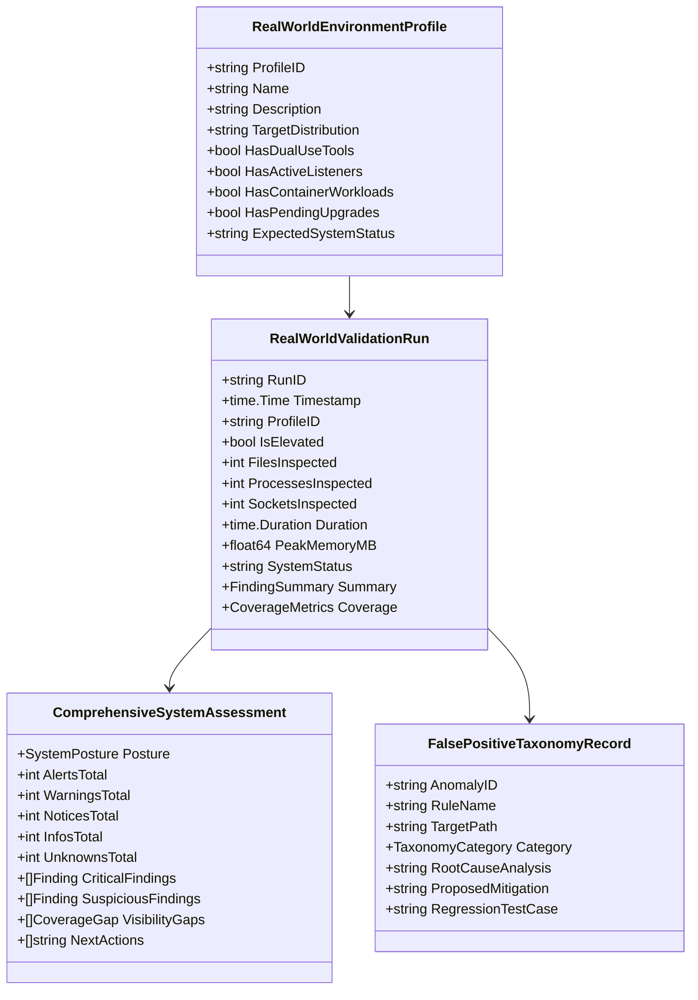

# Feature Specification: Real-World Linux Security Assessment & Reliability Validation

**Feature Branch**: `004-real-world-validation`
**Created**: 2026-10-04
**Status**: Draft
**Input**: User description: "AETHER — REAL-WORLD LINUX SECURITY ASSESSMENT & RELIABILITY VALIDATION"

---

## 1. Overview & Background

Aether has completed the implementation and validation of three foundational capabilities:
1. **Feature 001 (Trustworthy Detection & False-Positive Control)**: Established direct vs. contextual evidence weighting, cryptographic false-positive pinning, and the unified verdict engine (`SAFE`, `SUSPICIOUS`, `MALICIOUS`, `UNKNOWN`).
2. **Feature 002 (Detection Accuracy & Validation Benchmark)**: Constructed an automated, division-by-zero protected, hermetic benchmark engine measuring Precision (100%), Threat Recall (100%), False-Positive Rate (0%), F1-Score (1.0000), 8-Question Explainability (100%), and 10-run Determinism (100%).
3. **Feature 003 (Runtime Threat Assessment & Static/Runtime Correlation)**: Introduced passive kernel procfs socket auditing, non-disruptive process threat hunting, container namespace awareness, privilege degradation, and cross-domain correlation ($\ge 2$ operational domains elevating multi-vector threats), raising Suspicious Triage Accuracy on runtime-only fixtures from 33.33% to 100%.

While the Feature 002 and 003 benchmarks establish that Aether satisfies its mathematical quality gates on curated, synthetic test fixtures, **passing controlled unit and benchmark tests does not prove universal real-world reliability**. Synthetic corpora cannot fully capture the complexity, scale, dynamism, and nuance of production Linux installations:
- Curated benchmarks test static files and mock `/proc` states, whereas real systems have hundreds of thousands of files, thousands of short-lived processes, and dynamic network sockets opening and closing mid-scan.
- Synthetic fixtures have clear demarcations between clean and malicious code, whereas real workstations contain legitimate dual-use software (debuggers, penetration testing tools, packet sniffers, developer web servers, administrative shell pipelines) that share technical mechanisms with malicious tools.
- Real systems exhibit package manager upgrades where running executables are replaced or unlinked, mixed container namespaces, diverse distribution package databases (`dpkg`, `rpm`, `pacman`), and complex permission hierarchies.

```
+---------------------------------------------------------------------------------------------------+
|                                  THE REAL-WORLD VALIDATION GAP                                    |
|                                                                                                   |
|   CONTROLLED BENCHMARK WORLD (Features 002/003)         REAL LINUX SYSTEM WORLD (Feature 004)     |
|   - Synthetic, hermetic fixtures                       - 100,000+ files, 1,000+ processes         |
|   - Static, frozen state                               - Live runtime races (/proc changes)       |
|   - Binary clean vs. malicious distinction             - Dual-use admin, dev, and pentest tools   |
|   - Uniform mock package database                      - dpkg, rpm, pacman, flatpak, unmanaged    |
|   - Controlled mock non-root returns                   - Arbitrary DAC, capability, ACL limits    |
|   - Suspicious Triage = 100% on 3 fixtures             - Real Suspicious Triage across diverse OS |
+---------------------------------------------------------------------------------------------------+
                                                  |
                                                  v
+---------------------------------------------------------------------------------------------------+
|                              PRIMARY PRODUCT OBJECTIVE (Feature 004)                              |
|                                                                                                   |
|   Deliver a defensible answer to:                                                                 |
|   "Is anything malicious, suspicious, unauthorized, dangerous, persistent, or otherwise           |
|    security-relevant present or running on my Linux system?"                                      |
|                                                                                                   |
|   Validate Aether's assessment across:                                                            |
|   1. What exists (Filesystem)                  7. What evidence supports it (EvidenceRecord)      |
|   2. What is running (Processes)               8. What context was considered (ContextProfile)    |
|   3. What is persistent (Autostart/Cron)       9. What corroborates it (CorroboratingSignals)     |
|   4. What is listening (Sockets/Ports)         10. What could not be inspected (CoverageNotes)    |
|   5. What is suspicious (Warnings)             11. How confident the assessment is (Confidence)   |
|   6. What is malicious (Alerts)                12. What the user should investigate next (Action) |
+---------------------------------------------------------------------------------------------------+
```

Feature 004 establishes a comprehensive, read-only validation methodology to evaluate Aether on realistic Linux environments without executing live malware, without weaponizing payloads, and without mutating target systems.

---

## 2. User Scenarios & Testing *(mandatory)*

### User Story 1 - Real-World Workstation & Server Security Assessment (Priority: P1)

As a Linux systems administrator or security auditor, I want to run `aether scan --full` on a production workstation or server and receive a clear, defensible, high-level executive security status (`SAFE`, `ATTENTION REQUIRED`, `HIGH RISK`, or `LIMITED VISIBILITY`) with prioritized findings, so that I can immediately understand whether the system has been compromised, requires maintenance, or has uninspected blind spots.

**Why this priority**: This is the core product purpose of Aether. A security assessment tool is only as valuable as the clarity, accuracy, and defensibility of its overall system posture report when applied to actual machines.

**Independent Test**: Execute full scans across reproducible benign profiles (normal desktop, developer workstation, web server, minimal server) and verify that:
1. Systems with only benign background services report `SAFE` or `ATTENTION REQUIRED` (only for actionable hygiene like unlinked replaced binaries).
2. Systems never emit spurious `HIGH RISK` or `MALICIOUS` verdicts for baseline OS operations.
3. Every finding provides concrete, actionable remediation steps.

**Acceptance Scenarios**:
1. **Given** a standard Debian/Ubuntu desktop with common desktop services (PulseAudio/PipeWire, CUPS, NetworkManager, X11/Wayland), **When** Aether runs a full scan, **Then** it produces an overall status of `SAFE` or `ATTENTION REQUIRED` (with zero `ALERT` or `MALICIOUS` findings), accurately accounting for desktop socket listeners and user processes.
2. **Given** a production Linux server running Nginx, PostgreSQL, OpenSSH, and systemd journal daemons, **When** Aether performs an audit, **Then** all listening sockets owned by verified packages are classified as `VerdictSafe` with `INFO` severity, and the overall system status remains clean.
3. **Given** a system with pending service restarts after a distro upgrade (old binary held open in memory by daemon while disk binary has a new inode), **When** Aether runs, **Then** it categorizes the finding as `NOTICE` / `VerdictSuspicious` with clear explanation: "pending service restart post-package upgrade", rather than raising a malware alarm.
4. **Given** any high-confidence finding, **When** the user inspects the report, **Then** it details WHAT, WHERE, WHY, EVIDENCE, CONTEXT, CORROBORATION, CONFIDENCE, and REMEDIATION in plain language without exposing internal Go variable dumps.

---

### User Story 2 - Legitimate Dual-Use Software Discrimination (Priority: P1)

As a security engineer or developer running Aether on a cybersecurity workstation (e.g. Kali Linux, developer laptop with Metasploit, Nmap, Wireshark, GDB, or local Python HTTP test servers), I want Aether to distinguish the mere passive presence of dual-use tools from active malicious exploitation, so that my security research and development tools do not trigger false positive compromise alerts.

**Why this priority**: Security professionals and developers are the primary early adopters of host security tools. If Aether flags penetration testing frameworks or debugging utilities as active malware simply because they exist in `/usr/share` or `~/tools`, the tool loses trust immediately.

**Independent Test**: Run Aether across environments containing legitimate installations of: Metasploit modules, Nmap, Wireshark packet capture helpers, GDB/LLDB debuggers, Python development servers (`python3 -m http.server`), and developer virtualenvs. Verify that passive presence produces `NOTICE` or `INFO` (or contextual `WARNING` where unmanaged), while active weaponization (e.g., active reverse shell or rootkit hook) triggers `ALERT`.

**Acceptance Scenarios**:
1. **Given** an installed penetration-testing framework (e.g., `metasploit-framework` or `exploitdb` under package paths or standard pentest directories), **When** Aether scans the filesystem, **Then** it flags them with context `pentest_tool_path`, classifies the verdict as `VerdictSafe` (`INFO`), and notes that the files belong to an authorized pentest utility.
2. **Given** a developer executing `python3 -m http.server 8000` bound to localhost or an ephemeral port, **When** Aether inspects network listeners, **Then** it distinguishes the loopback/dev server context from an unmapped external C2 server, classifying it as `VerdictSafe` (`INFO`) if bound to loopback, or `VerdictSuspicious` (`WARNING`) if bound to wildcard `0.0.0.0` without package ownership, with low confidence.
3. **Given** a dual-use binary (e.g., `ncat` or `socat`) that is actively executing an interactive shell redirection (`sh -i` piped to an external IP), **When** Aether correlates the process with the active network socket, **Then** it elevates the finding to `ALERT` (`VerdictMalicious`, `StrengthCorroborated`), correctly detecting the weaponized usage despite the binary being dual-use.
4. **Given** administrative utility scripts in `/usr/local/bin` using `curl` or `rsync` for backups, **When** Aether inspects them, **Then** in the absence of active execution, cron persistence, or external exfiltration, it does not elevate them to malicious ransomware or stealers.

---

### User Story 3 - Runtime Dynamic Race & Snapshot Consistency Validation (Priority: P2)

As a Linux user scanning a live, actively running system, I want Aether to maintain stability, data consistency, and detection accuracy even when processes spawn, exit, or modify `/proc` state while a scan is in progress, so that transient operating system changes never cause crashes, corrupt reports, or spurious malware alerts.

**Why this priority**: Linux is dynamic. PIDs exit in milliseconds, ephemeral sockets close, and temporary files vanish. A forensic engine that panics on `ENOENT`, or that hallucinates a "deleted stealth executable" because a process exited between reading `/proc/<pid>/cmdline` and `/proc/<pid>/exe`, is unusable in production.

**Independent Test**: Execute automated stress tests where hundreds of short-lived processes (compilers, shell scripts, curl commands) spawn and terminate rapidly while Aether executes concurrent process, network, and filesystem inspection sweeps. Verify zero panics, zero unhandled errors, and zero false `ALERT` escalations from transient process death.

**Acceptance Scenarios**:
1. **Given** a short-lived process that terminates between Aether reading `/proc/<pid>/stat` and `/proc/<pid>/exe`, **When** Aether encounters `os.ErrNotExist` / `ENOENT`, **Then** it cleanly increments `SkippedVanished` in coverage metrics and continues without logging errors or emitting false findings.
2. **Given** a network socket that closes while Aether is correlating inode to PID via `/proc/<pid>/fd/*`, **When** the symlink target is missing, **Then** Aether safely marks the socket as transient or unmapped without claiming an adversary hid the socket.
3. **Given** a file deleted by a user or compiler while the filesystem walker is enqueuing it, **When** `safeopen.OpenRegularReadOnly` returns `ErrVanished`, **Then** Aether increments `SkippedVanished` without failing the scan.
4. **Given** multi-domain correlation running across accumulated findings, **When** findings reference PIDs that have since vanished, **Then** correlation evaluates the snapshot evidence recorded at discovery time without raising inconsistent verdict oscillations.

---

### User Story 4 - Multi-Environment Scale & Performance Profiling (Priority: P2)

As a systems engineer deploying Aether across servers of varying sizes (from 1GB RAM virtual machines to enterprise hosts with 500,000 files and 2,000 processes), I want Aether to adhere to predictable memory and execution budgets, so that scans complete in a reasonable timeframe without exhausting endpoint memory or degrading host performance.

**Why this priority**: Real-world utility requires predictable resource consumption. An auditing tool that consumes gigabytes of memory or locks disk I/O for hours will be killed by the Linux OOM-killer or disabled by administrators.

**Independent Test**: Benchmark Aether across simulated and real system hierarchies with varying file counts (10k, 50k, 200k+ files) and process counts (100, 500, 2000+ processes), measuring peak memory, CPU utilization, file throughput (files/sec), and duration breakdown.

**Acceptance Scenarios**:
1. **Given** a system with over 100,000 files in target inspection paths, **When** `aether scan --full` runs, **Then** peak memory usage remains strictly bounded within the configured `MemoryBudgetTracker` limit (default $\le 250\text{MB}$), with zero out-of-memory panics.
2. **Given** a multi-core host with default thread allocation, **When** filesystem scanning runs, **Then** sustained inspection throughput achieves at least 2,500 files/second on NVMe/SSD storage.
3. **Given** complete execution of `aether scan --full`, **When** the final summary is emitted, **Then** it provides an accurate duration breakdown distinguishing filesystem scan time, runtime process collection time, network socket collection time, and correlation pass time.

---

### User Story 5 - Privilege Boundary & Transparent Abstention Validation (Priority: P3)

As a security auditor executing Aether both with and without `sudo`/root privileges, I want Aether to clearly and transparently report what was inspected and what was hidden due to Linux DAC and capability restrictions, so that I never mistake an unprivileged blind spot for a clean bill of health.

**Why this priority**: Running as an unprivileged user cannot inspect other users' `/proc/<pid>/exe`, `/etc/shadow`, or restricted sockets. Collapsing `EACCES` into `SAFE` creates dangerous false negatives; guessing `MALICIOUS` creates alert fatigue. Aether must explicitly uphold `UNKNOWN != SAFE`.

**Independent Test**: Run identical audits on the same Linux host first as an unprivileged standard user (`UID >= 1000`), then as `root` (`UID 0`). Compare emitted findings and verify that unreadable targets are classified as `VerdictUnknown` with `StrengthIncomplete` and prominent `CoverageLimitations` notes.

**Acceptance Scenarios**:
1. **Given** an unprivileged user scan encountering `/proc/<pid>/exe` owned by root or another user (`EACCES`), **When** Aether audits processes, **Then** it increments `SkippedPermission`, flags `NonRootLimited = true`, emits `VerdictUnknown` for that target with `ConfidenceLow`, and displays a clear message: "Inspection limited by user permissions; re-run with sudo for full visibility".
2. **Given** an unprivileged user scan encountering `/etc/shadow` or restricted PAM configuration files, **When** persistence and user modules run, **Then** they record unreadable paths in `CheckCoverage.UnreadablePaths` without crashing and without declaring `/etc/shadow` clean.
3. **Given** the overall system status calculation for an unprivileged scan with missing visibility, **When** any core inspection area is partially unreadable, **Then** the executive status reflects `LIMITED VISIBILITY` rather than a misleading `SAFE`.

---

### User Story 6 - False-Positive Taxonomy & Regression Capture (Priority: P3)

As a detection engineer maintaining Aether, I want every false positive and edge case identified during real-world validation to be categorized by root cause and automatically convertible into a deterministic, hermetic regression test, so that field discoveries permanently prevent regression without compromising the integrity of the controlled benchmark.

**Why this priority**: Continuous reliability improvement requires systematic feedback loops. Ad-hoc fixes lead to whack-a-mole regressions; systematic taxonomy ensures every field lesson becomes a permanent automated safeguard.

**Independent Test**: Ingest findings from diverse real-world profiles into an automated regression verification suite. Verify that each finding is classified under the defined false-positive taxonomy and mapped to an isolated test case.

**Acceptance Scenarios**:
1. **Given** an unexpected finding discovered during a real-world scan, **When** an analyst assesses the finding, **Then** the validation framework provides a structured taxonomy to classify the root cause (e.g., `MISSING_CONTEXT`, `WEAK_HEURISTIC`, `DUAL_USE_TOOL`, `PACKAGE_DB_MISMATCH`, `RUNTIME_RACE`, `NAMESPACE_ISOLATION`).
2. **Given** a confirmed false positive, **When** a fix is developed, **Then** a companion synthetic regression fixture is added to `testdata/benchmark_corpus/` or package unit tests, ensuring the scenario remains permanently covered in automated CI.
3. **Given** new real-world validation fixtures, **When** the validation suite runs, **Then** real-world evaluation metrics are reported separately from Feature 002/003 controlled benchmark scores to prevent polluting immutable benchmark gates.

---

## 3. Edge Cases

- **Vanishing `/proc` Nodes**: Process terminates between directory read of `/proc` and opening `/proc/<pid>/stat` or `/proc/<pid>/exe`. Must return `ErrVanished`, increment counters, and cleanly continue.
- **Nested & Overlapping Container Namespaces**: Podman rootless containers where `/proc/<pid>/ns/mnt` differs from host PID 1, and mapped UID on host differs from container internal UID 0. Must record namespace discrepancy without assuming container root equals host root.
- **Package Upgrades During Scan**: Inode of `/usr/bin/daemon` changes on disk while Aether is traversing `/usr/bin`. Must not confuse the changed inode with unauthorized tampering; check package database verification state.
- **High-Density Ephemeral Workers**: CI/CD build agents executing thousands of transient compiler processes (`cc1`, `rustc`, `go build`). Must avoid memory bloat from tracking millions of dead processes; use bounded caches and time-based garbage collection for process records.
- **Read-Only / Immutable Host Filesystems**: Systems running with `ro` root mount (e.g. ostree, Fedora Silverblue, microOS) where `/tmp` is tmpfs and `/var` is writable. Must adapt path heuristics to recognize read-only system immutable roots.
- **Broken Symlink Forests**: Deep recursive symlinks or dangling symlinks in `/usr/lib` or `/var`. Traversal must strictly respect `O_NOFOLLOW` and avoid infinite loops.
- **Chrooted Daemons**: Services running inside `/var/chroot/...` with duplicated `/dev`, `/etc`, and `/lib`. Must recognize chroot boundaries and not flag standard system libraries as suspicious anomalies in `/var`.

---

## 4. Requirements *(mandatory)*

### Functional Requirements

#### A. Real-World Environment Matrix & Profiles
- **FR-001**: The system MUST define a reproducible matrix of at least 8 distinct real-world environment profiles:
  1. `desktop-standard`: Standard Linux desktop with audio, display server, network managers, and user apps.
  2. `workstation-dev`: Development machine with Go, Rust, Python, Node.js toolchains, build caches, and test fixtures.
  3. `workstation-pentest`: Security workstation with Metasploit, Nmap, Wireshark, GDB, ExploitDB, and pentest packages.
  4. `server-web`: Production web server running Nginx/Apache, PostgreSQL/MySQL, systemd units, and SSL certificates.
  5. `server-minimal`: Minimal cloud base image (e.g. Debian minimal, Alpine) with minimal packages and root-only daemons.
  6. `container-host`: System running Docker/Podman engines with active multi-tenant container workloads.
  7. `package-mixed`: System with mixed package managers (system `dpkg`/`rpm`, plus Flatpak, Snap, and pip/cargo user installs).
  8. `upgraded-pending`: System with active daemons running unlinked binaries following a package upgrade.
- **FR-002**: Validation on each profile MUST be executable safely without requiring root privileges, while supporting elevated verification where appropriate.
- **FR-003**: The validation framework MUST support evaluating both live hosts and captured read-only system snapshots (`rootFS` + `procRoot` + `sysRoot`) for hermetic, non-destructive testing.

#### B. Legitimate Dual-Use Software & Context Evaluation
- **FR-004**: The system MUST distinguish between passive presence of dual-use tools and active malicious exploitation.
- **FR-005**: Legitimate penetration-testing tools, vulnerability scanners, debuggers, development servers, and admin scripts located in recognized package paths, standard tool paths, or developer directories MUST NOT trigger `ALERT` or `VerdictMalicious` in the absence of corroborating attack behavior.
- **FR-006**: Dual-use tools actively exhibiting corroborated attack patterns (e.g. interactive shell redirection to remote hosts, unmapped wildcard listeners with root privilege, or autostart persistence hooks) MUST be elevated to `ALERT` (`VerdictMalicious`, `StrengthCorroborated`).
- **FR-007**: The system MUST recognize package ownership via `pkgdb` as strong contextual evidence against malice, but MUST NOT treat package ownership as universal immunity when direct cryptographic IOCs or explicit malware signatures match.

#### C. Runtime Dynamic State & Race Resilience
- **FR-008**: The system MUST handle transient `/proc` entries gracefully; when a PID terminates or a socket closes mid-scan, the system MUST NOT panic, MUST NOT log spurious operational errors, and MUST NOT emit false malicious findings.
- **FR-009**: The system MUST track runtime race events in structured coverage statistics (`SkippedVanished`, `KernelThreadsSkipped`, `ZombiesSkipped`).
- **FR-010**: Aether MUST NOT require the host operating system to freeze or pause during scanning.
- **FR-011**: In-memory inspection routines MUST verify that process status has not transitioned to zombie (`Z`) or dead (`X`) before attempting to inspect `/proc/<pid>/maps` or `/proc/<pid>/exe`.

#### D. Realistic System Scale & Resource Profiling
- **FR-012**: The system MUST adhere to a strict memory budget limit ($\le 250\text{MB}$ peak RSS by default) regardless of total filesystem size or process count.
- **FR-013**: The system MUST benchmark and log duration breakdowns across: (1) filesystem crawl, (2) runtime process collection, (3) runtime network collection, (4) persistence auditing, and (5) cross-domain correlation.
- **FR-014**: Filesystem inspection throughput MUST sustain at least 2,500 regular files per second on solid-state storage.
- **FR-015**: The memory budget tracker (`scanner.MemoryBudgetTracker`) MUST enforce hard concurrency bounds on concurrent large-file buffering to prevent OOM termination.

#### E. Permission Boundaries & Transparent Abstention
- **FR-016**: When run as an unprivileged user, the system MUST accurately identify DAC/capability boundaries (`EACCES`, `EPERM`) and track them in `CoverageLimitations`.
- **FR-017**: Unreadable files or processes MUST emit `VerdictUnknown` with `StrengthIncomplete` and `ConfidenceLow`; the system MUST NEVER convert inaccessible targets into `SAFE` or guess `MALICIOUS`.
- **FR-018**: The overall system posture MUST reflect `LIMITED VISIBILITY` whenever core security checks encounter permission boundaries that prevent a confident assessment.

#### F. Cross-Domain Correlation Integrity
- **FR-019**: The correlation engine MUST correlate across at least 4 operational domains: `DomainFilesystem`, `DomainProcess`, `DomainNetwork`, and `DomainPersistence`.
- **FR-020**: Elevation of contextual anomalies to `ALERT` (`VerdictMalicious`, `StrengthCorroborated`) MUST strictly require evidence from $\ge 2$ independent operational domains.
- **FR-021**: The correlation engine MUST prevent double-counting multiple findings within the same operational domain as independent corroboration.

#### G. False-Positive Categorization & Regression Ingestion
- **FR-022**: The validation framework MUST implement a standardized false-positive taxonomy classifying anomalies into:
  - `FP_MISSING_CONTEXT`: Legitimate file/process matching a broad heuristic without domain context.
  - `FP_WEAK_HEURISTIC`: Rule pattern too generic for production Linux environments.
  - `FP_DUAL_USE_TOOL`: Passive security, debugging, or admin tool misidentified as malware.
  - `FP_PACKAGE_MISMATCH`: Legitimate file missed by package manager queries.
  - `FP_RUNTIME_RACE`: Transient process termination or socket closure misinterpreted as evasion.
  - `FP_NAMESPACE_ISOLATION`: Containerized workload evaluated against host root assumptions.
  - `FP_ENVIRONMENTAL`: Harmless distribution-specific configuration file in `/etc`.
- **FR-023**: Every confirmed false-positive finding MUST be ingested as a permanent, deterministic regression test case.

#### H. User-Facing Assessment & Full Scan Workflow
- **FR-024**: The output of `aether scan --full` MUST produce an executive summary answering:
  - **SYSTEM STATUS**: `SAFE` | `ATTENTION REQUIRED` | `HIGH RISK` | `LIMITED VISIBILITY`
  - Total assets inspected (files, processes, sockets, persistence hooks)
  - Critical / high findings requiring immediate response
  - Suspicious anomalies requiring review
  - Incomplete / uninspected items due to permission limits
  - Recommended next actions prioritized by severity
- **FR-025**: Every finding MUST satisfy the 8-Question Explainability Standard:
  1. WHAT: Human-readable threat title
  2. WHERE: Exact path, PID, or socket
  3. WHY: Plain-English danger explanation
  4. EVIDENCE: Matched pattern, hash, or IOC
  5. CONTEXT: Package status, location profile, namespace
  6. CORROBORATION: Independent cross-domain signals
  7. CONFIDENCE: High / Medium / Low with rationale
  8. REMEDIATION: Concrete containment and investigation instructions
- **FR-026**: Report output MUST maintain format parity across terminal (`--plain`), JSON (`--json-out`), TUI (`--tui`), and offline HTML (`--html-out`).

#### I. Forensic Safety & Benchmark Separation
- **FR-027**: All validation workflows MUST remain strictly read-only: zero payload execution, zero process killing, zero syscall mutation, and zero forensic contamination.
- **FR-028**: Real-world validation metrics MUST be reported independently of Feature 002/003 controlled benchmark scorecards to preserve immutable benchmark gates.

---

### Key Entities



- **`RealWorldEnvironmentProfile`**: Defines a standardized testing environment representing a specific class of Linux installation (desktop, developer workstation, server, pentest box, container host).
- **`RealWorldValidationRun`**: Captures the complete execution metrics, findings, and performance telemetry of an audit run across an environment profile.
- **`FalsePositiveTaxonomyRecord`**: Classifies and documents any false alarm or unexpected finding encountered during validation, tracking its root cause and corresponding regression test case.
- **`ComprehensiveSystemAssessment`**: The high-level executive posture document synthesizing findings, visibility gaps, and prioritized next steps for human system operators.

---

## 5. Success Criteria *(mandatory)*

### Measurable Outcomes

- **SC-001 (Zero Execution Invariant)**: 100% of validation tests MUST complete without executing any binary, invoking any test payload, killing any process, or mutating any host timestamp.
- **SC-002 (Dual-Use Tool Discrimination)**: On legitimate cybersecurity/pentest profiles (`workstation-pentest`), passive dual-use tools MUST achieve $\ge 95.0\%$ triage accuracy, producing zero false `ALERT` or `VerdictMalicious` findings in the absence of active exploitation.
- **SC-003 (Clean Environment Noise Floor)**: On standard benign workstation and server profiles (`desktop-standard`, `server-web`, `server-minimal`), the engine MUST produce zero false `ALERT` findings and an False-Positive Rate of $\le 1.0\%$ across all inspected assets.
- **SC-004 (Runtime Race Immunity)**: Across 50 concurrent stress-test iterations with rapid process creation and termination, Aether MUST achieve 0 crashes, 0 unhandled panics, and 0 false malware alerts attributed to vanishing PIDs or sockets.
- **SC-005 (Resource & Throughput Bounds)**: Full system scans MUST maintain peak memory consumption $\le 250\text{MB}$ RSS on standard scans, sustaining an average throughput of $\ge 2,500$ files/second on SSD storage.
- **SC-006 (Explainability Standard)**: 100% of reported findings across all real-world profiles MUST provide complete, plain-English answers to all 8 explainability questions without raw internal data structure dumps.
- **SC-007 (Transparent Abstention Parity)**: When scanning restricted paths as an unprivileged user, 100% of permission-denied targets MUST emit `VerdictUnknown` with `StrengthIncomplete`; zero inaccessible targets may be converted to `SAFE` or `MALICIOUS`.
- **SC-008 (Permanent Regression Conversion)**: 100% of confirmed false positives or triage discrepancies identified during field validation MUST be captured as permanent, hermetic regression test cases.
- **SC-009 (Benchmark Authority Isolation)**: Controlled benchmark scorecards (Feature 002/003) MUST remain completely isolated and intact; real-world validation data MUST NOT alter immutable benchmark ground truths.

---

## 6. Assumptions

- **A-001 (Supported OS)**: Target Linux environments use Linux kernel $\ge 4.19$ with standard `/proc`, `/sys`, and `/etc` filesystems, and a standard init system (systemd or OpenRC).
- **A-002 (Package Managers)**: Supported package databases include `dpkg` (Debian/Ubuntu), `rpm` (RHEL/CentOS/Fedora/Rocky), `pacman` (Arch), and unmanaged systems. Proprietary package managers or custom chroots are treated as unmanaged.
- **A-003 (Read-Only Safety)**: Real-world validation testing will utilize safe non-modifying operations, read-only system snapshots, and inert test fixtures; live malware payloads will never be executed on validation endpoints.
- **A-004 (Non-Root Visibility)**: When running without elevated privileges, the Linux kernel strictly blocks access to `/proc/<pid>/exe`, `/proc/<pid>/maps`, `/proc/<pid>/fd`, and `/proc/<pid>/cmdline` of processes owned by other users unless `CAP_SYS_PTRACE` or `CAP_DAC_READ_SEARCH` is granted.
- **A-005 (Dual-Use Definitions)**: Standard penetration testing frameworks (Metasploit, Nmap, Wireshark, ExploitDB) and debugging tools (GDB, strace, ltrace) installed in standard package directories or user tool directories are considered authorized unless active unauthorized behavior is detected.
- **A-006 (Network Listeners)**: Sockets listening strictly on `127.0.0.1` or `::1` are assumed to serve local inter-process communication or local development unless linked to external tunneling or direct malware IOCs.

