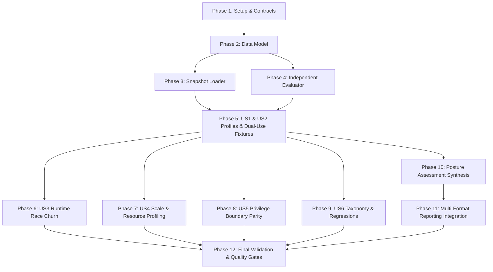

# Tasks: Real-World Linux Security Assessment & Reliability Validation

**Feature**: `004-real-world-validation`
**Input Design Artifacts**:
- `specs/004-real-world-validation/spec.md`
- `specs/004-real-world-validation/plan.md`
- `specs/004-real-world-validation/research.md`
- `specs/004-real-world-validation/data-model.md`
- `specs/004-real-world-validation/quickstart.md`
- `specs/004-real-world-validation/contracts/*`
- `.specify/memory/constitution.md`
- Feature 001, Feature 002, Feature 003 specifications and source code

---

## Phase 1: Setup & Contracts

**Purpose**: Establish package structure, test corpora directories, and validate formal contract schemas.

- [X] T001 Create directory structure for real-world validation in `internal/realworld/`, `test/realworld/`, `testdata/realworld_corpus/profiles/`, and `testdata/realworld_corpus/regressions/`
- [X] T002 [P] Implement schema validation tests in `internal/realworld/contracts_test.go` verifying `contracts/profile-manifest-schema.json`, `contracts/system-assessment-schema.json`, and `contracts/validation-run-schema.json`

---

## Phase 2: Real-World Validation Data Model

**Purpose**: Implement foundational types, manifest structures, timing breakdowns, and anomaly taxonomy models.

- [X] T003 [P] Implement core profile and manifest types (`RealWorldEnvironmentProfile`, `ProfileManifest`, `AcceptableFindingRule`, `ForbiddenFindingRule`, `DualUseSoftwareCatalogEntry`, `DurationBreakdown`, `RealWorldValidationRun`) in `internal/realworld/types.go` quoting enum constraints from `data-model.md`
- [X] T004 [P] Implement anomaly taxonomy definitions and records (`AnomalyTaxonomyCategory`, `FalsePositiveTaxonomyRecord`, `CoverageGap`, `PrioritizedAction`) in `internal/realworld/taxonomy.go`

---

## Phase 3: Environment & Profile Snapshot Loading

**Purpose**: Implement hermetic snapshot loading for diverse Linux distributions and filesystem hierarchies.

- [X] T005 [P] Unit tests for profile manifest parsing, validation against schema, and snapshot path normalization in `internal/realworld/loader_test.go`
- [X] T006 Implement `ProfileLoader` and `SnapshotLoader` supporting hermetic `rootFS`, `procRoot`, and `sysRoot` loading with package DB resolution in `internal/realworld/loader.go`

---

## Phase 4: Independent Compliance Evaluator

**Purpose**: Implement external ground truth verification comparing Aether's actual findings against independent manifest expectations without modifying production detection logic.

- [X] T007 [P] Unit tests for manifest compliance evaluator (asserting expected posture, allowed findings, forbidden findings, and dual-use tool verification) in `internal/realworld/evaluator_test.go`
- [X] T008 Implement independent `ComplianceEvaluator` in `internal/realworld/evaluator.go` comparing actual `report.Finding` results against `ProfileManifest` expectations

---

## Phase 5: User Story 1 & 2 - Environment Profiles and Benign/Dual-Use Software Fixtures (Priority: P1) 🎯 MVP

**Goal**: Deliver end-to-end security assessment across realistic benign desktop/server profiles and ensure legitimate penetration-testing and development software are distinguished from active malicious behavior.

**Independent Test**: Execute `go test -v ./test/realworld/... -run TestRealWorldEnvironmentProfiles` and assert 0 false `ALERT` findings on benign profiles, and triage accuracy $\ge 95.0\%$ on dual-use tools in `TestDualUseToolDiscrimination`.

### Tests for User Story 1 & 2

- [X] T009 [P] [US1] Create hermetic snapshot and manifest for `desktop-standard` (`testdata/realworld_corpus/profiles/desktop-standard/profile_manifest.json`) with clean `dpkg` database, PulseAudio/PipeWire/X11 processes, and loopback sockets
- [X] T010 [P] [US1] Create hermetic snapshot and manifest for `server-web` (`testdata/realworld_corpus/profiles/server-web/profile_manifest.json`) with Nginx, PostgreSQL, OpenSSH listeners on ports 80/443/22 owned by verified packages
- [X] T011 [P] [US1] Create hermetic snapshot and manifest for `server-minimal` (`testdata/realworld_corpus/profiles/server-minimal/profile_manifest.json`) with minimal packages and single SSH port 22 listener
- [X] T012 [P] [US1] Create hermetic snapshot and manifest for `upgraded-pending` (`testdata/realworld_corpus/profiles/upgraded-pending/profile_manifest.json`) with running daemon holding unlinked binary replaced on disk
- [X] T013 [P] [US2] Create hermetic snapshot and manifest for `workstation-pentest` (`testdata/realworld_corpus/profiles/workstation-pentest/profile_manifest.json`) with passive Metasploit, Nmap, Wireshark, GDB, ExploitDB fixtures
- [X] T014 [P] [US2] Create hermetic snapshot and manifest for `workstation-dev` (`testdata/realworld_corpus/profiles/workstation-dev/profile_manifest.json`) with Go/Rust/Python build trees and Python loopback dev server (`127.0.0.1:8000`)
- [X] T015 [P] [US1] Create hermetic snapshot and manifest for `container-host` (`testdata/realworld_corpus/profiles/container-host/profile_manifest.json`) with Docker/containerd processes and isolated mount namespaces
- [X] T016 [P] [US1] Create hermetic snapshot and manifest for `package-mixed` (`testdata/realworld_corpus/profiles/package-mixed/profile_manifest.json`) with system `dpkg`, Flatpak runtimes, and user `~/.local/bin` binaries

### Implementation for User Story 1 & 2

- [X] T017 [US1] Implement environment profiles integration test suite in `test/realworld/profiles_test.go` evaluating all 8 environment profiles against manifests, asserting expected posture and 0 false `ALERT` findings
- [X] T018 [US2] Implement dual-use software discrimination test suite in `test/realworld/dual_use_test.go` verifying passive tools remain `SAFE` (`INFO`) while active weaponized shells elevate to `ALERT` (`StrengthCorroborated`)

**Checkpoint**: At this point, User Stories 1 and 2 are fully functional and verifiable across the 8 environment profiles.

---

## Phase 6: User Story 3 - Runtime Dynamic Race & Churn Validation (Priority: P2)

**Goal**: Verify engine stability and error-handling resilience under rapid process creation/termination and ephemeral socket churn without panics, crashes, or false malware findings.

**Independent Test**: Execute `go test -v ./test/realworld/... -run TestRuntimeRaceStress` over 50 iterations and assert 0 crashes, 0 false `ALERT` findings, and accurate `SkippedVanished` metrics.

### Tests & Implementation for User Story 3

- [X] T019 [P] [US3] Implement concurrent race stress generator (`RaceHarness`) in `internal/realworld/race_harness.go` producing rapid process spawning/dying, ephemeral socket creation/closure, and temporary file deletion
- [X] T020 [US3] Implement runtime race stress integration test suite in `test/realworld/race_test.go` executing 50 concurrent iterations of high-churn process stress while running Aether inspection sweeps, asserting 0 crashes and 0 false alerts

**Checkpoint**: Runtime dynamic race resilience is proven under active Linux multitasking churn.

---

## Phase 7: User Story 4 - Multi-Environment Scale, Performance & Resource Profiling (Priority: P2)

**Goal**: Benchmark execution duration, throughput, and memory consumption across realistic file scale (10k, 50k, 100k files) ensuring peak RSS $\le 250\text{MB}$ and throughput $\ge 2,500$ files/second.

**Independent Test**: Execute `go test -v ./test/realworld/... -run TestRealWorldScaleAndMemory` and verify memory bounds and subsystem duration breakdowns.

### Tests & Implementation for User Story 4

- [X] T021 [P] [US4] Implement dense hierarchy scale generator and memory profiler in `internal/realworld/scale_benchmark.go` measuring resident set size (RSS) via `/proc/self/statm` and Go runtime `ReadMemStats`
- [X] T022 [US4] Implement subsystem timing telemetry in `internal/realworld/metrics.go` calculating duration breakdowns across filesystem walk, hashing, heuristics, YARA, process, network, and correlation
- [X] T023 [US4] Implement scale, throughput, and memory budget benchmark suite in `test/realworld/scale_test.go` evaluating 10k, 50k, and 100k file hierarchies, asserting throughput $\ge 2,500$ files/sec and memory $\le 250\text{MB}$ RSS under documented baseline hardware

**Checkpoint**: Resource consumption, memory budget safety, and throughput bounds are verified.

---

## Phase 8: User Story 5 - Privilege Boundary & Transparent Abstention Validation (Priority: P3)

**Goal**: Verify that running unprivileged accurately tracks DAC/capability boundaries (`EACCES`), emits `VerdictUnknown` with `StrengthIncomplete`, and reports `LIMITED VISIBILITY` without guessing.

**Independent Test**: Execute `go test -v ./test/realworld/... -run TestPrivilegeBoundaryParity` comparing unprivileged vs. root audit runs.

### Tests & Implementation for User Story 5

- [X] T024 [P] [US5] Create mock DAC/capability restricted snapshot (`testdata/realworld_corpus/profiles/privilege-restricted/profile_manifest.json`) with simulated root-only processes and permission-denied `/etc/shadow`
- [X] T025 [US5] Implement privilege boundary parity test suite in `test/realworld/privilege_test.go` asserting unprivileged runs emit `VerdictUnknown` on inaccessible targets and synthesize posture `LIMITED VISIBILITY`

**Checkpoint**: Transparent abstention parity (`UNKNOWN != SAFE`) is formally verified.

---

## Phase 9: User Story 6 - False-Positive Taxonomy & Regression Capture (Priority: P3)

**Goal**: Standardize root-cause anomaly categorization (`FP_*`, `FN_*`) and establish an automated pipeline converting field anomalies into permanent, hermetic regression fixtures.

**Independent Test**: Execute `go test -v ./test/realworld/... -run TestFalsePositiveTaxonomyRegression` and verify anomaly categorization and companion regression test execution.

### Tests & Implementation for User Story 6

- [X] T026 [P] [US6] Implement automated anomaly taxonomy categorizer in `internal/realworld/taxonomy.go` classifying findings into `FP_MISSING_CONTEXT`, `FP_WEAK_HEURISTIC`, `FP_DUAL_USE_TOOL`, `FP_PACKAGE_MISMATCH`, `FP_RUNTIME_RACE`, `FP_NAMESPACE_ISOLATION`, `FP_ENVIRONMENTAL`, and equivalent `FN_*` categories
- [X] T027 [US6] Implement regression fixture writer in `internal/realworld/regression_writer.go` generating minimal, reproducible test fixtures under `testdata/realworld_corpus/regressions/`
- [X] T028 [US6] Implement permanent real-world regression test runner in `test/realworld/regression_test.go` verifying that all ingested field anomalies permanently pass without regression

**Checkpoint**: The field anomaly feedback loop is complete and automated.

---

## Phase 10: Executive System Assessment Synthesis

**Purpose**: Synthesize overall host posture (`SAFE`, `ATTENTION REQUIRED`, `HIGH RISK`, `LIMITED VISIBILITY`) with prioritized action recommendations.

- [X] T029 [P] [US1] Implement executive system posture synthesizer in `internal/realworld/assessment.go` calculating `SAFE`, `ATTENTION_REQUIRED`, `HIGH_RISK`, or `LIMITED_VISIBILITY`, synthesizing critical findings, visibility gaps, and prioritized action recommendations
- [X] T030 [US1] Implement assessment unit and contract tests in `internal/realworld/assessment_test.go` validating posture transitions and schema compliance with `contracts/system-assessment-schema.json`

---

## Phase 11: Output & Multi-Format Report Integration

**Purpose**: Wire executive posture cards, duration breakdowns, and prioritized recommendations into terminal, offline HTML, and JSON reports.

- [X] T031 [P] [US1] Update plain terminal reporting in `internal/ui/plain/card.go` and `internal/ui/plain/header.go` to render executive posture card, duration breakdown, and prioritized action recommendations
- [X] T032 [P] [US1] Update offline HTML report in `internal/report/html/html.go` and `internal/report/html/template.go` to render executive posture badge, timing breakdown, and remediation plan with inline CSS/SVG and zero external dependencies
- [X] T033 [US1] Wire `cmd/aether/main.go` full scan workflow (`--full`) to synthesize executive assessment and format across plain, JSON stream, and HTML outputs

---

## Phase 12: Polish, Explainability, Determinism & Final Quality Gates

**Purpose**: Cross-cutting explainability verification, concurrent determinism, benchmark isolation, and full repository verification.

- [X] T034 [P] Verify 100% substantive 8-question explainability compliance across all real-world findings in `test/realworld/explainability_test.go`
- [X] T035 [P] Verify byte-for-byte 10-run determinism across real-world profiles in `test/realworld/determinism_test.go`
- [X] T036 Verify complete separation and preservation of Feature 002/003 controlled benchmarks in `test/realworld/benchmark_isolation_test.go`
- [X] T037 Run complete validation suite across all packages: `go test ./...`, `go test -tags yara ./...`, and `go test -race ./internal/realworld/... ./test/realworld/...`

---

## Dependencies & Execution Order

### Phase Dependencies

### Parallel Opportunities

- **Phase 1**: T001, T002 can execute in parallel.
- **Phase 2**: T003, T004 can execute in parallel.
- **Phase 5**: Fixtures T009 through T016 can all be created in parallel.
- **Phase 6, 7, 8, 9**: Runtime race (US3), Scale benchmark (US4), Privilege parity (US5), and Taxonomy (US6) can execute in parallel after Phase 5.
- **Phase 11**: Terminal updates (T031) and HTML updates (T032) can execute in parallel.
- **Phase 12**: Explainability (T034), Determinism (T035), and Benchmark Isolation (T036) can execute in parallel.

---

## Implementation Strategy

### MVP First (User Story 1 & 2: Environment Profiles & Dual-Use Software)
1. Complete Phase 1 (Setup), Phase 2 (Data Model), Phase 3 (Loader), and Phase 4 (Evaluator).
2. Implement Phase 5 (8 Environment Profiles & Dual-Use Fixtures: US1 & US2).
3. Validate benign profiles remain `SAFE` and passive dual-use tools are distinguished from active attacks.

### Incremental Delivery
1. Add Phase 6 (Runtime Race Churn: US3) $\rightarrow$ Verify zero panics under process churn.
2. Add Phase 7 (Scale & Resource Profiling: US4) $\rightarrow$ Verify $\le 250\text{MB}$ memory and $\ge 2,500$ files/sec.
3. Add Phase 8 (Privilege Boundary: US5) $\rightarrow$ Verify `UNKNOWN` and `LIMITED VISIBILITY`.
4. Add Phase 9 (Taxonomy & Regressions: US6) $\rightarrow$ Ingest field anomalies into permanent tests.
5. Add Phase 10 & 11 (Assessment Synthesis & Reporting) $\rightarrow$ Polish executive dashboard across plain, HTML, JSON.
6. Execute Phase 12 (Full Verification & Benchmark Isolation).

