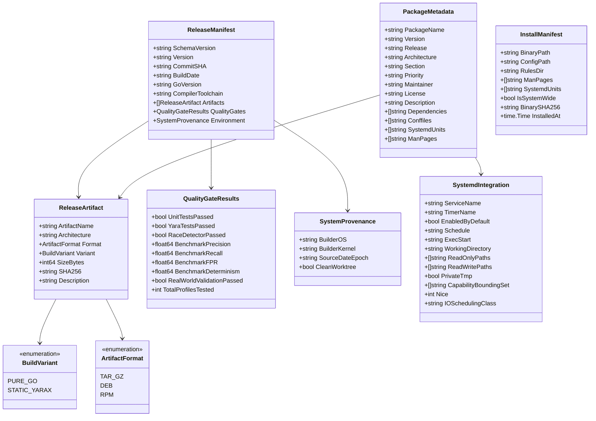

# Data Model: v1.0.0 Packaging, Release Engineering & Distribution

**Feature Branch**: `005-packaging-and-release`  
**Created**: 2026-10-04  
**Status**: Completed  
**Spec**: [specs/005-packaging-and-release/spec.md](spec.md)

---

## 1. Entity Overview

The packaging and release engineering system models release artifacts, build variants, packaging metadata, systemd integrations, and provenance records to ensure reproducible and secure software delivery.

---

## 2. Entity Definitions

### 2.1 ReleaseManifest

The root document representing the verified, immutable metadata of a v1.0.0 release.

| Field | Type | Description | Validation Rules |
| :--- | :--- | :--- | :--- |
| `SchemaVersion` | string | Schema version of the manifest format. | Must equal `"1.0.0"`. |
| `Version` | string | Semantic release version. | Must match semver (e.g. `"1.0.0"`). |
| `CommitSHA` | string | Git commit hash of the release source. | 40-character hexadecimal string or 7-character short SHA. |
| `BuildDate` | string | ISO-8601 UTC timestamp of build. | Must match format `YYYY-MM-DDTHH:MM:SSZ`. |
| `GoVersion` | string | Version of the Go compiler used. | e.g. `"go1.26.8"`. |
| `CompilerToolchain` | string | Full toolchain identification. | e.g. `"linux/amd64"`. |
| `Artifacts` | []ReleaseArtifact | Array of produced software packages. | Exactly 7 software packages (3 tarballs, 2 debs, 2 rpms). |
| `QualityGates` | QualityGateResults | Verification outcomes from pre-release testing. | All test gates must be `true` and benchmarks 100%. |
| `Environment` | SystemProvenance | Information regarding the build environment. | Required for build traceability. |

---

### 2.2 ReleaseArtifact

Represents an individual distributable file produced by the packaging pipeline.

| Field | Type | Description | Validation Rules |
| :--- | :--- | :--- | :--- |
| `ArtifactName` | string | Filename of the artifact. | Non-empty, conforming to artifact naming standards. |
| `Architecture` | string | Target hardware architecture. | `"amd64"` (x86_64) or `"arm64"` (aarch64). |
| `Format` | ArtifactFormat | Archive/packaging container format. | Enum: `"tar.gz"`, `"deb"`, `"rpm"`. |
| `Variant` | BuildVariant | Internal engine variant. | Enum: `"PURE_GO"` or `"STATIC_YARAX"`. |
| `SizeBytes` | int64 | Exact byte length of the file on disk. | Must be $> 0$. |
| `SHA256` | string | Cryptographic SHA-256 hash of the artifact. | 64-character lowercase hex string. |
| `Description` | string | Human-readable description of artifact purpose. | Non-empty string. |

---

### 2.3 QualityGateResults

Captures the results of automated test suite and benchmark execution prior to release generation.

| Field | Type | Description | Acceptance Criteria |
| :--- | :--- | :--- | :--- |
| `UnitTestsPassed` | bool | Outcome of `go test ./...`. | Must be `true` (100% pass). |
| `YaraTestsPassed` | bool | Outcome of `go test -tags yara ./...`. | Must be `true` (100% pass). |
| `RaceDetectorPassed` | bool | Outcome of `go test -race -short ./...`. | Must be `true` (0 data races detected). |
| `BenchmarkPrecision` | float64 | Precision score on Feature 002 benchmark. | Must equal `1.0000` (100.0%). |
| `BenchmarkRecall` | float64 | Recall score on Feature 002 benchmark. | Must equal `1.0000` (100.0%). |
| `BenchmarkFPR` | float64 | False Positive Rate on Feature 002 benchmark. | Must equal `0.0000` (0.0%). |
| `BenchmarkDeterminism` | float64 | 10-run byte-for-byte determinism score. | Must equal `1.0000` (100.0%). |
| `RealWorldValidationPassed` | bool | Outcome of Feature 004 real-world validation. | Must be `true` (zero crashes, memory within bounds). |
| `TotalProfilesTested` | int | Count of real-world environment profiles run. | Must be $\ge 8$. |

---

### 2.4 PackageMetadata

Defines Debian (`control`) and RPM (`.spec`) packaging configuration.

| Field | Type | Description | Standards Reference |
| :--- | :--- | :--- | :--- |
| `PackageName` | string | Name of package. | `"aether"`. |
| `Version` | string | Package upstream version. | `"1.0.0"`. |
| `Release` | string | Package distribution revision. | `"1"` (RPM) or `"1"` (Debian). |
| `Architecture` | string | Debian (`amd64`, `arm64`) or RPM (`x86_64`, `aarch64`). | Standard architecture tokens. |
| `Section` | string | Package classification section. | `"admin"` or `"security"`. |
| `Priority` | string | Package priority. | `"optional"`. |
| `Maintainer` | string | Package author/team identification. | `"Aether Security Team <security@aether-project.local>"`. |
| `License` | string | Software license identifier. | `"Apache-2.0"`. |
| `Description` | string | Full package synopsis and description. | Adheres to claim discipline guidelines. |
| `Dependencies` | []string | Runtime shared library dependencies. | Pure-Go: none (`libc6` optional); YARA-X: `libc6 (>= 2.31)`. |
| `Conffiles` | []string | Configuration files preserved across upgrades. | Includes `"/etc/aether/config.yaml"`. |
| `SystemdUnits` | []string | Installed systemd service and timer files. | Includes `aether-scan.service` and `aether-scan.timer`. |
| `ManPages` | []string | Installed section 1 manual pages. | Includes `aether.1.gz`, `aether-scan.1.gz`, etc. |

---

### 2.5 SystemdIntegration

Configuration parameters for scheduled background security assessment.

| Parameter | Value | Hardening Rationale |
| :--- | :--- | :--- |
| `ServiceName` | `"aether-scan.service"` | Standard systemd service unit name. |
| `TimerName` | `"aether-scan.timer"` | Standard systemd timer unit name. |
| `EnabledByDefault` | `false` | Principle II (Least Privilege): Scheduled auditing must be explicitly opt-in. |
| `Schedule` | `"weekly"` (`OnCalendar=weekly`) | Periodic non-disruptive hygiene scan. |
| `ExecStart` | `"/usr/bin/aether scan --full --no-report --json-out=/var/log/aether/audit-%Y%m%d.json"` | Full audit writing structured JSON locally. |
| `ReadOnlyPaths` | `["/"]` (`ProtectSystem=strict`) | Entire system mounted read-only for engine process. |
| `ReadWritePaths` | `["/var/log/aether"]` | Sole permitted write destination for report logging. |
| `LogsDirectory` | `"aether"` | Systemd manages `/var/log/aether/` lifecycle and directory permissions. |
| `PrivateTmp` | `false` | **Critical**: Must NOT isolate `/tmp` namespace; engine must inspect host `/tmp` for malware droppers. |
| `ProtectHome` | `"read-only"` | Protects user files from modification while permitting security inspection. |
| `CapabilityBoundingSet` | `CAP_DAC_READ_SEARCH CAP_SYS_PTRACE` | Permitted capabilities for auditing unprivileged and multi-user processes. |
| `Nice` | `19` | Lowest CPU scheduling priority. |
| `IOSchedulingClass` | `"idle"` | Idle I/O priority prevents disk starvation of host applications. |

---

### 2.6 InstallManifest

Created during local installation to record the exact installed state and support safe uninstallation.

| Field | Type | Description |
| :--- | :--- | :--- |
| `BinaryPath` | string | Absolute path to installed executable (`/usr/bin/aether` or `~/.local/bin/aether`). |
| `ConfigPath` | string | Path to active configuration file (`/etc/aether/config.yaml` or `~/.config/aether/config.yaml`). |
| `RulesDir` | string | Directory containing installed YARA/heuristic rules. |
| `ManPages` | []string | Array of installed manual page file paths. |
| `SystemdUnits` | []string | Array of installed systemd unit paths. |
| `IsSystemWide` | bool | `true` if installed as root; `false` if unprivileged user install. |
| `BinarySHA256` | string | Cryptographic hash of installed executable at time of installation. |
| `InstalledAt` | time.Time | UTC timestamp of installation. |
