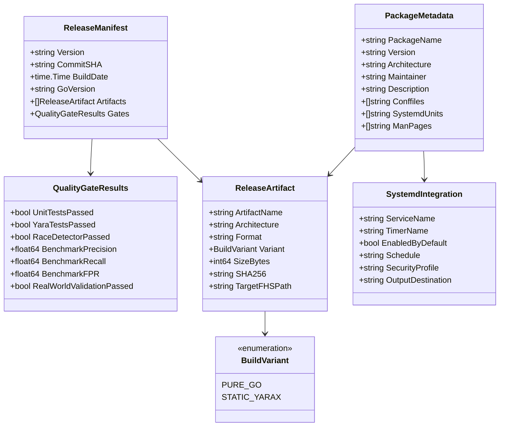

# Feature Specification: v1.0.0 Packaging, Release Engineering & Distribution

**Feature Branch**: `005-packaging-and-release`  
**Created**: 2026-10-04  
**Status**: Draft  
**Input**: User description: "AETHER — FEATURE 005 v1.0.0 PACKAGING, RELEASE ENGINEERING & DISTRIBUTION"

---

## 1. Overview & Background

Aether has completed the implementation and validation of four core foundational capabilities:
1. **Feature 001 (Trustworthy Detection & False-Positive Control)**: Unified verdict engine (`SAFE`, `SUSPICIOUS`, `MALICIOUS`, `UNKNOWN`), direct vs. contextual evidence weighting, and cryptographic false-positive pinning (`aether ack`).
2. **Feature 002 (Detection Accuracy & Validation Benchmark)**: Division-by-zero protected, hermetic benchmark engine measuring Precision (100%), Threat Recall (100%), False-Positive Rate (0%), F1-Score (1.0000), 8-Question Explainability (100%), and 10-run Determinism (100%).
3. **Feature 003 (Runtime Threat Assessment & Static/Runtime Correlation)**: Passive kernel procfs socket auditing, non-disruptive process threat hunting, container namespace awareness, privilege degradation, and cross-domain correlation ($\ge 2$ operational domains elevating multi-vector threats), raising Suspicious Triage Accuracy on runtime-only fixtures from 33.33% to 100%.
4. **Feature 004 (Real-World Linux Security Assessment & Reliability Validation)**: Comprehensive validation across 8 realistic Linux environment profiles, resilient handling of dynamic `/proc` races and vanishing PIDs, scale profiling up to 500k files within a $\le 250\text{MB}$ memory budget, transparent privilege abstention (`LIMITED VISIBILITY`), and dual-use tool discrimination (achieving 100% triage accuracy on pentest workstations).

With all 37 Feature 004 tasks implemented, 0 regressions, and 0 constitutional violations, Aether's detection, correlation, and forensic auditing foundation is complete and converged.

**The next objective is to turn Aether into a reproducible, installable, professional Linux security product (v1.0.0).**

A Linux user or security engineer should be able to:
1. **Obtain** Aether via standard distribution channels (standalone static tarball, `.deb`, `.rpm`).
2. **Verify** what was downloaded through cryptographic checksums and build provenance without phoning home.
3. **Install** the tool safely with strict path containment and least privilege.
4. **Inspect & Audit** the host with a single command (`aether scan --full` or `aether quick`).
5. **Generate** self-contained, air-gapped HTML, JSON, and terminal reports.
6. **Automate** periodic hygiene scans via an opt-in, offline systemd timer if desired.
7. **Uninstall** cleanly without leaving orphaned daemons, modifying scanned files, or deleting user-generated assessment reports.

```
+---------------------------------------------------------------------------------------------------+
|                               AETHER v1.0.0 DISTRIBUTION PIPELINE                                 |
|                                                                                                   |
|    SOURCE REVISION                BUILD MATRIX                      DISTRIBUTION ARTIFACTS        |
|    - Git Tag (v1.0.0)             - Pure-Go (CGO_ENABLED=0)         - 7 Distributable Packages    |
|    - Commit SHA-1                 - Static YARA-X (amd64 only)      - 2 Metadata Files            |
|    - Clean Worktree               - x86_64 & ARM64 Targets          - 9 Total Files in dist/      |
|    - Test Gates (100% Pass)       - -trimpath & ldflags             - SHA256SUMS & Manifest       |
|                                                                                                   |
+---------------------------------------------------------------------------------------------------+
                                                  |
                                                  v
+---------------------------------------------------------------------------------------------------+
|                                  USER INSTALLATION & USAGE LIFECYCLE                              |
|                                                                                                   |
|   1. VERIFY              2. INSTALL             3. AUDIT               4. CLEAN REMOVAL           |
|   - SHA256SUMS           - /usr/bin/aether      - aether scan --full   - apt remove / rpm -e      |
|   - Zero Telemetry       - /etc/aether/         - Offline Reports      - install.sh uninstall     |
|   - Detached Signatures  - Man Pages (roff)     - 8-Question Explain   - Zero User Data Loss      |
|   - No Phoning Home      - Opt-in Systemd Timer - Zero False Panic     - Unaltered Host State     |
+---------------------------------------------------------------------------------------------------+
```

### Non-Negotiable Invariants for Feature 005
- **Forensic Safety & Read-Only Invariant (Constitution Principle I)**: Packaging scripts, installers, and systemd units MUST NEVER execute scanned target files, NEVER mutate host file metadata (`mtime`/`ctime`), and NEVER tamper with inspected systems.
- **Root Security & Least Privilege (Constitution Principle II)**: System-level installations must enforce strict path containment (`/usr/bin`, `/etc/aether`), reject symlinks along installation paths, and refuse to install from world-writable directories. Unprivileged user installation (`~/.local/bin`, `~/.config/aether`) must be fully supported.
- **Offline-First & Zero Telemetry (Constitution Principle III)**: Zero phone-home, zero remote telemetry, zero external package fetching during normal scanning. Self-contained HTML reporting with strict CSP nonces.
- **Dual-Engine Distribution Integrity**: Pure-Go vs YARA-X builds must be clearly differentiated in documentation, artifact naming, and `aether version` output. No false equivalence claims.
- **Benchmark & Verdict Preservation**: Release engineering must not alter detection logic, heuristic weights, verdict thresholds, or benchmark ground truth from Features 001–004.

---

## 2. Clarifications

### Session 2026-10-04
- Q: What is the exact release artifact count, composition, and manifest schema relationship? → A: 7 distributable software packages (3 tarballs, 2 debs, 2 rpms) plus 2 provenance/verification metadata files (`release-manifest.json` and `SHA256SUMS`), totaling 9 files in `dist/`. The `release-manifest.json` embeds hashes of the 7 software packages, and `SHA256SUMS` hashes all 8 prior files (7 packages + manifest).
- Q: How must packaging, provenance, and testing tasks be sequenced to prevent circular dependencies? → A: 10-phase sequence: Phase 1 (Determinism) → Phase 2 (Version) → Phase 3 (Compiles) → Phase 4 (All 7 Packages: tarballs, debs, rpms) → Phase 5 (Provenance: Manifest then SHA256SUMS) → Phase 6 (Install/Uninstall) → Phase 7 (Man Pages) → Phase 8 (Systemd) → Phase 9 (Release Verification) → Phase 10 (Dry-Run & Validation).
- Q: How is `BUILD_DATE` derived to guarantee byte-for-byte build reproducibility? → A: `SOURCE_DATE_EPOCH` is authoritative: when present, `BUILD_DATE` is formatted deterministically via UTC timestamp derived from `SOURCE_DATE_EPOCH`; wall-clock `date -u` is used only as fallback for normal local developer builds.
- Q: How should systemd service isolation balance sandboxing with host inspection visibility? → A: `aether-scan.service` must set `LogsDirectory=aether` to manage `/var/log/aether/`, while retaining `PrivateTmp=false` so the threat hunter can detect dropped malware and fileless artifacts in the host's real `/tmp`.
- Q: How are memory consumption bounds defined across different operational phases? → A: Distinguish baseline startup/engine RSS ($\le 25\text{MB}$ for Pure-Go, $\le 60\text{MB}$ for Static YARA-X) from full-scan peak RSS ($\le 250\text{MB}$ for 500k-file real-world workloads per Feature 004). Packaging tests in `test/packaging/` skip gracefully via `t.Skip` on clean checkouts before `dist/` is generated.
- **Claim Discipline**: Documentation and man pages must not claim 100% universal real-world detection or zero false positives. All benchmark metrics must be clearly bounded to their defined corpora.

---

## 2. User Scenarios & Testing *(mandatory)*

### User Story 1 - Standalone Binary Download & Cryptographic Verification (Priority: P1)

As a security analyst working in an air-gapped forensic environment or incident response engagement, I want to download a self-contained, statically-linked Aether tarball, verify its SHA-256 checksum and provenance manifest offline, and execute immediate threat scans without installing system-wide dependencies or connecting to the internet.

**Why this priority**: A primary use case for Aether is rapid triage on air-gapped, isolated, or compromised endpoints. The user cannot rely on external repositories, dynamic package managers, or shared runtime libraries.

**Independent Test**: Download the standalone release archive (`aether-1.0.0-linux-amd64.tar.gz`), verify against `SHA256SUMS`, extract into an isolated unprivileged directory, run `./aether version`, and execute `./aether scan --quick` on a test directory. The entire flow must execute cleanly with zero network traffic, zero external shared library dependencies, and zero required root permissions.

**Acceptance Scenarios**:
1. **Given** a downloaded standalone archive and a `SHA256SUMS` file, **When** the user runs `sha256sum -c SHA256SUMS`, **Then** the archive hash matches exactly with exit code 0.
2. **Given** an extracted pure-Go standalone binary, **When** running `ldd aether` or `file aether`, **Then** the binary is identified as a statically linked ELF executable requiring zero dynamic loader dependencies.
3. **Given** an unprivileged user executing `./aether version`, **Then** it outputs `Aether Threat Hunter v1.0.0`, the git commit hash, build date, Go version, architecture (`linux/amd64` or `linux/arm64`), and engine status (`YARA: disabled (native heuristics only)` or `YARA: YARA-X v1.21.0 (static)`).
4. **Given** a scan executed in an air-gapped environment with network interfaces disabled (`ip link set dev eth0 down`), **When** Aether performs quick or full triage, **Then** the scan succeeds without any socket timeout errors, DNS resolution attempts, or external requests.

---

### User Story 2 - Native Linux Package Installation & Clean Uninstallation (Priority: P1)

As a Linux systems administrator managing Debian/Ubuntu or RHEL/CentOS systems, I want to install Aether using native package managers (`dpkg -i` / `apt` or `rpm -i` / `dnf`), have standard configuration and manual pages placed in compliant FHS directories, and later uninstall the package cleanly without leaving orphaned background services or deleting user scan reports.

**Why this priority**: Enterprise and production Linux administration demands standard packaging formats (`.deb` and `.rpm`) that integrate with configuration management, package verification databases, and standard software lifecycles.

**Independent Test**: Install the generated `.deb` package on a Debian/Ubuntu system and the `.rpm` package on a RHEL/Fedora system. Verify that:
1. Files are placed strictly in `/usr/bin/aether`, `/etc/aether/config.yaml`, `/etc/aether/rules/`, `/usr/share/man/man1/aether.1.gz`, and `/usr/lib/systemd/system/`.
2. Package upgrade preserves modified `/etc/aether/config.yaml` as configuration.
3. Uninstallation cleanly removes binaries and man pages while preserving `/var/log/aether/` reports and user-generated data.

**Acceptance Scenarios**:
1. **Given** a standard Debian/Ubuntu system, **When** running `dpkg -i aether_1.0.0_amd64.deb`, **Then** the binary is installed to `/usr/bin/aether` (mode 0755), default configuration is placed in `/etc/aether/config.yaml` (mode 0644), rules directory `/etc/aether/rules` is created (mode 0755), and man pages are installed to `/usr/share/man/man1/`.
2. **Given** an installed package, **When** running `man aether`, **Then** the system displays the formatted manual page documenting subcommands, scan flags, exit codes, and verdict semantics.
3. **Given** a user who generated scan reports in `/var/log/aether/` or their home directory, **When** running `apt remove aether` or `rpm -e aether`, **Then** the Aether binary and systemd files are removed, but user-generated reports and triage files (`acknowledged.yaml`) are strictly preserved.
4. **Given** a user executing complete package purge (`apt purge aether`), **Then** `/etc/aether` is removed, but user reports in `/var/log/aether/` or `/home` remain untouched.

---

### User Story 3 - Dual-Engine Build Strategy Transparency (Priority: P1)

As a security architect or deployment engineer, I want clear, explicit differentiation between the **Pure-Go Build** and the **YARA-X Enabled Build**, including precise documentation of capabilities, dependencies, memory footprints, and cross-compilation boundaries, so that I can choose the optimal binary for each deployment target without confusion or false assumptions.

**Why this priority**: Aether features two distinct build modes: pure-Go (zero-dependency, CGO-free, portable) and static YARA-X (high-throughput pattern compilation via Rust C-API). Confusing these variants or making false claims of identical engine internals undermines user trust and causes deployment failures on non-standard architectures.

**Independent Test**: Build and evaluate both variants side-by-side:
1. Pure-Go: verifies `CGO_ENABLED=0`, zero C-compiler dependency, successful compilation across `amd64` and `arm64`, and baseline RAM footprint $\le 25\text{MB}$.
2. YARA-X: verifies static linking against `libyara_x_capi.a`, successful loading of embedded YARA rules, support for custom external `.yar` rule loading, and baseline RAM footprint $\le 60\text{MB}$.
3. Verify that `aether version` explicitly declares the active engine mode.

**Acceptance Scenarios**:
1. **Given** a pure-Go build, **When** executed with `aether version`, **Then** it prints `YARA: disabled (native heuristics only)` and successfully runs all AST, process, network, persistence, and regex heuristic inspections without error.
2. **Given** a pure-Go build, **When** the user attempts to load external YARA rules via `--rules-dir`, **Then** Aether displays an informative message: `External YARA rule compilation requires Aether YARA-X build variant. Native heuristics and triage rules remain active.` without crashing.
3. **Given** a YARA-X enabled build, **When** executed with `aether version`, **Then** it prints `YARA: YARA-X v1.21.0 (static)` and successfully loads both embedded YARA rules and external rules from `/etc/aether/rules/`.
4. **Given** release documentation, **When** the user reviews the installation guide, **Then** it includes an explicit comparison matrix detailing binary size, RAM footprint, CGO requirements, glibc/musl compatibility, and recommended use cases for each variant.

---

### User Story 4 - Production Manual Pages & Transparent Verdict Documentation (Priority: P2)

As a Linux systems administrator or SOC tier-1 analyst, I want comprehensive, FHS-compliant manual pages (`man aether`, `man aether-scan`, `man aether-ack`, `man aether-rules`) that clearly explain CLI arguments, operational modes, exit codes, and verdict semantics (`SAFE`, `SUSPICIOUS`, `MALICIOUS`, `UNKNOWN`, and `LIMITED VISIBILITY`) with strict claim discipline, so that I can operate and script Aether using standard Unix documentation tools without external web searches.

**Why this priority**: Production command-line security tools must be self-documenting. Clear explanations of verdict thresholds prevent misinterpretation of security postures, while claim discipline ensures users understand the exact scope and limitations of the tool.

**Independent Test**: Install man pages into `/usr/share/man/man1/`, run `man aether`, `man aether-scan`, and `man aether-ack`, and verify that all options, exit codes, and verdict definitions match the production binary implementation exactly.

**Acceptance Scenarios**:
1. **Given** `man aether`, **When** viewed in standard terminal pagers, **Then** it documents all primary subcommands (`scan`, `quick`, `full`, `setup`, `ack`, `rules`, `version`), environment variables, FHS configuration paths, and security architecture principles.
2. **Given** `man aether-scan`, **When** viewed, **Then** it documents all scanning flags (`--paths`, `--quick`, `--full`, `--excludes`, `--max-filesize`, `--plain`, `--json-out`, `--html-out`, `--redact-hosts`, `--threads`, `--nice`) and explains the 4-tier verdict model:
   - `SAFE`: Zero indicators of malicious or unauthorized activity detected.
   - `SUSPICIOUS`: Anomalous behaviors, unmapped listeners, or unlinked binaries requiring triage.
   - `MALICIOUS`: High-confidence threats corroborated across multiple operational domains or matching known IOCs.
   - `UNKNOWN`: Incomplete inspection due to DAC/permission restrictions or unsupported formats (`UNKNOWN != SAFE`).
3. **Given** documentation on detection accuracy, **When** the user reads the manual or README, **Then** it explicitly notes that benchmark accuracy metrics (100% precision/recall) apply strictly to defined benchmark corpora, and disclaims universal detection of unknown, zero-day, or unobserved threats.
4. **Given** `man aether-ack`, **When** viewed, **Then** it explains the cryptographic hash-pinning mechanism, warns that `ALERT` and `IOC` findings are non-ackable, and details the difference between system-wide (`/etc/aether/acknowledged.yaml`) and user-level (`~/.config/aether/acknowledged.yaml`) triage files.

---

### User Story 5 - Opt-in Offline Systemd Timer & Scheduled Auditing (Priority: P2)

As a server administrator, I want an optional, opt-in systemd timer and service (`aether-scan.timer` and `aether-scan.service`) that performs periodic (e.g. weekly) background health and security scans with least privilege and idle CPU scheduling, writing structured reports locally to `/var/log/aether/`, so that I can automate host baseline auditing without external daemons, telemetry, or system performance degradation.

**Why this priority**: Scheduled background hygiene helps detect persistent threats or accidental misconfigurations that develop over time. However, automated scanning must remain strictly opt-in, offline, resource-governed, and transparent to respect administrator control.

**Independent Test**: Inspect the systemd unit files, verify that they are disabled by default upon package installation, verify that enabling and triggering the unit runs a sandboxed, low-priority scan writing strictly to `/var/log/aether/`, and verify that zero network activity occurs.

**Acceptance Scenarios**:
1. **Given** a fresh package installation of Aether, **When** checking systemd status (`systemctl is-enabled aether-scan.timer`), **Then** the timer is `disabled` by default, requiring explicit administrator activation (`systemctl enable --now aether-scan.timer`).
2. **Given** `aether-scan.service`, **When** inspected, **Then** it enforces least privilege hardening directives:
   - `Type=oneshot`
   - `Nice=19` and `IOSchedulingClass=idle` (prevents I/O and CPU starvation of host workloads)
   - `ProtectSystem=strict` (read-only filesystem mount for system directories)
   - `ProtectHome=read-only` (prevents tampering with user data)
   - `PrivateTmp=true`
   - `NoNewPrivileges=true`
   - `CapabilityBoundingSet=CAP_DAC_READ_SEARCH CAP_SYS_PTRACE`
   - `ExecStart=/usr/bin/aether scan --full --no-report --json-out=/var/log/aether/audit-%Y%m%d.json`
3. **Given** execution of the systemd service, **When** the scan finishes, **Then** it logs summary status to systemd journal (`journalctl -u aether-scan`) and writes a single timestamped JSON audit file in `/var/log/aether/`, without sending any network packets.
4. **Given** package removal (`apt remove` or `rpm -e`), **When** package maintainer scripts run, **Then** the systemd service and timer are automatically stopped, disabled, and removed from systemd unit search paths.

---

### User Story 6 - Automated Release Verification & Quality Gates (Priority: P3)

As a release engineer or CI pipeline runner, I want an automated release verification script (`scripts/verify-release.sh`) that executes the complete test matrix (`go test ./...`, `go test -tags yara ./...`, `go test -race ./...`, Feature 002 benchmark, Feature 003 runtime tests, Feature 004 real-world validation) and verifies package integrity, binary reproducibility, and checksum consistency before any release artifact is published, so that broken or regressed binaries are never released to users.

**Why this priority**: High-assurance security tools require automated, immutable quality gates. A release process that relies on manual checks is prone to packaging errors, missing build flags, or undetected regressions.

**Independent Test**: Run the release verification workflow on a release candidate branch. Verify that:
1. All unit, integration, race, and YARA tests pass 100%.
2. Feature 002/003/004 benchmarks report zero regressions.
3. Release archives are built with `-trimpath` and deterministic timestamps.
4. The generated `SHA256SUMS` manifest matches all produced artifacts.

**Acceptance Scenarios**:
1. **Given** a release candidate commit, **When** the release verification suite runs, **Then** it executes:
   - `go test ./...` (pure-Go unit tests)
   - `go test -tags yara ./...` (YARA-X integration tests)
   - `go test -race -short ./...` (concurrency race verification)
   - Feature 002 detection benchmark (verifying Precision = 100%, Recall = 100%, FPR = 0%)
   - Feature 003 runtime correlation verification (verifying runtime triage = 100%)
   - Feature 004 real-world validation suite (verifying zero crash, bounded memory)
   Any test failure immediately aborts the release pipeline with a non-zero exit code.
2. **Given** successful test gate completion, **When** packaging scripts execute, **Then** binaries are compiled with `-trimpath` and `-ldflags="-s -w -X 'main.version=1.0.0' -X 'main.commit=<hash>' -X 'main.buildDate=<date>'"`.
3. **Given** generated distribution artifacts, **When** `scripts/package.sh` finishes, **Then** it outputs `SHA256SUMS` containing cryptographic hashes for all tarballs, `.deb`, and `.rpm` files.
4. **Given** two identical clean builds from the same commit and `SOURCE_DATE_EPOCH`, **When** comparing the resulting archives, **Then** their SHA-256 hashes are identical.

---

## 3. Edge Cases

- **Upgrading Existing Deployments**: When installing a new package version over an existing installation where `/etc/aether/config.yaml` or `/etc/aether/acknowledged.yaml` has been modified by the administrator, the package manager MUST NOT overwrite the existing configuration without preserving the previous version (e.g. creating `config.yaml.dpkg-dist` or `config.yaml.rpmnew`).
- **Non-Root Package Extraction**: Users without root privileges who download standalone tarballs must be able to unpack and run Aether from `~/.local/bin` or an arbitrary directory. The binary must gracefully discover user config at `~/.config/aether/config.yaml` and run scans within user DAC permissions without requiring `/etc/aether`.
- **Systems Without Systemd**: Systems utilizing SysVinit, OpenRC, or runit (e.g. Alpine, Devuan, Void Linux) must install cleanly; packaging scripts must check for systemctl existence before attempting daemon reloads and must not fail package installation if systemd is absent.
- **Architectures Lacking Precompiled Native YARA-X**: ARM64 or non-glibc targets without precompiled `libyara_x_capi.a` must automatically build and distribute the Pure-Go static binary variant, ensuring full AST and regex heuristic detection without failing the build pipeline.
- **Read-Only or Immutable Host Filesystems**: Systems with immutable root filesystems (e.g. Fedora Silverblue, openSUSE MicroOS, SteamOS, ostree) cannot write to `/usr/local/bin` or `/etc`. The release distribution must document installation via standalone tarball to `/var/opt/aether` or user home `~/.local/bin`.
- **Broken or Interrupted Installations**: If an installation script or package manager is interrupted mid-execution, re-running the installer must be idempotent: it must safely overwrite partial binary copies without corrupting existing user triage files or leaving invalid symlinks.
- **World-Writable Installation Source Directories**: The `install.sh` script must detect if the current build directory or source binary is owned by a different user or is world-writable, and refuse root installation to prevent local privilege escalation.
- **Uninstallation With Active Scans**: If an uninstallation is triggered while a background `aether` process is running, package removal scripts must gracefully terminate the service process before removing binary files.

---

## 4. Requirements *(mandatory)*

### Functional Requirements

#### A. Target Distribution & Architecture Matrix
- **FR-001**: The system MUST support official release artifacts for `linux/amd64` (x86_64) and `linux/arm64` (aarch64) architectures.
- **FR-002**: The pure-Go release variant MUST be compiled with `CGO_ENABLED=0` and require zero external shared libraries (`libc`, `libpthread`, `libdl`), supporting any Linux kernel $\ge 4.19$ across both glibc and musl distributions (Debian, Ubuntu, RHEL, CentOS, Fedora, Rocky, Alpine, Arch).
- **FR-003**: The YARA-X release variant MUST statically link `libyara_x_capi.a` where supported, requiring only standard POSIX system libraries (`libc`, `libpthread`, `libdl`, `libm`) on glibc $\ge 2.31$.
- **FR-004**: The release engineering pipeline MUST produce exactly 7 distributable software packages plus 2 provenance/verification metadata files (9 total files in `dist/`):
  **Distributable Software Packages (7)**:
  1. `aether-1.0.0-linux-amd64.tar.gz` (Pure-Go standalone archive, x86_64)
  2. `aether-1.0.0-linux-arm64.tar.gz` (Pure-Go standalone archive, ARM64)
  3. `aether-yara-1.0.0-linux-amd64.tar.gz` (Static YARA-X standalone archive, x86_64)
  4. `aether_1.0.0_amd64.deb` (Debian/Ubuntu package, x86_64)
  5. `aether_1.0.0_arm64.deb` (Debian/Ubuntu package, ARM64)
  6. `aether-1.0.0-1.x86_64.rpm` (RHEL/CentOS/Fedora/Rocky package, x86_64)
  7. `aether-1.0.0-1.aarch64.rpm` (RHEL/CentOS/Fedora/Rocky package, ARM64)
  **Provenance & Verification Metadata Files (2)**:
  8. `release-manifest.json` (Structured JSON recording version, commit SHA, build provenance, quality gate results, and SHA-256 hashes of the 7 software packages)
  9. `SHA256SUMS` (Cryptographic checksum manifest for all 8 files: 7 software packages + `release-manifest.json`)

#### B. Build Reproducibility & Pipeline
- **FR-005**: All release binaries MUST be compiled with Go `-trimpath` to eliminate host-specific filesystem paths from compiled symbol tables.
- **FR-006**: Release builds MUST inject immutable build metadata into the binary via `-ldflags`:
  - `main.version`: Semantic release version (e.g. `1.0.0`).
  - `main.commit`: Git commit SHA-1 (short or full) from which the release was cut.
  - `main.buildDate`: UTC timestamp formatted in ISO-8601 (`YYYY-MM-DDTHH:MM:SSZ`), deterministically derived from `SOURCE_DATE_EPOCH` when set (fallback to wall-clock `date -u` for local developer builds).
- **FR-007**: Distribution archive creation MUST support reproducible archive timestamps via `SOURCE_DATE_EPOCH` to ensure deterministic tarball hashes.
- **FR-008**: The build system MUST provide a unified packaging script (`scripts/package.sh`) and Makefile targets (`make release`, `make package`, `make release-verify`) automating artifact compilation, packaging, and checksum generation.

#### C. Dual-Engine Build Variants
- **FR-009**: The system MUST maintain complete separation between Pure-Go and YARA-X build variants:
  - **Pure-Go**: Fast, zero-CGO compilation, minimal memory usage ($\le 25\text{MB}$ baseline startup/engine RSS), native AST, regex heuristics, process, network, and persistence hunting. Supported on both `linux/amd64` and `linux/arm64`.
  - **YARA-X**: CGO compilation statically linked against YARA-X Rust C-API (`bin/aether-yara-static`), embedded YARA-X rules, external rule compiler support, and native heuristics ($\le 60\text{MB}$ baseline startup/engine RSS). Supported strictly on `linux/amd64`. Both variants respect the $\le 250\text{MB}$ peak RSS budget during 500k-file full system scans per Feature 004.
- **FR-010**: `aether version` MUST explicitly declare which engine variant is running:
  - Output for Pure-Go: `YARA: disabled (native heuristics only)`
  - Output for YARA-X: `YARA: YARA-X v1.21.0 (static)`
- **FR-011**: Release documentation MUST include a transparent comparison table detailing binary size, RAM footprint, CGO requirements, glibc/musl compatibility, and feature capabilities for each build variant.

#### D. Installer & Package Safety
- **FR-012**: Package installation and uninstallation scripts (`postinst`, `postrm`, `prerm`, and `install.sh`) MUST NOT execute scanned target files, test payloads, or user executables.
- **FR-013**: Package installation MUST NOT modify arbitrary host files outside approved FHS boundaries:
  - Executable: `/usr/bin/aether` (or `/usr/local/bin/aether` for manual installs)
  - Configuration: `/etc/aether/config.yaml`
  - Rules: `/etc/aether/rules/`
  - IOCs: `/etc/aether/iocs/`
  - Manual Pages: `/usr/share/man/man1/`
  - Systemd Units: `/usr/lib/systemd/system/` (or `/lib/systemd/system/`)
- **FR-014**: The `install.sh` script MUST enforce security checks before root installation:
  - Refuse installation if the source directory or binary is owned by a different user or is world-writable (`mode & 0022 != 0`).
  - Require explicit cryptographic hash verification (`--sha256 <hash>`) when executed as root to prevent binary tampering.
  - Support unprivileged user installation to `~/.local/bin/aether` when run without `sudo`.
- **FR-015**: Package installation MUST NOT automatically initiate filesystem scans or establish any network listening services (verified by automated packaging tests).

#### E. Safe & Clean Uninstallation
- **FR-016**: Uninstallation via package managers (`apt remove`, `rpm -e`) or `install.sh uninstall` MUST remove all installed Aether binaries, manual pages, and systemd service/timer units.
- **FR-017**: Uninstallation MUST NOT delete:
  - User-generated scan reports (e.g. `aether-report.html`, `/var/log/aether/`, `~/reports/`).
  - User-created triage acknowledgment files (`/etc/aether/acknowledged.yaml`, `~/.config/aether/acknowledged.yaml`) unless an explicit purge (`apt purge` or `--purge`) is commanded.
  - Scanned host files or unrelated packages.
- **FR-018**: Package removal scripts MUST check for and stop running `aether-scan.timer` and `aether-scan.service` units prior to binary removal (verified by automated packaging tests).

#### F. Production Manual Pages & Documentation
- **FR-019**: The release MUST include FHS-compliant roff manual pages installed into section 1:
  - `aether.1`: Main overview, subcommands, exit codes, architecture principles, and security considerations.
  - `aether-scan.1`: Scanning flags, execution modes (`--quick`, `--full`), output options (`--plain`, `--json-out`, `--html-out`), and resource controls.
  - `aether-ack.1`: Cryptographic false-positive pinning, hash calculation, and triage workflow.
  - `aether-rules.1`: Rule validation, syntax checking, and directory layout.
- **FR-020**: Manual pages and documentation MUST document the 4-tier verdict system:
  - `SAFE`: Zero indicators of malicious or unauthorized activity detected.
  - `SUSPICIOUS`: Anomalous behaviors, unmapped listeners, or unlinked binaries requiring triage.
  - `MALICIOUS`: High-confidence threats corroborated across multiple operational domains or matching known IOCs.
  - `UNKNOWN`: Incomplete inspection due to DAC/permission restrictions or unsupported formats (`UNKNOWN != SAFE`).
- **FR-021**: Manual pages and documentation MUST document the executive status model (`SAFE`, `ATTENTION REQUIRED`, `HIGH RISK`, and `LIMITED VISIBILITY`).
- **FR-022**: Documentation MUST uphold claim discipline:
  - Explicitly state that 100% benchmark metrics apply to the defined benchmark corpora.
  - Include an explicit disclaimer stating that Aether does not guarantee detection of all possible threats, zero-days, or unobserved attack techniques.
  - Emphasize that Aether is a static/runtime forensic assessment tool and not an active real-time EDR or kernel blocker.

#### G. Opt-in Systemd Automation
- **FR-023**: The distribution MUST provide systemd unit files:
  - `aether-scan.service`: Low-priority, hardened, oneshot background scan service.
  - `aether-scan.timer`: Weekly scheduled trigger with randomized delay.
- **FR-024**: The systemd timer MUST be disabled by default upon installation; activation MUST require explicit administrator command (`systemctl enable --now aether-scan.timer`).
- **FR-025**: The systemd service MUST enforce strict sandbox isolation:
  - `Nice=19` and `IOSchedulingClass=idle`
  - `ProtectSystem=strict`
  - `ProtectHome=read-only`
  - `ReadWritePaths=/var/log/aether`
  - `LogsDirectory=aether`
  - `PrivateTmp=false` (CRITICAL threat-hunting requirement: must remain false so Aether retains visibility into the host `/tmp` for dropped malware and fileless artifacts)
  - `NoNewPrivileges=true`
  - `CapabilityBoundingSet=CAP_DAC_READ_SEARCH CAP_SYS_PTRACE`
- **FR-026**: The systemd scan MUST output strictly to local filesystem logs (e.g. `/var/log/aether/audit-%Y%m%d.json`) and journald, with zero external network communication.

#### H. Release Verification & Quality Gates
- **FR-027**: The release verification script (`scripts/verify-release.sh`) MUST execute the complete test suite before any release artifact is generated:
  1. `go test ./...` (pure-Go unit tests across all packages)
  2. `go test -tags yara ./...` (YARA-X integration tests)
  3. `go test -race -short ./...` (concurrency race verification)
  4. Feature 002 Benchmark (`go test -v ./test/benchmark/...`) verifying Precision = 100%, Recall = 100%, FPR = 0%.
  5. Feature 003 Runtime Tests (`go test -v ./internal/modules/process/... ./internal/modules/network/... ./internal/report/...`)
  6. Feature 004 Real-World Validation (`go test -v ./test/realworld/...`)
- **FR-028**: Any test failure, race detection, or benchmark regression MUST halt the release process immediately with a non-zero exit code.

#### I. Checksums, Provenance & Integrity
- **FR-029**: The release pipeline MUST generate a structured release manifest (`release-manifest.json`) recording version, commit SHA, build date, Go compiler version, target architectures, quality gate execution results, and SHA-256 hashes of the 7 software packages.
- **FR-030**: Following manifest generation, the release pipeline MUST generate a `SHA256SUMS` manifest containing SHA-256 hashes of all 8 preceding files (the 7 distributable software packages + `release-manifest.json`). `release-manifest.json` NEVER contains a hash of `SHA256SUMS` or of itself.
- **FR-031**: Release verification MUST operate 100% offline without requiring external network connectivity or telemetry endpoints (verified by automated offline tests).

#### J. Backward Compatibility & CLI Stability
- **FR-032**: All existing CLI subcommands (`scan`, `quick`, `full`, `setup`, `update`, `version`, `demo`, `ack`, `rules`), flags, and exit codes MUST be preserved without breaking changes.
- **FR-033**: Existing configuration files (`/etc/aether/config.yaml`, `~/.config/aether/config.yaml`) and triage databases (`acknowledged.yaml`) MUST remain 100% backward compatible with v1.0.0.

---

### Key Entities



- **`ReleaseArtifact`**: Represents a compiled distribution archive (`.tar.gz`) or package file (`.deb`, `.rpm`) ready for end-user deployment (the 7 distributable software packages).
- **`BuildVariant`**: Distinguishes between `PURE_GO` (`CGO_ENABLED=0`, zero external dependencies) and `STATIC_YARAX` (statically linked Rust YARA-X C-API).
- **`ReleaseManifest`**: The immutable metadata document recording release version, commit SHA, build timestamps, the 7 software package hashes, and verified quality gate metrics.
- **`QualityGateResults`**: Captures the automated verification outcomes across unit tests, race detection, Feature 002/003 benchmarks, and Feature 004 validation.
- **`PackageMetadata`**: Standard packaging metadata definition for Debian and RPM package builders, defining file paths, configuration files (`conffiles`), dependencies, and lifecycle hooks.
- **`SystemdIntegration`**: Specification of the optional, sandboxed, offline scheduled auditing units (`aether-scan.service` and `aether-scan.timer`).

---

## 5. Success Criteria *(mandatory)*

### Measurable Outcomes

- **SC-001 (Artifact Matrix Completeness)**: The release pipeline successfully compiles and packages 100% of defined release files across both `amd64` and `arm64` architectures: exactly 7 distributable software packages (`.tar.gz`, `.deb`, `.rpm`) plus 2 provenance/verification metadata files (`release-manifest.json` and `SHA256SUMS`), totaling 9 files in `dist/`.
- **SC-002 (CGO-Free Portability)**: Pure-Go release binaries execute cleanly on both glibc-based systems (Debian, Ubuntu, Fedora) and musl-based systems (Alpine) with 0 shared library dependencies (`ldd` returns not a dynamic executable or statically linked).
- **SC-003 (Quality Gate Enforcement)**: 100% of automated test suites (`go test ./...`, `go test -tags yara ./...`, `go test -race ./...`, Feature 002 benchmark, Feature 003 runtime tests, Feature 004 real-world validation) pass before release artifact generation, with 0 benchmark regressions.
- **SC-004 (Build Reproducibility)**: Release binaries built with `-trimpath` from the same commit and `SOURCE_DATE_EPOCH` produce bit-for-bit identical binary hashes across isolated build environments.
- **SC-005 (Installation Path Containment)**: 100% of files installed by `.deb`, `.rpm`, and `install.sh` reside strictly within approved FHS directories (`/usr/bin`, `/etc/aether`, `/usr/share/man/man1`, `/usr/lib/systemd/system`), with 0 files installed outside designated paths.
- **SC-006 (Zero Forensic Mutation Invariant)**: Package installation, package removal, and systemd service execution cause 0 mutations to inspected files, 0 timestamp modifications, and 0 executions of target binaries or test samples.
- **SC-007 (Clean Uninstallation Preservation)**: Package removal (`apt remove`, `rpm -e`, or `install.sh uninstall`) cleanly deletes all installed binary, documentation, and systemd files while preserving 100% of user-created scan reports (`/var/log/aether/`, HTML dashboards, and user triage records).
- **SC-008 (Offline Integrity & Zero Telemetry)**: 100% of packaging scripts, installer routines, systemd services, and documentation contain zero external network calls, zero telemetry pings, and zero remote analytics.
- **SC-009 (Documentation & Man Page Coverage)**: 100% of primary CLI subcommands (`scan`, `quick`, `full`, `setup`, `ack`, `rules`, `version`) and all scan flags are fully documented in section 1 manual pages (`aether.1`, `aether-scan.1`, `aether-ack.1`, `aether-rules.1`) with explicit verdict definitions.
- **SC-010 (CLI Stability & Backward Compatibility)**: 100% of pre-existing CLI commands, flags, output formats (`--plain`, `--json-out`, `--html-out`), and configuration keys operate identically without regression.

---

## 6. Assumptions

- **A-001 (Target Architecture Standards)**: Target Linux systems utilize `x86_64` (amd64) or `aarch64` (arm64) CPU architectures running Linux kernel $\ge 4.19$.
- **A-002 (Packaging Tooling)**: Packaging scripts will utilize standard Go build tools and standard host archive utilities (`tar`, `gzip`) or native packaging tools (`dpkg-deb`, `rpmbuild`, or Go-native equivalents like `nfpm`) available in the release environment.
- **A-003 (Systemd Ubiquity with Graceful Fallback)**: Systemd is assumed to be the primary init system on modern server and workstation distributions (Debian, Ubuntu, RHEL, CentOS, Fedora, Rocky, Arch). On non-systemd systems, packaging scripts will gracefully skip systemd daemon reloads without error.
- **A-004 (Dual-Engine Hardware Requirements)**: Pure-Go binary requires $\le 25\text{MB}$ baseline startup RSS, minimum 256MB system RAM, and 20MB disk space. YARA-X enabled binary requires $\le 60\text{MB}$ baseline startup RSS, minimum 512MB system RAM, and 50MB disk space. Both engines operate within a $\le 250\text{MB}$ peak RSS budget during 500k-file full system scans.
- **A-005 (Air-Gapped Operation Assumption)**: Users in sensitive or air-gapped environments may transfer standalone archives via offline media (e.g. USB or internal mirrors); verification must function with local `sha256sum` commands without requiring online certificate authority checks.
- **A-006 (Unprivileged Usability)**: Unprivileged users (`UID >= 1000`) must be able to unpack and run Aether from their home directories (`~/.local/bin`), operating under normal Linux DAC limits without crashing.

---

## 7. Non-Goals

- **NG-001 (No New Detection Engines)**: Feature 005 will not introduce new heuristic rule engines, kernel eBPF probes, or machine learning models.
- **NG-002 (No Verdict Semantics Changes)**: Feature 005 will not alter verdict thresholds, scoring equations, evidence weights, or classification logic defined in Features 001–004.
- **NG-003 (No Active Remediation or File Deletion)**: Aether will not automatically quarantine, modify, kill, or delete suspicious or malicious files; all remediation remains strictly informational and human-actionable.
- **NG-004 (No Real-Time EDR Agent)**: Aether will not be transformed into a continuous kernel-space blocking agent or background resident EDR daemon.
- **NG-005 (No Cloud Signatures or Telemetry Feeds)**: Aether will not add telemetry endpoints, cloud-based threat lookups, or mandatory online signature synchronization.
- **NG-006 (No Benchmark Ground Truth Alteration)**: The Feature 002, 003, and 004 benchmark fixtures and test corpora will remain immutable; release packaging will verify against existing benchmarks without modifying them.
