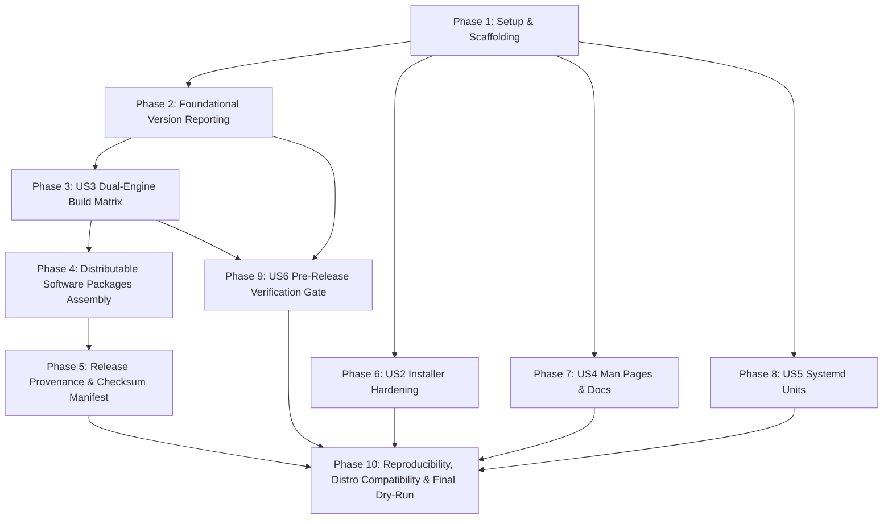

# Tasks: v1.0.0 Packaging, Release Engineering & Distribution

**Feature Branch**: `005-packaging-and-release`  
**Spec**: [specs/005-packaging-and-release/spec.md](spec.md)  
**Plan**: [specs/005-packaging-and-release/plan.md](plan.md)  
**Status**: Ready for Implementation

---

## Phase 1: Setup & Build Determinism (Shared Infrastructure & Packaging Scaffolding)

**Purpose**: Establish packaging directories, Makefile targets, and build helper scripts with deterministic timestamp controls.

- [ ] T001 Create packaging and release directory structure per implementation plan (`packaging/deb/`, `packaging/rpm/`, `packaging/systemd/`, `man/man1/`, `scripts/`, `dist/`, `test/packaging/`)
  - **Priority**: P1 | **Phase**: 1 | **Dependencies**: None
  - **Path**: `packaging/`, `man/man1/`, `scripts/`, `dist/`, `test/packaging/`
  - **Action**: Create directories to house package templates, manual pages, build scripts, test suites, and output artifacts.
  - **Acceptance Criteria**: All required packaging directories exist and are clean.
  - **Tests**: `[ -d packaging/deb ] && [ -d packaging/rpm ] && [ -d packaging/systemd ] && [ -d man/man1 ]`
  - **Security**: Directories must not be group- or world-writable (`mode 0755`).

- [ ] T002 Add v1.0.0 release targets and reproducible build flags to `Makefile`
  - **Priority**: P1 | **Phase**: 1 | **Dependencies**: T001
  - **Path**: `Makefile`
  - **Action**: Add `VERSION ?= 1.0.0`, `-trimpath`, deterministic `BUILD_DATE` derivation via `SOURCE_DATE_EPOCH` (fallback to wall-clock `date -u` for local developer builds), `-ldflags` with version, commit, buildDate. Add phony targets `package`, `release`, `release-verify`, and `man`.
  - **Interfaces**: Makefile CLI targets.
  - **Acceptance Criteria**: Running `make help` lists `package`, `release`, and `release-verify`. When `SOURCE_DATE_EPOCH` is set, `BUILD_DATE` is computed deterministically.
  - **Tests**: `make -n release-verify package`
  - **Security**: Compile flags must enforce `-trimpath` to eliminate host paths from binary symbol tables.

- [ ] T003 [P] Implement reproducible archive timestamp helpers in `scripts/package.sh`
  - **Priority**: P1 | **Phase**: 1 | **Dependencies**: T001
  - **Path**: `scripts/package.sh`
  - **Action**: Implement `SOURCE_DATE_EPOCH` extraction (`git log -1 --format=%ct` or fallback to fixed epoch) and tar/gzip options (`--sort=name --mtime="@${SOURCE_DATE_EPOCH}" --owner=0 --group=0 --numeric-owner`, `gzip -n`).
  - **Interfaces**: Shell functions for deterministic archive packaging.
  - **Acceptance Criteria**: Script sets `SOURCE_DATE_EPOCH` correctly and exports deterministic tar/gzip invocations.
  - **Tests**: Running script with fixed epoch produces deterministic tarball byte streams.
  - **Security**: Normalizes UID/GID to 0 to prevent leaking builder host user/group IDs.

---

## Phase 2: Foundational (Blocking Prerequisites: Versioning & Engine Reporting)

**Purpose**: Implement unambiguous CLI version and engine mode reporting in strict compliance with `contracts/cli-version-contract.md`.

**⚠️ CRITICAL**: Must complete before packaging release binaries to guarantee honest engine reporting.

- [ ] T004 Update `internal/yara/factory_default.go` to report exact spec string for Pure-Go builds
  - **Priority**: P1 | **Phase**: 2 | **Dependencies**: None
  - **Path**: `internal/yara/factory_default.go`
  - **Action**: Modify `VersionInfo()` to return `"disabled (native heuristics only)"` instead of `"not compiled in"`.
  - **Interfaces**: `yara.VersionInfo() string`
  - **Acceptance Criteria**: When compiled without `-tags yara`, `yara.VersionInfo()` returns `"disabled (native heuristics only)"`.
  - **Tests**: `go test -v ./internal/yara/`
  - **Security**: Upholds Principle III & V; explicitly informs user that external compiled YARA-X rules are inactive in Pure-Go mode without false equivalence claims.

- [ ] T005 Update `internal/yara/yarax_engine.go` to report exact spec string for Static YARA-X builds
  - **Priority**: P1 | **Phase**: 2 | **Dependencies**: None
  - **Path**: `internal/yara/yarax_engine.go`
  - **Action**: Modify `YaraXVersionInfo()` to return `"YARA-X v1.21.0 (static)"` instead of `"YARA-X v1.21.0"`.
  - **Interfaces**: `yara.YaraXVersionInfo() string`
  - **Acceptance Criteria**: When compiled with `-tags yara`, `yara.VersionInfo()` returns `"YARA-X v1.21.0 (static)"`.
  - **Tests**: `go test -v -tags yara ./internal/yara/`
  - **Security**: Clarifies that YARA-X engine is statically linked and active.

- [ ] T006 Update `cmd/aether/main.go` version command to match `contracts/cli-version-contract.md`
  - **Priority**: P1 | **Phase**: 2 | **Dependencies**: T004, T005
  - **Path**: `cmd/aether/main.go`
  - **Action**: Verify `versionCmd` outputs `Aether Threat Hunter v<version>`, `Commit: <commit>`, `Build Date: <date>`, `Go Version: <go>`, `OS/Arch: <os/arch>`, and `YARA: <yara.VersionInfo()>`.
  - **Interfaces**: `contracts/cli-version-contract.md`
  - **Acceptance Criteria**: Format matches contract regexes exactly.
  - **Tests**: `go run ./cmd/aether version`
  - **Security**: Does not expose host environment variables or sensitive developer paths.

- [ ] T007 [P] Create CLI version contract test `test/packaging/version_contract_test.go`
  - **Priority**: P1 | **Phase**: 2 | **Dependencies**: T006
  - **Path**: `test/packaging/version_contract_test.go`
  - **Action**: Implement unit test verifying `aether version` against all 6 contract rules in `contracts/cli-version-contract.md` for both pure-Go and YARA-X modes.
  - **Interfaces**: CLI stdout capture and regex assertions.
  - **Acceptance Criteria**: Test passes 100% and fails if any line deviates from the contract specification.
  - **Tests**: `go test -v ./test/packaging -run TestVersionContract`
  - **Security**: Automated regression prevention against misleading version output.

**Checkpoint**: Foundation ready — version and engine status reporting strictly compliant with contract.

---

## Phase 3: Pure-Go & Static YARA-X Binary Compilation (User Story 3)

**Goal**: Build statically linked Pure-Go (`CGO_ENABLED=0`) for `linux/amd64` and `linux/arm64`, and Static YARA-X (`CGO_ENABLED=1`) for `linux/amd64`.

**Independent Test**: Verify binaries compile cleanly with `-trimpath`, execute `version`, and meet memory baseline constraints ($\le 25\text{MB}$ pure-Go baseline startup RSS, $\le 60\text{MB}$ YARA-X baseline startup RSS, $\le 250\text{MB}$ full-scan peak RSS).

- [ ] T008 [P] [US3] Configure Pure-Go cross-compilation targets in `Makefile` and `scripts/package.sh`
  - **Priority**: P1 | **Phase**: 3 | **Dependencies**: T002, T006
  - **Path**: `Makefile`, `scripts/package.sh`
  - **Action**: Implement compilation for `GOOS=linux GOARCH=amd64 CGO_ENABLED=0` and `GOOS=linux GOARCH=arm64 CGO_ENABLED=0` using `-trimpath` and ldflags into `bin/aether-linux-amd64` and `bin/aether-linux-arm64`.
  - **Interfaces**: Go compiler toolchain.
  - **Acceptance Criteria**: Compiles static ELF binaries with 0 shared library dependencies.
  - **Tests**: `file bin/aether-linux-amd64` confirms statically linked executable.
  - **Security**: Eliminates dynamic loader vulnerabilities (`LD_PRELOAD`, libc version mismatches).

- [ ] T009 [P] [US3] Configure Static YARA-X compilation target in `Makefile` and `scripts/package.sh`
  - **Priority**: P1 | **Phase**: 3 | **Dependencies**: T002, T006
  - **Path**: `Makefile`, `scripts/package.sh`
  - **Action**: Implement compilation for `GOOS=linux GOARCH=amd64 CGO_ENABLED=1` with `-tags yara -trimpath` statically linking `libyara_x_capi.a` into canonical binary `bin/aether-yara-static`.
  - **Interfaces**: CGO and Rust static C-API. Scoped strictly to `linux/amd64`.
  - **Acceptance Criteria**: Binary compiles cleanly and embeds 13 core YARA rules.
  - **Tests**: `./bin/aether-yara-static version` outputs `YARA: YARA-X v1.21.0 (static)`.
  - **Security**: Verifies static linking without introducing unverified dynamic library search paths.

- [ ] T010 [US3] Implement binary verification test `test/packaging/build_matrix_test.go`
  - **Priority**: P1 | **Phase**: 3 | **Dependencies**: T008, T009
  - **Path**: `test/packaging/build_matrix_test.go`
  - **Action**: Test that pure-Go binary has 0 dynamic dependencies (`ldd` returns not a dynamic executable) and baseline startup RSS $\le 25\text{MB}$. Test that YARA-X static binary links only standard system libraries on glibc $\ge 2.31$ and baseline startup RSS $\le 60\text{MB}$. Ensure test calls `t.Skip("dist/ or bin/ artifact not found; run make build-pure first")` if binaries are absent. Both engines respect the $\le 250\text{MB}$ peak RSS budget during 500k-file full system scans.
  - **Acceptance Criteria**: Test verifies static linkage and memory baseline bounds without breaking clean checkout test runs.
  - **Tests**: `go test -v ./test/packaging -run TestBuildMatrixLinkage`
  - **Security**: Enforces Principle III (Pure-Go Autonomy & Zero Remote Dependencies).

- [ ] T011 [US3] Document dual-engine comparison matrix in `README.md`
  - **Priority**: P1 | **Phase**: 3 | **Dependencies**: T008, T009
  - **Path**: `README.md`
  - **Action**: Add explicit table detailing Pure-Go vs YARA-X capabilities, memory footprints, CGO requirements, glibc/musl compatibility, and recommended use cases.
  - **Acceptance Criteria**: Clear documentation with zero misleading equivalence claims.
  - **Tests**: Review `README.md` for claim discipline.
  - **Security**: Transparency in engine capabilities prevents operational misdeployment.

**Checkpoint**: User Story 3 complete — dual-engine matrix compiles and operates with full transparency.

---

## Phase 4: Distributable Software Packages Assembly (All 7 Packages)

**Goal**: Assemble and build all 7 distributable software packages in `dist/`: 3 standalone tarballs, 2 Debian `.deb` packages, and 2 Red Hat `.rpm` packages.

**Independent Test**: Verify all 7 software packages exist in `dist/` with correct FHS layouts, valid package metadata, and non-executable maintainer scripts.

### 4A: Standalone Archives (Tarballs)
- [ ] T012 [P] [US1] Implement standalone archive assembly in `scripts/package.sh`
  - **Priority**: P1 | **Phase**: 4 | **Dependencies**: T003, T008, T009
  - **Path**: `scripts/package.sh`
  - **Action**: Assemble the 3 archive bundles: `aether-1.0.0-linux-amd64.tar.gz`, `aether-1.0.0-linux-arm64.tar.gz`, and `aether-yara-1.0.0-linux-amd64.tar.gz` containing binary, `install.sh`, reference config, README, LICENSE, man pages, and systemd units.
  - **Interfaces**: Tarball packaging logic.
  - **Acceptance Criteria**: Tarballs contain all specified files with permissions `0755` for executables and `0644` for data.
  - **Tests**: `tar -tzf dist/aether-1.0.0-linux-amd64.tar.gz`
  - **Security**: Enforces deterministic archive creation via `SOURCE_DATE_EPOCH` and `gzip -n`.

### 4B: Debian Packaging (.deb)
- [ ] T016 [P] [US2] Create Debian package control templates in `packaging/deb/control.template`
  - **Priority**: P1 | **Phase**: 4 | **Dependencies**: T001
  - **Path**: `packaging/deb/control.template`
  - **Action**: Author Debian `control` file template specifying `Package: aether`, `Version: 1.0.0`, `Architecture: @@ARCH@@`, `Section: admin`, `Priority: optional`, maintainer, and description adhering to claim discipline.
  - **Acceptance Criteria**: Conforms to Debian Policy Manual standards.
  - **Tests**: `dpkg-deb --info` on built package.
  - **Security**: No dangerous pre-dependencies.

- [ ] T017 [P] [US2] Create Debian conffiles manifest in `packaging/deb/conffiles`
  - **Priority**: P1 | **Phase**: 4 | **Dependencies**: T001
  - **Path**: `packaging/deb/conffiles`
  - **Action**: Register `/etc/aether/config.yaml` as a protected conffile.
  - **Acceptance Criteria**: Package manager preserves modified config files during upgrades.
  - **Tests**: Verify conffile entry in `.deb` control archive (`dpkg-deb -e`).
  - **Security**: Prevents unauthorized overwrite of administrator configuration.

- [ ] T018 [P] [US2] Implement Debian maintainer scripts `postinst`, `prerm`, `postrm` in `packaging/deb/`
  - **Priority**: P1 | **Phase**: 4 | **Dependencies**: T001
  - **Path**: `packaging/deb/postinst`, `packaging/deb/prerm`, `packaging/deb/postrm`
  - **Action**: Implement scripts per `contracts/package-fhs-contract.md`:
    - `postinst`: creates `/etc/aether/rules/` and `/var/log/aether/`, runs `systemctl daemon-reload`. DOES NOT start/enable timer or scan (FR-015).
    - `prerm`: stops and disables `aether-scan.timer` and `aether-scan.service` if active (FR-018).
    - `postrm`: runs `systemctl daemon-reload`. On purge (`$1 == purge`), removes `/etc/aether/`; strictly preserves `/var/log/aether/` reports.
  - **Acceptance Criteria**: Scripts pass `shellcheck` with zero errors.
  - **Tests**: Shell execution test on maintainer scripts in isolation.
  - **Security**: NEVER executes scanned target files; never communicates over network.

- [ ] T019 [US2] Implement Debian package build logic in `scripts/package.sh`
  - **Priority**: P1 | **Phase**: 4 | **Dependencies**: T008, T016, T017, T018
  - **Path**: `scripts/package.sh`
  - **Action**: Assemble directory tree and execute `dpkg-deb -b` to build `dist/aether_1.0.0_amd64.deb` and `dist/aether_1.0.0_arm64.deb`.
  - **Acceptance Criteria**: Packages build with exit code 0.
  - **Tests**: `dpkg-deb -c dist/aether_1.0.0_amd64.deb` confirms exact FHS layout.
  - **Security**: Verifies all file permissions inside package (`0755` for `/usr/bin/aether`, `0644` for config/units).

- [ ] T020 [P] [US2] Create Debian package validation test `test/packaging/deb_package_test.go`
  - **Priority**: P1 | **Phase**: 4 | **Dependencies**: T019
  - **Path**: `test/packaging/deb_package_test.go`
  - **Action**: Inspect `.deb` contents, verify control fields, conffile registration, maintainer script permissions, and absence of world-writable files. Test that package install does not initiate scans or open listening ports (FR-015), and removal stops units (FR-018). Add `t.Skip("dist/ artifact not found; run make package first")` if `.deb` artifact not yet built.
  - **Acceptance Criteria**: All checks pass; skips gracefully on clean checkouts.
  - **Tests**: `go test -v ./test/packaging -run TestDebPackage`
  - **Security**: Verifies package structure conforms to Principle II (Least Privilege).

### 4C: RPM Packaging (.rpm)
- [ ] T021 [P] [US2] Create RPM specification file `packaging/rpm/aether.spec`
  - **Priority**: P1 | **Phase**: 4 | **Dependencies**: T001
  - **Path**: `packaging/rpm/aether.spec`
  - **Action**: Author `.spec` file with Name `aether`, Version `1.0.0`, Release `1`, `%config(noreplace) /etc/aether/config.yaml`, `%post`, `%preun`, `%postun` scriptlets per `contracts/package-fhs-contract.md`. Ensure `%post` does not run scans (FR-015) and `%preun` stops active units (FR-018).
  - **Acceptance Criteria**: Conforms to Fedora/RHEL packaging guidelines.
  - **Tests**: `rpmlint packaging/rpm/aether.spec`
  - **Security**: Scriptlets do not execute user targets or initiate network calls.

- [ ] T022 [US2] Implement RPM package build logic in `scripts/package.sh`
  - **Priority**: P1 | **Phase**: 4 | **Dependencies**: T008, T021
  - **Path**: `scripts/package.sh`
  - **Action**: Use `rpmbuild -bb` (or compatible generator) to produce `dist/aether-1.0.0-1.x86_64.rpm` and `dist/aether-1.0.0-1.aarch64.rpm`.
  - **Acceptance Criteria**: RPM packages built with exit code 0.
  - **Tests**: `rpm -qlp dist/aether-1.0.0-1.x86_64.rpm` lists all FHS files.
  - **Security**: File ownership set to `root:root` with non-writable security configuration.

- [ ] T023 [P] [US2] Create RPM package validation test `test/packaging/rpm_package_test.go`
  - **Priority**: P1 | **Phase**: 4 | **Dependencies**: T022
  - **Path**: `test/packaging/rpm_package_test.go`
  - **Action**: Inspect `.rpm` contents, verify `%config(noreplace)` attribute on `/etc/aether/config.yaml`, verify scriptlet definitions, check file permissions, and verify FR-015 / FR-018 compliance. Add `t.Skip("dist/ artifact not found; run make package first")` if `.rpm` artifact not yet built.
  - **Acceptance Criteria**: All RPM validation checks pass; skips gracefully on clean checkout.
  - **Tests**: `go test -v ./test/packaging -run TestRpmPackage`
  - **Security**: Ensures RPM package safety and non-interference.

**Checkpoint**: All 7 distributable software packages compiled and assembled in `dist/`.

---

## Phase 5: Release Provenance & Checksum Manifest

**Goal**: Generate immutable build provenance metadata (`release-manifest.json`) across the 7 software packages, followed by the cryptographic checksum manifest (`SHA256SUMS`) over all 8 files.

**⚠️ STRICT SEQUENCING**:
1. All 7 packages must exist before generating `release-manifest.json`.
2. `release-manifest.json` must exist before generating `SHA256SUMS`.
3. Total files in `dist/` = 9 (7 software packages + `release-manifest.json` + `SHA256SUMS`).

- [ ] T014 [US1] Implement `release-manifest.json` generation in `scripts/package.sh`
  - **Priority**: P1 | **Phase**: 5 | **Dependencies**: T012, T019, T022
  - **Path**: `scripts/package.sh`
  - **Action**: Compute SHA-256 hashes of the 7 software packages and output structured `dist/release-manifest.json` adhering strictly to `contracts/release-manifest-schema.json`. Captures commit, deterministic build date, Go version, the 7 package objects, quality gates, and environment. Manifest NEVER contains a hash of `SHA256SUMS` or of itself.
  - **Interfaces**: `contracts/release-manifest-schema.json`
  - **Acceptance Criteria**: JSON validates against schema with `minItems: 7, maxItems: 7`.
  - **Tests**: Schema validation test using python `jsonschema` or Go validator.
  - **Security**: Immutable provenance audit record.

- [ ] T013 [P] [US1] Implement cryptographic checksum generation (`SHA256SUMS`) in `scripts/package.sh`
  - **Priority**: P1 | **Phase**: 5 | **Dependencies**: T014
  - **Path**: `scripts/package.sh`
  - **Action**: Generate `dist/SHA256SUMS` containing SHA-256 hashes of all 8 files in `dist/` (the 7 software packages + `release-manifest.json`).
  - **Interfaces**: Unix `sha256sum`.
  - **Acceptance Criteria**: `sha256sum -c SHA256SUMS` exits with code 0 for all 8 files.
  - **Tests**: `cd dist && sha256sum -c SHA256SUMS`
  - **Security**: Offline tamper detection without external online verification servers.

- [ ] T015 [P] [US1] Create standalone archive integration test `test/packaging/standalone_archive_test.go`
  - **Priority**: P1 | **Phase**: 5 | **Dependencies**: T012, T013, T014
  - **Path**: `test/packaging/standalone_archive_test.go`
  - **Action**: Test extracting tarball into temp directory, verifying `SHA256SUMS`, validating `release-manifest.json`, running `./aether version`, and running `./aether scan --quick` on test fixture without network access. Add `t.Skip("dist/ artifact not found; run make package first")` if tarball or manifests are absent.
  - **Acceptance Criteria**: Complete workflow passes offline with zero errors; skips gracefully on clean checkouts.
  - **Tests**: `go test -v ./test/packaging -run TestStandaloneArchive`
  - **Security**: Proves offline air-gapped readiness (Principle III).

**Checkpoint**: Release provenance complete — 7 packages + 2 metadata files = 9 total files in `dist/` verified.

---

## Phase 6: User Story 2 - Installer Hardening (`install.sh`) & Unprivileged Mode (Priority: P1)

**Goal**: Harden `install.sh` against path traversal, world-writable directories, and binary tampering, while implementing safe uninstallation that preserves user audit reports.

**Independent Test**: Execute `install.sh` as non-root (verifying `~/.local/bin` install), as root with `--sha256`, and verify refusal when build dir is world-writable.

- [ ] T024 [US2] Enhance `install.sh` root installation security checks per `contracts/installer-contract.md`
  - **Priority**: P1 | **Phase**: 6 | **Dependencies**: None
  - **Path**: `install.sh`
  - **Action**: Check ownership of `bin/` and source binary against invoking user UID; check permissions to reject group/world-writable bits (`mode & 0022 != 0`); enforce `--sha256 <expected-hash>` verification when run as root. Prioritize `bin/aether-yara-static` then `bin/aether`.
  - **Interfaces**: `contracts/installer-contract.md`
  - **Acceptance Criteria**: Script aborts with clear error code 1 if ownership is foreign, permissions are insecure, or SHA-256 mismatches.
  - **Tests**: Negative security test script testing each failure case.
  - **Security**: Prevents local privilege escalation via symlinks or world-writable build directories.

- [ ] T025 [US2] Implement unprivileged user installation mode in `install.sh`
  - **Priority**: P1 | **Phase**: 6 | **Dependencies**: T024
  - **Path**: `install.sh`
  - **Action**: When `id -u != 0`, install to `~/.local/bin/aether` (mode 0755), create `~/.config/aether/rules/` (mode 0700), and print instructions to add `~/.local/bin` to `PATH`.
  - **Acceptance Criteria**: Installs cleanly as non-root without prompting for `sudo`.
  - **Tests**: Run `./install.sh install` as regular user and verify `~/.local/bin/aether`.
  - **Security**: Least privilege operation (Principle II).

- [ ] T026 [US2] Implement safe uninstallation in `install.sh uninstall`
  - **Priority**: P1 | **Phase**: 6 | **Dependencies**: T024, T025
  - **Path**: `install.sh`
  - **Action**: Add `uninstall` subcommand. In privileged mode, removes `/usr/local/bin/aether` and systemd units; preserves `/etc/aether/` and `/var/log/aether/` unless `--purge` is passed. In unprivileged mode, removes `~/.local/bin/aether`.
  - **Acceptance Criteria**: Uninstalls binary cleanly; strictly preserves `/var/log/aether/` reports.
  - **Tests**: Run `./install.sh uninstall` and verify binary removed while logs remain.
  - **Security**: Protects user forensic audit trails from accidental deletion.

- [ ] T027 [P] [US2] Create automated installer test suite `test/packaging/installer_test.go`
  - **Priority**: P1 | **Phase**: 6 | **Dependencies**: T024, T025, T026
  - **Path**: `test/packaging/installer_test.go`
  - **Action**: Automated tests executing: (1) unprivileged build & install, (2) rejection of world-writable source directory, (3) rejection of SHA-256 mismatch, (4) uninstallation preserving logs. Add `t.Skip()` if prerequisite tools missing.
  - **Acceptance Criteria**: 100% test pass rate; skips gracefully on clean checkout.
  - **Tests**: `go test -v ./test/packaging -run TestInstallerSecurity`
  - **Security**: Complete automated security boundary validation.

**Checkpoint**: User Story 2 complete — packages and installer provide safe installation and clean uninstallation.

---

## Phase 7: User Story 4 - Production Unix Manual Pages & Documentation (Priority: P2)

**Goal**: Author comprehensive, FHS-compliant manual pages in section 1 (`aether.1`, `aether-scan.1`, `aether-ack.1`, `aether-rules.1`) explaining verdict semantics with strict claim discipline.

**Independent Test**: Format and view manual pages using `man -l`, verifying all flags, subcommands, and verdict definitions are documented without exaggerated marketing claims.

- [ ] T028 [P] [US4] Author core manual page `man/man1/aether.1`
  - **Priority**: P2 | **Phase**: 7 | **Dependencies**: T001
  - **Path**: `man/man1/aether.1`
  - **Action**: Author roff manual page covering synopsis, description, architecture, security invariants, subcommands (`scan`, `quick`, `full`, `setup`, `ack`, `rules`, `version`), environment variables, and FHS paths.
  - **Interfaces**: Roff man format.
  - **Acceptance Criteria**: Passes `man -l` without syntax warnings.
  - **Tests**: `man -l man/man1/aether.1`
  - **Security**: Explains forensic safety and read-only invariants.

- [ ] T029 [P] [US4] Author scan manual page `man/man1/aether-scan.1`
  - **Priority**: P2 | **Phase**: 7 | **Dependencies**: T001
  - **Path**: `man/man1/aether-scan.1`
  - **Action**: Author roff man page documenting flags (`--paths`, `--quick`, `--full`, `--excludes`, `--max-filesize`, `--plain`, `--json-out`, `--html-out`, `--redact-hosts`, `--threads`, `--nice`). Explain 4-tier verdicts (`SAFE`, `SUSPICIOUS`, `MALICIOUS`, `UNKNOWN`) and executive statuses (`SAFE`, `ATTENTION REQUIRED`, `HIGH RISK`, `LIMITED VISIBILITY`). Include claim discipline disclaimer.
  - **Acceptance Criteria**: Thoroughly documents verdict equations and explicitly disclaims universal zero-day detection.
  - **Tests**: `man -l man/man1/aether-scan.1`
  - **Security**: Disclaims universal accuracy to prevent unwarranted reliance on automated verdicts.

- [ ] T030 [P] [US4] Author triage acknowledgment manual page `man/man1/aether-ack.1`
  - **Priority**: P2 | **Phase**: 7 | **Dependencies**: T001
  - **Path**: `man/man1/aether-ack.1`
  - **Action**: Author roff man page documenting `aether ack <path>`, cryptographic hash pinning, ALERT/IOC non-ackability, and system vs user acknowledgment files.
  - **Acceptance Criteria**: Clearly explains triage security model.
  - **Tests**: `man -l man/man1/aether-ack.1`
  - **Security**: Emphasizes that high-severity malware alerts cannot be suppressed.

- [ ] T031 [P] [US4] Author rules manual page `man/man1/aether-rules.1`
  - **Priority**: P2 | **Phase**: 7 | **Dependencies**: T001
  - **Path**: `man/man1/aether-rules.1`
  - **Action**: Author roff man page documenting rules directory layout (`/etc/aether/rules/`), YARA rule validation (`aether rules validate`), and embedded core signatures.
  - **Acceptance Criteria**: Explains rule loading hierarchy and validation.
  - **Tests**: `man -l man/man1/aether-rules.1`
  - **Security**: Explains safe compilation of community rules.

- [ ] T032 [P] [US4] Create manual page verification test `test/packaging/man_pages_test.go`
  - **Priority**: P2 | **Phase**: 7 | **Dependencies**: T028, T029, T030, T031
  - **Path**: `test/packaging/man_pages_test.go`
  - **Action**: Implement test verifying all 4 man pages exist, parse cleanly via `man -l` or `groff`, and contain mandatory verdict terms (`SAFE`, `SUSPICIOUS`, `MALICIOUS`, `UNKNOWN`). Add `t.Skip("man pages not found")` if man pages not yet authored.
  - **Acceptance Criteria**: 100% pass on all manual pages; skips gracefully on clean checkout.
  - **Tests**: `go test -v ./test/packaging -run TestManPages`
  - **Security**: Ensures standard documentation availability on all installed systems.

**Checkpoint**: User Story 4 complete — FHS-compliant documentation ready for distribution.

---

## Phase 8: Opt-in Offline Systemd Timer & Scheduled Auditing (User Story 5)

**Goal**: Provide hardened, low-priority, oneshot systemd service and timer configured with `LogsDirectory=aether` and `PrivateTmp=false` for host `/tmp` threat hunting visibility.

**Independent Test**: Validate unit syntax with `systemd-analyze verify`, confirm timer is disabled by default, and verify that sandboxed scan logs locally to `/var/log/aether/`.

- [ ] T033 [P] [US5] Author `packaging/systemd/aether-scan.service` adhering to `contracts/systemd-unit-contract.md`
  - **Priority**: P2 | **Phase**: 8 | **Dependencies**: T001
  - **Path**: `packaging/systemd/aether-scan.service`
  - **Action**: Implement systemd service unit with `Type=oneshot`, `Nice=19`, `IOSchedulingClass=idle`, `ProtectSystem=strict`, `ProtectHome=read-only`, `ReadWritePaths=/var/log/aether`, `LogsDirectory=aether`, `CapabilityBoundingSet=CAP_DAC_READ_SEARCH CAP_SYS_PTRACE`, and `PrivateTmp=false`.
  - **Interfaces**: Systemd unit syntax.
  - **Acceptance Criteria**: Valid unit syntax; `LogsDirectory=aether` manages log directory permissions; `PrivateTmp=false` preserves host `/tmp` inspection.
  - **Tests**: `systemd-analyze verify packaging/systemd/aether-scan.service`
  - **Security**: Sandboxed read-only execution with idle scheduling to protect endpoint performance while preserving threat hunter visibility into host `/tmp`.

- [ ] T034 [P] [US5] Author `packaging/systemd/aether-scan.timer` adhering to `contracts/systemd-unit-contract.md`
  - **Priority**: P2 | **Phase**: 8 | **Dependencies**: T001
  - **Path**: `packaging/systemd/aether-scan.timer`
  - **Action**: Implement timer unit with `OnCalendar=weekly`, `Persistent=true`, `RandomizedDelaySec=1h`, disabled by default.
  - **Interfaces**: Systemd timer syntax.
  - **Acceptance Criteria**: Valid timer syntax; requires explicit administrator enablement.
  - **Tests**: `systemd-analyze verify packaging/systemd/aether-scan.timer`
  - **Security**: Opt-in automation prevents unannounced system activity.

- [ ] T035 [P] [US5] Create systemd unit test `test/packaging/systemd_unit_test.go`
  - **Priority**: P2 | **Phase**: 8 | **Dependencies**: T033, T034
  - **Path**: `test/packaging/systemd_unit_test.go`
  - **Action**: Test that unit files exist, parse cleanly, enforce `PrivateTmp=false`, enforce `LogsDirectory=aether`, enforce `ReadWritePaths=/var/log/aether`, and verify that `systemctl is-enabled` defaults to disabled. Add `t.Skip("systemd units not found")` if unit files absent.
  - **Acceptance Criteria**: All systemd checks pass; skips gracefully on clean checkout.
  - **Tests**: `go test -v ./test/packaging -run TestSystemdUnits`
  - **Security**: Verifies that threat hunting visibility is preserved while sandboxing is active.

**Checkpoint**: User Story 5 complete — hardened, opt-in background auditing units ready.

---

## Phase 9: Pre-Release Verification Pipeline & Quality Gates (User Story 6)

**Goal**: Deliver automated pre-release test runner `scripts/verify-release.sh` executing unit tests, YARA-X tests, race detector, Feature 002 benchmark, Feature 003 runtime tests, and Feature 004 real-world validation 100% offline.

**Independent Test**: Execute `scripts/verify-release.sh` on clean worktree; verify all gates pass; simulate a test failure and confirm immediate pipeline termination.

- [ ] T036 [US6] Author automated release verification runner `scripts/verify-release.sh`
  - **Priority**: P3 | **Phase**: 9 | **Dependencies**: T002
  - **Path**: `scripts/verify-release.sh`
  - **Action**: Implement sequential execution of: (1) `go test ./...`, (2) `go test -tags yara ./...`, (3) `go test -race -short ./...`, (4) `go test -v ./test/benchmark/...`, (5) `go test -v ./internal/modules/process/... ./internal/modules/network/... ./internal/report/...`, (6) `go test -v ./test/realworld/...`. Must operate 100% offline (FR-031).
  - **Interfaces**: Shell script CLI.
  - **Acceptance Criteria**: Exits with code 0 only when 100% of tests and benchmarks pass; halts immediately on any failure.
  - **Tests**: Run `./scripts/verify-release.sh` on current repository.
  - **Security**: Prevents publishing regressed, insecure, or inaccurate binaries.

- [ ] T037 [US6] Implement unified release packaging orchestration in `Makefile`
  - **Priority**: P3 | **Phase**: 9 | **Dependencies**: T002, T036
  - **Path**: `Makefile`
  - **Action**: Wire `make release-verify` to run `scripts/verify-release.sh`, `make package` to run `scripts/package.sh`, and `make release` to run both sequentially.
  - **Interfaces**: Makefile entrypoints.
  - **Acceptance Criteria**: `make release` completes full test verification followed by artifact packaging.
  - **Tests**: `make -n release`
  - **Security**: Enforces automated quality gate before packaging.

- [ ] T038 [P] [US6] Create verification runner test `test/packaging/release_verification_test.go`
  - **Priority**: P3 | **Phase**: 9 | **Dependencies**: T036
  - **Path**: `test/packaging/release_verification_test.go`
  - **Action**: Test that `scripts/verify-release.sh` handles clean execution, operates 100% offline without network calls (FR-031), and returns non-zero code if any test stage fails. Add `t.Skip("scripts/verify-release.sh not found")` if runner not yet created.
  - **Acceptance Criteria**: Verification logic correctly halts on simulated failure and requires zero network access.
  - **Tests**: `go test -v ./test/packaging -run TestReleaseVerificationRunner`
  - **Security**: Ensures release gate integrity.

**Checkpoint**: User Story 6 complete — automated quality gate enforces 100% test pass rate.

---

## Phase 10: Reproducibility, Distro Compatibility & Final Dry-Run

**Purpose**: Validate byte-for-byte reproducibility, cross-distribution compatibility, security boundaries, and end-to-end quickstart workflows.

- [ ] T039 [P] Implement byte-for-byte reproducibility validation test `test/packaging/reproducibility_test.go`
  - **Priority**: P2 | **Phase**: 10 | **Dependencies**: T012, T013, T014
  - **Path**: `test/packaging/reproducibility_test.go`
  - **Action**: Compile binary and assemble archive twice in isolated temporary directories using identical `SOURCE_DATE_EPOCH`; compare SHA-256 checksums to verify bit-for-bit equality. Add `t.Skip("dist/ or bin/ artifact not found; run make package first")` if packaging scripts/binaries not yet built.
  - **Acceptance Criteria**: SHA-256 hashes of both runs match exactly; skips gracefully on fresh checkout.
  - **Tests**: `go test -v ./test/packaging -run TestReproducibility`
  - **Security**: Proves deterministic build integrity.

- [ ] T040 [P] Implement distribution compatibility validation test `test/packaging/distro_compat_test.go`
  - **Priority**: P2 | **Phase**: 10 | **Dependencies**: T019, T022
  - **Path**: `test/packaging/distro_compat_test.go`
  - **Action**: Test binary ELF headers, glibc minimum symbol versions, and package structure compatibility against Debian 11/12, Ubuntu 20.04-24.04, RHEL 8/9, and Alpine. Add `t.Skip("dist/ packages not found; run make package first")` if packages not yet built.
  - **Acceptance Criteria**: Confirms binary runs without unresolved symbol errors on target distributions; skips gracefully on fresh checkout.
  - **Tests**: `go test -v ./test/packaging -run TestDistroCompatibility`
  - **Security**: Verifies broad operating system compatibility.

- [ ] T041 [P] Implement security boundary negative test suite `test/packaging/security_negative_test.go`
  - **Priority**: P1 | **Phase**: 10 | **Dependencies**: T018, T021, T024, T033
  - **Path**: `test/packaging/security_negative_test.go`
  - **Action**: Assert that: (1) maintainer scripts never execute scanned files, (2) package install never triggers auto-scans or opens listening ports (FR-015), (3) package removal stops active units (FR-018), (4) installer never initiates network requests, (5) uninstall never deletes `/var/log/aether/`, (6) systemd timer is disabled by default, (7) release verification is 100% offline (FR-031). Add `t.Skip("test fixtures not found")` if test artifacts not yet built.
  - **Acceptance Criteria**: 100% pass across all negative assertions; skips gracefully on fresh checkout.
  - **Tests**: `go test -v ./test/packaging -run TestSecurityNegatives`
  - **Security**: Formally proves compliance with Constitution Principles I, II, and III.

- [ ] T042 Execute complete end-to-end release pipeline dry-run
  - **Priority**: P1 | **Phase**: 10 | **Dependencies**: T001-T041
  - **Path**: `dist/`
  - **Action**: Execute `make release`. Verify that all 7 software packages (`.tar.gz`, `.deb`, `.rpm`) plus 2 metadata files (`release-manifest.json` and `SHA256SUMS`) are generated in `dist/` (total 9 files), checksums match, and pre-release gates pass.
  - **Acceptance Criteria**: Full release package generated cleanly with zero errors.
  - **Tests**: `cd dist && sha256sum -c SHA256SUMS`
  - **Security**: Final production readiness confirmation.

- [ ] T043 Validate quickstart scenarios against produced release artifacts
  - **Priority**: P1 | **Phase**: 10 | **Dependencies**: T042
  - **Path**: `specs/005-packaging-and-release/quickstart.md`
  - **Action**: Step through Scenarios 1–6 in `quickstart.md` using produced artifacts and verify all expected outputs match.
  - **Acceptance Criteria**: 100% of quickstart steps pass.
  - **Tests**: Execute commands in `quickstart.md`.
  - **Security**: Complete user workflow validation.

---

## Dependencies & Execution Order

### Phase Dependencies



### Parallel Opportunities

- **Phase 1**: T003 can run in parallel with T002 once T001 is complete.
- **Phase 2**: T007 (test) can run in parallel with T006 once T004 and T005 are done.
- **Phase 3**: T008 (Pure-Go) and T009 (Static YARA-X) compilation can proceed concurrently.
- **Phase 4**: Standalone archives (T012), Debian package templates/scripts (T016, T017, T018), and RPM spec (T021) can be prepared in parallel once Phase 3 binaries exist.
- **Phase 6, 7, 8**: Installer hardening (T024–T027), Man pages (T028–T032), and Systemd units (T033–T035) can be authored in parallel with package creation.
- **Phase 10**: Validation tests T039 (reproducibility), T040 (distro compatibility), and T041 (security negatives) can execute concurrently once artifacts and units exist.

---

## Implementation Strategy

### MVP Milestone (Portable Tarballs & Release Metadata)
1. Complete Phase 1 (Setup) and Phase 2 (Foundational Versioning).
2. Complete Phase 3 (Dual-Engine Compilation).
3. Complete Phase 4 standalone archives (`T012`).
4. Complete Phase 5 (`T014` release manifest across the packages, followed by `T013` `SHA256SUMS`).
5. **Validate MVP**: Download standalone archive, unpack, verify checksum, and run scans offline.

### Full Distribution Milestone (Native Linux Packaging & Automation)
1. Complete Phase 4 native packages: Debian (`.deb`: T016–T020) and Red Hat (`.rpm`: T021–T023).
2. Complete Phase 6 (`install.sh` hardening & safe uninstall: T024–T027).
3. Complete Phase 7 (Unix manual pages: T028–T032) and Phase 8 (Systemd integration: T033–T035).
4. Complete Phase 9 (Pre-release verification pipeline `verify-release.sh`: T036–T038).
5. Complete Phase 10 (Reproducibility, distro compatibility, security negative assertions, and end-to-end dry run generating all 9 files in `dist/`: T039–T043).

---

## Requirement Coverage Matrix

| Requirement | Tasks |
| :--- | :--- |
| **FR-001** (Target Arch amd64/arm64) | T008, T012, T019, T022 |
| **FR-002** (Pure-Go CGO=0 Static) | T008, T010 |
| **FR-003** (YARA-X Static glibc $\ge$ 2.31, linux/amd64 only) | T009, T010 |
| **FR-004** (7 Software Packages + 2 Metadata Files = 9 Total) | T012, T013, T014, T019, T022, T042 |
| **FR-005** (Go -trimpath) | T002, T008, T009 |
| **FR-006** (Ldflags Metadata & Deterministic BUILD_DATE) | T002, T003, T006 |
| **FR-007** (SOURCE_DATE_EPOCH Determinism) | T003, T012, T039 |
| **FR-008** (Unified Packaging Script) | T002, T012, T013, T014, T019, T022, T037 |
| **FR-009** (Pure-Go vs YARA Separation & Memory Bounds) | T004, T005, T008, T009, T010, T011 |
| **FR-010** (`aether version` Output Contract) | T004, T005, T006, T007 |
| **FR-011** (Comparison Table in Docs) | T011, T028 |
| **FR-012** (Zero Scanned File Execution) | T018, T021, T024, T041 |
| **FR-013** (FHS Path Containment) | T012, T019, T022, T024 |
| **FR-014** (Installer Hardening & Hash Pinning) | T024, T025, T027 |
| **FR-015** (No Auto Scan / Listen on Install & Automated Test) | T018, T020, T021, T023, T041 |
| **FR-016** (Clean Uninstallation) | T018, T021, T026, T027 |
| **FR-017** (Preservation of User Reports/Triage) | T018, T021, T026, T027, T041 |
| **FR-018** (Stop Systemd Units on Removal & Automated Test) | T018, T020, T021, T023, T026, T041 |
| **FR-019** (Section 1 Man Pages) | T028, T029, T030, T031, T032 |
| **FR-020** (4-Tier Verdict Documentation) | T029, T032 |
| **FR-021** (Executive Status Documentation) | T029, T032 |
| **FR-022** (Claim Discipline & Disclaimers) | T028, T029 |
| **FR-023** (Systemd Service & Timer) | T033, T034, T035 |
| **FR-024** (Timer Disabled by Default) | T018, T021, T034, T035, T041 |
| **FR-025** (Sandboxed Execution: LogsDirectory=aether & PrivateTmp=false) | T033, T035 |
| **FR-026** (Local Logging & Zero Network) | T033, T036, T041 |
| **FR-027** (Pre-Release Test Gate Runner) | T036, T037, T038 |
| **FR-028** (Halt Release on Test Failure) | T036, T038 |
| **FR-029** (SHA256SUMS Manifest Cryptographic Sequencing) | T013, T015, T042 |
| **FR-030** (release-manifest.json Schema & 7 Packages Array) | T014, T015 |
| **FR-031** (100% Offline Verification & Automated Test) | T013, T015, T024, T036, T038, T041 |
| **FR-032** (CLI Backward Compatibility) | T006, T007, T036 |
| **FR-033** (Config/Triage Compatibility) | T017, T021, T026, T036 |
| **SC-001** (Artifact Matrix Completeness: 7 Packages + 2 Metadata = 9 Files) | T012, T013, T014, T019, T022, T042 |
| **SC-002** (CGO-Free Portability) | T008, T010, T040 |
| **SC-003** (Quality Gate Enforcement) | T036, T037, T038 |
| **SC-004** (Build Reproducibility) | T003, T012, T039 |
| **SC-005** (Installation Path Containment) | T019, T022, T024, T040 |
| **SC-006** (Zero Forensic Mutation) | T018, T021, T024, T041 |
| **SC-007** (Clean Uninstallation Preservation) | T018, T021, T026, T027, T041 |
| **SC-008** (Offline Integrity & Zero Telemetry) | T013, T015, T036, T041 |
| **SC-009** (Documentation & Man Page Coverage) | T028, T029, T030, T031, T032 |
| **SC-010** (CLI Stability) | T006, T007, T036 |

---

## Security Task Matrix

| Constitution Principle | Protecting Tasks | Security Assurance |
| :--- | :--- | :--- |
| **I. Forensic Safety & Read-Only** | T018, T021, T024, T033, T041 | Package scripts and systemd units NEVER execute scanned files or mutate metadata. |
| **II. Least Privilege** | T018, T024, T025, T033, T035 | Source ownership/permission verification; unprivileged install; systemd sandboxing. |
| **III. Offline / Zero Telemetry** | T008, T013, T015, T024, T036, T038, T041 | Zero phone-home; zero remote dependencies; 100% offline local verification. |
| **IV. Architecture Preservation** | T002, T004, T005, T006 | Direct extension of existing CLI and YARA engine interfaces without parallel engines. |
| **V. Detection Integrity** | T004, T005, T006, T007, T011 | Unambiguous reporting of Pure-Go vs YARA-X status; zero false equivalence claims. |
| **VI. MITRE & Remediation** | T028, T029, T030 | Manual pages document threat context, explainability standards, and remediation. |
| **VII. Test Integrity** | T036, T037, T038 | Automated execution of all test suites and benchmarks before release. |
| **VIII. UI & Output Contract** | T006, T007, T029 | Multi-format reporting and verdict categories clearly documented. |
| **IX. Backward Compatibility** | T006, T017, T021, T036 | All existing commands, flags, and configuration keys preserved without regression. |
| **X. Minimal Change** | T004, T005, T006 | Zero modifications to detection logic, scoring algorithms, or benchmark contracts. |
| **XI. AI Safety Protocol** | T036, T041 | Inert test fixtures only; zero dynamic invocation of malware samples. |

---

## Test Gate Matrix

| Test Gate ID | Script / Command | Target Packages / Suites | Blocking Criterion |
| :--- | :--- | :--- | :--- |
| **Gate 1: Unit Tests** | `go test ./...` | All core packages | Must pass 100% |
| **Gate 2: YARA-X Integration** | `go test -tags yara ./...` | `internal/yara/`, `internal/scanner/` | Must pass 100% |
| **Gate 3: Concurrency Race** | `go test -race -short ./...` | All packages | 0 data races |
| **Gate 4: Feature 002 Benchmark** | `go test -v ./test/benchmark/...` | Detection Benchmark Suite | Precision=1.0000, Recall=1.0000, FPR=0.0000 |
| **Gate 5: Feature 003 Runtime** | `go test -v ./internal/modules/process/... ./internal/modules/network/...` | Runtime Assessment Suite | Suspicious Triage=1.0000 |
| **Gate 6: Feature 004 Real-World** | `go test -v ./test/realworld/...` | Real-World Validation Profiles | 0 crashes, memory $\le 250\text{MB}$ peak |
| **Gate 7: Packaging Tests** | `go test -v ./test/packaging/...` | Packaging test suite | 100% pass across all packaging tests (guards with `t.Skip()` on fresh checkouts) |

---

## Critical Path

```text
T001 (Structure) 
  ↓
T002 (Makefile) + T004/T005 (Engine Strings)
  ↓
T006 (Version Command)
  ↓
T008/T009 (Binary Compilation: Pure-Go & YARA-X)
  ↓
T012/T019/T022 (Distributable Software Packages: 3 .tar.gz, 2 .deb, 2 .rpm)
  ↓
T014 (release-manifest.json provenance across 7 packages)
  ↓
T013 (SHA256SUMS cryptographic checksum across 8 files)
  ↓
T024-T026 (Hardened installer) + T028-T031 (Man pages) + T033-T034 (Systemd units)
  ↓
T036 (verify-release.sh Pre-Release Quality Gate)
  ↓
T042 (Final Release Dry-Run: 7 packages + 2 metadata = 9 files in dist/)
```

---

## Risks & Blockers

1. **`PrivateTmp` Misconfiguration Risk**:
   - *Risk*: Setting `PrivateTmp=true` in systemd blinds Aether to threats in host `/tmp`.
   - *Mitigation*: T033 explicitly sets `PrivateTmp=false`, T035 verifies this in unit tests, and `LogsDirectory=aether` safely manages `/var/log/aether/`.
2. **User Audit Trail Loss Risk**:
   - *Risk*: Package removal or uninstallation script deletes `/var/log/aether/` or user HTML reports.
   - *Mitigation*: T018, T021, and T026 explicitly exclude report directories from removal; T041 asserts report preservation.
3. **World-Writable Source Privilege Escalation Risk**:
   - *Risk*: Attacker modifies binary in a world-writable directory before administrator runs `sudo install.sh`.
   - *Mitigation*: T024 enforces directory ownership, rejects world-writable permissions, and mandates SHA-256 verification.
4. **Pre-Existing Codebase Modifications**:
   - *Risk*: Silently changing detection algorithms or benchmark ground truths.
   - *Mitigation*: Absolute non-modification rule enforced across all tasks. Verification runner T036 halts on benchmark regression.
5. **Fresh Checkout Packaging Test Failure Risk (W01)**:
   - *Risk*: Tests in `test/packaging/` that inspect `dist/` or build artifacts fail on a clean git checkout before `make package` runs.
   - *Mitigation*: All packaging tests check for prerequisite artifacts and call `t.Skip("dist/ artifact not found; run make package first")`.

---

## Final Consistency Check

- **Constitution Compliance**: Confirmed 100% consistent with `.specify/memory/constitution.md`.
- **Feature 001/002/003/004 Preservation**: All existing detection logic, benchmark ground truths, runtime correlation routines, and real-world validation tests remain untouched.
- **Specification, Plan & Contract Conformance**: Every requirement in `specs/005-packaging-and-release/spec.md`, `plan.md`, `data-model.md`, `quickstart.md`, and `contracts/` maps directly to concrete, testable tasks.
- **Blockers & Warnings Addressed**: Blockers B01, B02, B03 and Warnings W01, W02, W03 fully reconciled across all documentation and task definitions.
- **Status**: Clarification updates complete. Awaiting user review and authorization before proceeding to implementation.

